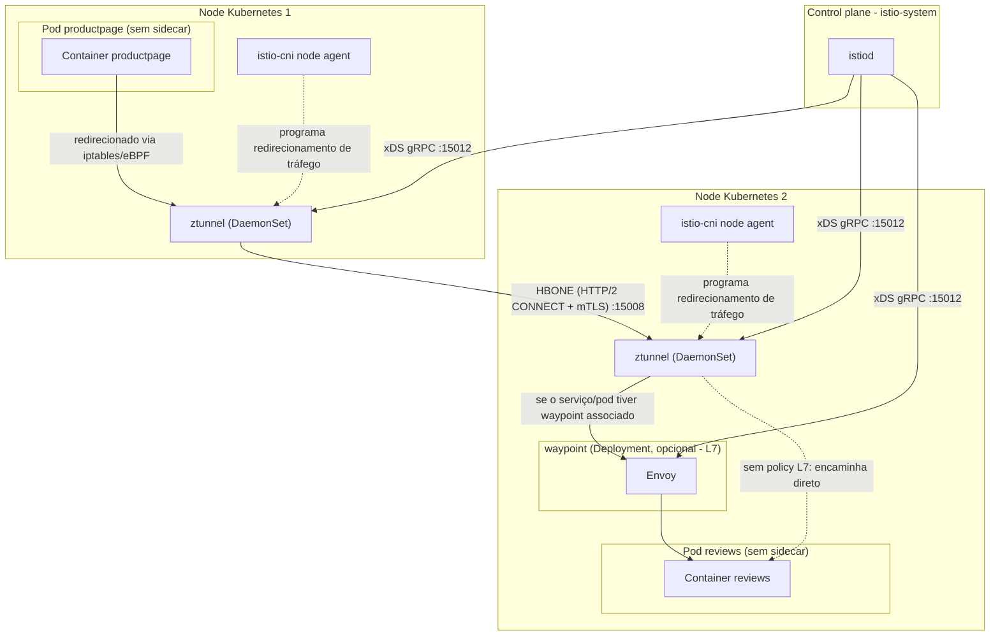
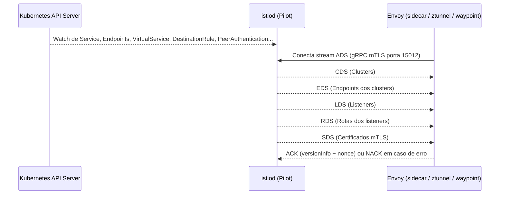
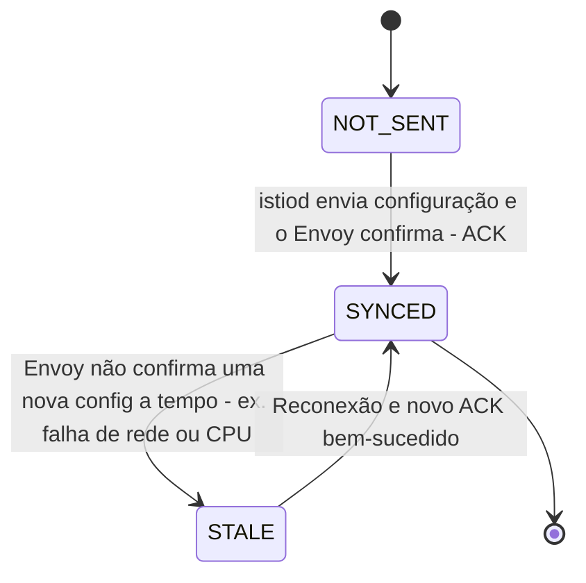
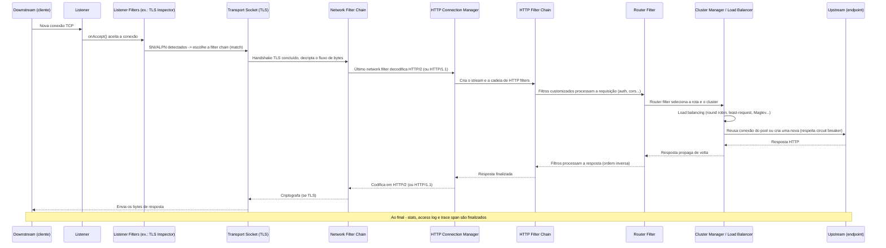

# Guia de Estudos: Istio e Envoy

<!-- TOC -->

- [Guia de Estudos: Istio e Envoy](#guia-de-estudos-istio-e-envoy)
- [Sobre este material](#sobre-este-material)
- [1. Glossário](#1-glossário)
  - [1.1. Conceitos gerais de Service Mesh](#11-conceitos-gerais-de-service-mesh)
  - [1.2. Glossário do Istio](#12-glossário-do-istio)
  - [1.3. Glossário do Envoy](#13-glossário-do-envoy)
  - [1.4. Glossário de infraestrutura usada neste repositório](#14-glossário-de-infraestrutura-usada-neste-repositório)
- [2. Arquitetura do Istio](#2-arquitetura-do-istio)
  - [2.1. Modo Sidecar](#21-modo-sidecar)
  - [2.2. Modo Ambient](#22-modo-ambient)
  - [2.3. Sidecar vs Ambient (comparação)](#23-sidecar-vs-ambient-comparação)
  - [2.4. Portas usadas pelo Istio e pelo Envoy](#24-portas-usadas-pelo-istio-e-pelo-envoy)
- [3. Envoy Proxy](#3-envoy-proxy)
  - [3.1. Visão geral e histórico](#31-visão-geral-e-histórico)
  - [3.2. Arquitetura interna (listener subsystem x cluster subsystem)](#32-arquitetura-interna-listener-subsystem-x-cluster-subsystem)
  - [3.3. xDS: como o Istio configura o Envoy](#33-xds-como-o-istio-configura-o-envoy)
  - [3.4. Life of a Request (o ciclo de vida de uma requisição no Envoy)](#34-life-of-a-request-o-ciclo-de-vida-de-uma-requisição-no-envoy)
  - [3.5. Vídeos recomendados de Matt Klein (criador do Envoy)](#35-vídeos-recomendados-de-matt-klein-criador-do-envoy)
- [4. Comandos práticos (kind + Istio deste repositório)](#4-comandos-práticos-kind--istio-deste-repositório)
  - [4.1. Pré-requisitos](#41-pré-requisitos)
  - [4.2. istioctl: comandos essenciais](#42-istioctl-comandos-essenciais)
  - [4.3. Admin API do Envoy (porta 15000)](#43-admin-api-do-envoy-porta-15000)
  - [4.4. Comandos específicos do modo Ambient (ztunnel e waypoint)](#44-comandos-específicos-do-modo-ambient-ztunnel-e-waypoint)
- [5. Exercícios de troubleshooting](#5-exercícios-de-troubleshooting)
  - [5.0. Preparando o ambiente dos laboratórios](#50-preparando-o-ambiente-dos-laboratórios)
  - [Lab 1 - Pod fora da mesh (ambient)](#lab-1---pod-fora-da-mesh-ambient)
  - [Lab 2 - mTLS STRICT quebrando tráfego (sidecar)](#lab-2---mtls-strict-quebrando-tráfego-sidecar)
  - [Lab 3 - VirtualService/DestinationRule com host errado (503 / no healthy upstream)](#lab-3---virtualservicedestinationrule-com-host-errado-503--no-healthy-upstream)
  - [Lab 4 - istiod fora de sincronia (STALE / NOT SENT)](#lab-4---istiod-fora-de-sincronia-stale--not-sent)
  - [Lab 5 - Inspecionando o Envoy diretamente pela Admin API](#lab-5---inspecionando-o-envoy-diretamente-pela-admin-api)
  - [Lab 6 - Política L7 ignorada em ambient mode sem waypoint](#lab-6---política-l7-ignorada-em-ambient-mode-sem-waypoint)
  - [Lab 7 - Diagnosticando o ztunnel (ambient)](#lab-7---diagnosticando-o-ztunnel-ambient)
  - [Lab 8 - `istioctl analyze` encontrando erros de configuração](#lab-8---istioctl-analyze-encontrando-erros-de-configuração)
  - [Lab 9 - Fault injection e timeout (retomando o Day 2)](#lab-9---fault-injection-e-timeout-retomando-o-day-2)
- [6. Referências](#6-referências)

<!-- TOC -->

# Sobre este material

Este documento é um **material de estudo** (glossário + diagramas + comandos + exercícios de troubleshooting) sobre **Istio** e **Envoy**, complementar aos arquivos [day1.md](day1.md) e [day2.md](day2.md) deste repositório.

Todo o conteúdo técnico aqui apresentado foi extraído/conferido nas fontes oficiais listadas na seção [6. Referências](#6-referências) (documentação oficial do Istio, documentação oficial do Envoy e conteúdos publicados por Matt Klein, criador do Envoy). Nenhum comportamento interno foi inventado: onde a documentação oficial não detalha algo (ex.: código-fonte específico), isso é indicado explicitamente.

**Versão de referência:** Istio **1.30** (LTS, versão estável mais recente em 2026-08-10) e Envoy na versão empacotada por ela. A versão 1.31 do Istio está em status `alpha` (`1.31.0-alpha.0`) na data deste material, portanto **não é recomendada** como base de estudo/produção — por isso este guia segue o padrão já usado no restante do repositório (`ISTIO_RELEASE=1.30`), conforme confirmado em [Istio / Supported Releases](https://istio.io/latest/docs/releases/supported-releases/) e nas releases do [github.com/istio/istio](https://github.com/istio/istio/releases/).

O ambiente prático usado neste guia é o mesmo do restante do repositório: cluster **kind** + **MetalLB** + **Istio** (modo `ambient` por padrão, com o modo `sidecar` como alternativa documentada em [OLD/day1-sidecar.md](OLD/day1-sidecar.md)). Veja os pré-requisitos completos em [INSTALL_REQUIREMENTS.md](INSTALL_REQUIREMENTS.md).

---

# 1. Glossário

## 1.1. Conceitos gerais de Service Mesh

| Termo | Definição |
|---|---|
| **Service Mesh** | Camada de infraestrutura dedicada que torna a comunicação entre serviços segura, rápida e confiável, tipicamente implementada com proxies leves implantados junto às aplicações, sem que a aplicação tenha conhecimento disso. |
| **Data plane** | Conjunto de proxies (no Istio, o Envoy) que efetivamente intermediam/transportam o tráfego de rede entre as cargas de trabalho (workloads) e coletam telemetria. |
| **Control plane** | Componentes responsáveis por gerenciar e configurar os proxies do data plane, transformando a configuração declarada pelo usuário (CRDs) em configuração de proxy (xDS). |
| **Sidecar** | Padrão de implantação em que um container auxiliar (o proxy) roda dentro do mesmo Pod da aplicação, compartilhando o ciclo de vida e a rede (`localhost`) com o container principal. |
| **mTLS (mutual TLS)** | Autenticação TLS em que **ambas** as partes (cliente e servidor) apresentam certificados, usada pelo Istio para autenticar e criptografar o tráfego entre workloads na mesh. |

Fonte: [Istio / What is Istio?](https://istio.io/v1.30/docs/overview/what-is-istio/), [Istio / Glossary](https://istio.io/v1.30/docs/reference/glossary/).

## 1.2. Glossário do Istio

Termos extraídos do glossário oficial ([istio.io/v1.30/docs/reference/glossary/](https://istio.io/v1.30/docs/reference/glossary/)):

| Termo | Definição (oficial, resumida) |
|---|---|
| **Istiod** | Binário de control plane consolidado que **encapsula** as antigas funções separadas **Pilot** (descoberta de serviço/configuração do Envoy), **Galley** (validação/distribuição de configuração) e **Citadel** (Autoridade Certificadora/CA), desde o Istio 1.5. |
| **Pilot** | Subcomponente do Istiod responsável por traduzir as regras de roteamento do usuário (VirtualService, DestinationRule, Gateway, etc.) em configuração específica do Envoy (xDS) e distribuí-la aos proxies. |
| **Ambient** | Modo de data plane **sem sidecar**: um componente por nó (ztunnel) e, opcionalmente, por namespace/serviço (waypoint), em vez de um proxy por Pod. |
| **Data Plane Mode** | A forma de implantação do proxy: `sidecar`, `ambient` ou `proxyless` (gRPC sem proxy, apenas com biblioteca xDS). |
| **Secure L4 Overlay** | A camada L4 (mTLS, autenticação, autorização, telemetria básica) fornecida pelo `ztunnel` no modo ambient. |
| **Waypoint** | Proxy Envoy **opcional**, L7, implantado como Deployment (não como sidecar) para fornecer o conjunto completo de recursos do Istio (roteamento HTTP, retries, fault injection, políticas L7) a workloads no modo ambient. |
| **ztunnel** ("zero-trust tunnel") | Componente node proxy do modo ambient; escrito para ser leve, escopo restrito a L3/L4 (mTLS, autenticação, autorização L4 e telemetria básica). |
| **HBONE** | "HTTP-Based Overlay Network Environment": protocolo de tunelamento seguro (HTTP/2 CONNECT sobre mTLS) usado entre componentes do Istio no modo ambient (ex.: ztunnel-a-ztunnel, ztunnel-a-waypoint). |
| **Gateway** | Proxy standalone (Envoy) na borda da mesh, roteando tráfego de entrada (ingress) ou saída (egress). |
| **Gateway API** | API padrão do Kubernetes (`gateway.networking.k8s.io`) para configuração de roteamento de tráfego, suportada nativamente pelo Istio como alternativa aos CRDs `Gateway`/`VirtualService` clássicos do Istio. |
| **Sidecar Injection** | Webhook mutante do Kubernetes que insere automaticamente o container `istio-proxy` (Envoy) nos Pods de um namespace com o label `istio-injection=enabled` (ou por revisão). |
| **CNI (Container Network Interface)** | Padrão usado pelo `istio-cni` para configurar o redirecionamento de tráfego dos Pods sem precisar de um container `initContainer` privilegiado. |
| **Identity** | Identidade criptográfica (certificado x509 SPIFFE) atribuída a cada workload, base da autenticação mTLS. |
| **Trust Domain** | Raiz de confiança de um sistema; usada para formar as identidades de workload dentro da mesh (ex.: `cluster.local`). |
| **Proxyless** | Modo de data plane em que a aplicação (ex.: gRPC) fala xDS diretamente com o Istiod, sem passar por um proxy Envoy. |
| **Multicluster** | Modelo de implantação da mesh com mais de um cluster Kubernetes (cluster primário e clusters remotos). |
| **VirtualService** *(CRD, não está no glossário citado acima, mas é usado nos exemplos do repositório)* | Define regras de roteamento de tráfego (L7) para um ou mais hosts. |
| **DestinationRule** *(idem)* | Define políticas aplicadas ao tráfego **após** o roteamento (ex.: subsets/versões, política de TLS, circuit breaking, load balancing). |
| **PeerAuthentication** *(idem)* | Define a política de mTLS (`STRICT`, `PERMISSIVE`, `DISABLE`) para um namespace ou workload. |
| **AuthorizationPolicy** *(idem)* | Define regras de autorização (`ALLOW`/`DENY`) para tráfego entre workloads. |

Fonte: [Istio / Glossary](https://istio.io/v1.30/docs/reference/glossary/), [Istio / Architecture](https://istio.io/v1.30/docs/ops/deployment/architecture/), [Istio / Ambient Architecture](https://istio.io/v1.30/docs/ambient/architecture/), [Istio / Traffic Redirection](https://istio.io/v1.30/docs/ambient/architecture/traffic-redirection/).

## 1.3. Glossário do Envoy

Termos extraídos da documentação oficial ([envoyproxy.io/docs/envoy/latest/intro/life_of_a_request](https://www.envoyproxy.io/docs/envoy/latest/intro/life_of_a_request) e [envoyproxy.io/docs/envoy/latest/intro/arch_overview](https://www.envoyproxy.io/docs/envoy/latest/intro/arch_overview/arch_overview)):

| Termo | Definição (oficial, resumida) |
|---|---|
| **Listener** | "Módulo do Envoy responsável por vincular-se a um IP/porta, aceitar novas conexões TCP (ou datagramas UDP) e orquestrar os aspectos de processamento voltados ao downstream." |
| **Listener Filter** | Filtro que atua **antes** da conexão ser totalmente aceita/roteada — ex.: `TLS Inspector` (detecta SNI/ALPN para escolher a filter chain correta). |
| **Filter Chain Match** | Mecanismo que seleciona qual cadeia de filtros (transport socket + network filters) tratará a conexão, com base em critérios como SNI, porta de destino ou intervalo de IP de origem. |
| **Transport Socket** | Abstração de baixo nível responsável por ler/escrever bytes brutos na conexão (ex.: `TLS transport socket` faz o handshake e decripta/criptografa). |
| **Network Filter** | Filtro que atua no nível de conexão (L3/L4). Existem três tipos: `ReadFilter`, `WriteFilter` e `Filter` (ambos). O **HTTP Connection Manager (HCM)** é normalmente o último network filter da cadeia. |
| **HTTP Connection Manager (HCM)** | Network filter que faz o parsing do protocolo HTTP (HTTP/1.1, HTTP/2, HTTP/3), demultiplexa a conexão em *streams* e gerencia a cadeia de HTTP filters e o roteamento. |
| **HTTP Filter** | Filtro que atua no nível de request/response HTTP (ex.: CORS, JWT auth, RBAC, `router`). Existem `StreamDecoderFilter`, `StreamEncoderFilter` e `StreamFilter`. |
| **Router Filter** | HTTP filter especial, tipicamente o último da cadeia, que seleciona a rota (via tabela de rotas/RDS) e encaminha a requisição ao **cluster** de destino, conectando o *listener subsystem* ao *cluster subsystem*. |
| **Route / Route Table** | Configuração (obtida via RDS) que mapeia atributos da requisição (host, path, headers) a um cluster upstream. |
| **Cluster** | "Um serviço lógico com um conjunto de endpoints para os quais o Envoy encaminha requisições." Equivalente ao `DestinationRule`/serviço de destino no Istio. |
| **Endpoint** | Nó de rede (IP:porta) que implementa um serviço lógico; endpoints são agrupados em clusters e ficam "upstream" do Envoy. |
| **Cluster Manager** | Subsistema que gerencia todos os clusters conhecidos, seus endpoints, health checks, circuit breakers e connection pools. |
| **Load Balancer** | Componente do cluster manager que escolhe qual endpoint de um cluster receberá a próxima requisição (ex.: round robin, least request, ring hash, Maglev, random). |
| **Connection Pool** | Conjunto de conexões upstream reutilizáveis mantidas pelo Envoy para evitar o custo de abrir uma nova conexão por requisição. |
| **Circuit Breaker** | Mecanismo que limita conexões/requisições/retries pendentes por cluster para evitar sobrecarga em cascata. |
| **Outlier Detection** | Mecanismo de *health checking passivo* que remove temporariamente do load balancing endpoints que respondem com erros. |
| **Downstream** | Entidade que se conecta ao Envoy (ex.: a aplicação local, no caso de um listener de saída/*egress*, ou um outro nó da mesh, no caso de um listener de entrada/*ingress*). |
| **Upstream** | Endpoint para o qual o Envoy encaminha a requisição. |
| **xDS** | Família de APIs de descoberta usadas para configurar o Envoy dinamicamente (ver seção [3.3](#33-xds-como-o-istio-configura-o-envoy)). |
| **Admin interface** | Servidor HTTP embutido do Envoy (padrão porta configurável, `15000` no Istio) que expõe endpoints como `/config_dump`, `/clusters`, `/listeners`, `/stats`, `/logging`, `/ready`. |

Fonte: [Envoy / Life of a Request](https://www.envoyproxy.io/docs/envoy/latest/intro/life_of_a_request), [Envoy / Architecture Overview](https://www.envoyproxy.io/docs/envoy/latest/intro/arch_overview/arch_overview), [Envoy / Admin interface](https://www.envoyproxy.io/docs/envoy/latest/operations/admin).

## 1.4. Glossário de infraestrutura usada neste repositório

| Termo | Definição |
|---|---|
| **kind** | "Kubernetes IN Docker": ferramenta que roda um cluster Kubernetes usando containers Docker como "nós", usada neste repositório para criar o cluster de estudo/laboratório — ver [INSTALL_REQUIREMENTS.md#kind](INSTALL_REQUIREMENTS.md#kind). |
| **MetalLB** | Implementação de LoadBalancer para clusters bare-metal/kind, usada para atribuir IP externo ao `Service` do tipo `LoadBalancer` criado pelo Istio Ingress Gateway — ver [INSTALL_REQUIREMENTS.md#metallb](INSTALL_REQUIREMENTS.md#metallb). |
| **Helm** | Gerenciador de pacotes do Kubernetes, usado neste repositório para instalar todos os componentes do Istio (`istio-base`, `istiod`, `istio-cni`, `ztunnel`, `istio-ingress`) — ver [day1.md](day1.md). |
| **Bookinfo** | Aplicação de exemplo multi-serviço (productpage, details, reviews v1/v2/v3, ratings) mantida pelo projeto Istio, usada nos laboratórios deste repositório e deste guia. |

---

# 2. Arquitetura do Istio

## 2.1. Modo Sidecar

No modo sidecar (o modo "clássico" do Istio), cada Pod da aplicação recebe um container extra, o **Envoy** (`istio-proxy`), injetado automaticamente. Todo o tráfego de/para o Pod passa por esse Envoy (via regras `iptables` configuradas pelo `istio-cni` ou por um `initContainer`), que é configurado dinamicamente pelo **istiod** via **xDS**.


Pontos-chave (fonte: [Istio / Architecture](https://istio.io/v1.30/docs/ops/deployment/architecture/), [Istio / Dataplane modes](https://istio.io/v1.30/docs/overview/dataplane-modes/)):

- O **data plane** é o conjunto de proxies Envoy implantados como sidecars, responsáveis por descoberta de serviço, load balancing, terminação TLS, HTTP/2 e proxy gRPC, circuit breaking, health checks, injeção de falhas e coleta de métricas.
- O **control plane** (**istiod**) fornece descoberta de serviço, gerenciamento de configuração e gerenciamento de certificados; converte as regras de roteamento (CRDs) em configuração específica do Envoy e atua como Autoridade Certificadora (CA) para o mTLS.
- O `istiod` **encapsula** (desde a versão 1.5) as antigas funções separadas **Pilot**, **Galley** e **Citadel** em um único binário — ver [Istio / Glossary — Istiod](https://istio.io/v1.30/docs/reference/glossary/).

## 2.2. Modo Ambient

No modo **ambient** (usado por padrão nos comandos de instalação deste repositório — ver [day1.md](day1.md)) não há injeção de sidecar. A malha é dividida em duas camadas:

1. **Secure L4 overlay**, provida pelo **ztunnel** (um DaemonSet, um por nó) — cuida de mTLS, autenticação, autorização L4 e telemetria básica, **sem** terminar/interpretar HTTP.
2. **Camada L7 opcional**, provida por **waypoint proxies** (Envoy completo, implantado como Deployment, por namespace/service account/serviço) — necessária para roteamento HTTP, retries, fault injection e políticas L7 (path, método, header).

O **istio-cni** configura, no namespace de rede de cada Pod, o redirecionamento de tráfego para o `ztunnel` do nó (hoje via `iptables`, com suporte a `eBPF` dependendo da plataforma).



Pontos-chave (fonte: [Istio / Ambient Overview](https://istio.io/latest/docs/ambient/overview/), [Istio / Ambient Architecture — Traffic Redirection](https://istio.io/v1.30/docs/ambient/architecture/traffic-redirection/), [Istio / Glossary](https://istio.io/v1.30/docs/reference/glossary/)):

- O **ztunnel** é escrito em Rust e é **intencionalmente restrito** a funções L3/L4: mTLS, autenticação, autorização L4 e telemetria — ele **não** termina tráfego HTTP nem interpreta headers HTTP da aplicação.
- **HBONE** ("HTTP-Based Overlay Network Environment") é o protocolo de tunelamento seguro usado entre ztunnels e entre ztunnel e waypoint; usa a porta **15008**.
- Redirecionamento de tráfego: entrada em texto plano é redirecionada para a porta **15006**; entrada via HBONE usa a porta **15008**; saída é redirecionada para a porta **15001**, usando `iptables` (tabelas `mangle`/`nat`, `TPROXY` e marcação de conexão).
- Políticas **L4** (identidade de origem, porta) podem ser aplicadas pelo próprio `ztunnel`; políticas **L7** (método HTTP, path, headers) exigem um **waypoint**.

## 2.3. Sidecar vs Ambient (comparação)

| Aspecto | Sidecar | Ambient |
|---|---|---|
| Proxy por Pod? | Sim (`istio-proxy` injetado em cada Pod) | Não (nenhum container extra no Pod da app) |
| Reinício de Pods ao entrar na mesh? | Sim (para injetar o sidecar) | Não (basta o label de namespace/label do Pod) |
| Componente L4 (mTLS, AuthZ L4) | Envoy sidecar | `ztunnel` (DaemonSet por nó) |
| Componente L7 (rotas HTTP, fault injection, retries) | Envoy sidecar | `waypoint` (opcional, por namespace/service account) |
| Linguagem do proxy de nó | N/A (não existe) | Rust (ztunnel) |
| Overhead de recursos por Pod | Um Envoy completo por Pod | Nenhum por padrão; custo concentrado no `ztunnel`/`waypoint` compartilhados |
| Uso de `iptables`/CNI | Sim | Sim |

Fonte: [Istio / Dataplane modes](https://istio.io/v1.30/docs/overview/dataplane-modes/), [Istio / Ambient Overview](https://istio.io/latest/docs/ambient/overview/).

## 2.4. Portas usadas pelo Istio e pelo Envoy

| Porta | Protocolo | Uso |
|---|---|---|
| 15000 | TCP | Porta de administração do Envoy (comandos/diagnóstico) |
| 15001 | TCP | Envoy outbound (interceptação de tráfego de saída) |
| 15002 | TCP | Porta de escuta para detecção de falhas |
| 15004 | HTTP | Porta de debug |
| 15006 | TCP | Envoy inbound (interceptação de tráfego de entrada) |
| 15008 | HTTP/2 | Porta do túnel mTLS **HBONE** |
| 15010 | gRPC (plaintext) | xDS do istiod em texto plano (não deve ser usada em produção) |
| 15012 | gRPC (mTLS) | xDS do istiod com TLS/mTLS — porta usada pelos proxies para obter configuração |
| 15014 | HTTP | Porta de controle/monitoramento do istiod (métricas para Prometheus e endpoints de debug) |
| 15020 | HTTP | Telemetria Prometheus consolidada (Istio agent + Envoy + aplicação) |
| 15021 | HTTP | Health checks |
| 15053 | DNS | Porta de DNS, quando o DNS capture está habilitado |
| 15090 | HTTP | Telemetria Prometheus do Envoy |

Fonte: [Istio / Application Requirements — Ports Used by Istio](https://istio.io/v1.30/docs/ops/deployment/application-requirements/), [Istio / Debug Endpoints](https://istio.io/latest/docs/ops/integrations/integration-guide/debug-endpoints/), [Istio / Ambient Architecture — Traffic Redirection](https://istio.io/v1.30/docs/ambient/architecture/traffic-redirection/).

---

# 3. Envoy Proxy

## 3.1. Visão geral e histórico

O **Envoy** é um proxy de rede L4/L7 de alto desempenho, escrito em C++, originalmente criado por **Matt Klein** na **Lyft** para substituir uma infraestrutura de comunicação de serviços difícil de operar por um "sidecar" de comunicação rápido e observável. Envoy foi o terceiro projeto a se graduar na **CNCF**, depois de Kubernetes e Prometheus. O Istio usa o Envoy como seu data plane (tanto no modo sidecar quanto, de forma adaptada, no `ztunnel`/`waypoint` do modo ambient).

Fonte: [Envoy / Introduction](https://www.envoyproxy.io/docs/envoy/latest/intro/intro), [The New Stack — Matt Klein on the Success of Envoy](https://thenewstack.io/matt-klein-on-the-success-of-envoy-and-the-future-of-the-service-mesh/), [Kubernetes Podcast from Google — Episode 221: Creating Envoy, with Matt Klein](https://kubernetespodcast.com/episode/221-creating-envoy/).

## 3.2. Arquitetura interna (listener subsystem x cluster subsystem)

A documentação oficial do Envoy descreve a arquitetura interna como dividida em dois grandes subsistemas, conectados pelo **router filter**:

- **Listener subsystem**: processa as requisições vindas do downstream, cuida do ciclo de vida da conexão e do caminho de resposta.
- **Cluster subsystem**: seleciona/configura a conexão upstream, gerencia health checking, load balancing e connection pooling.

```mermaid
flowchart LR
    subgraph Downstream["Downstream"]
        C["Conexão TCP/UDP do cliente"]
    end

    subgraph EnvoyProc["Processo Envoy"]
        direction TB
        LST["Listener<br/>(bind IP:porta)"]
        LSTF["Listener Filters<br/>(ex.: TLS Inspector)"]
        FCM["Filter Chain Match<br/>(SNI / ALPN / porta)"]
        TSOC["Transport Socket<br/>(TLS termination)"]
        NFC["Network Filter Chain<br/>(último filtro: HTTP Connection Manager)"]
        HFC["HTTP Filter Chain<br/>(ex.: CORS, JWT, RBAC)"]
        RTF["Router Filter<br/>(usa a Route Table / RDS)"]
        CLM["Cluster Manager<br/>(CDS)"]
        LB["Load Balancer"]
        CP["Connection Pool"]
    end

    subgraph Upstream["Upstream"]
        EP["Endpoints (EDS)"]
    end

    C --> LST --> LSTF --> FCM --> TSOC --> NFC --> HFC --> RTF --> CLM --> LB --> CP --> EP
```



Fonte: [Envoy / Life of a Request](https://www.envoyproxy.io/docs/envoy/latest/intro/life_of_a_request), [Envoy / Architecture Overview](https://www.envoyproxy.io/docs/envoy/latest/intro/arch_overview/arch_overview).

## 3.3. xDS: como o Istio configura o Envoy

O Envoy não lê um arquivo estático de configuração de produção; ele é configurado **dinamicamente** por um *management server* (no Istio, o **istiod**) através da família de APIs **xDS** ("`x` Discovery Service"):

| API | Nome completo | Função |
|---|---|---|
| **LDS** | Listener Discovery Service | Descobre quais **listeners** (IP:porta) o Envoy deve abrir |
| **RDS** | Route Discovery Service | Descobre as **tabelas de rotas** usadas pelo HTTP Connection Manager |
| **CDS** | Cluster Discovery Service | Descobre quais **clusters** (serviços upstream) existem |
| **EDS** | Endpoint Discovery Service | Descobre os **endpoints** (IP:porta de cada réplica) de cada cluster |
| **SDS** | Secret Discovery Service | Distribui **certificados/chaves** (usado pelo Istio para os certificados mTLS) |
| **ADS** | Aggregated Discovery Service | Agrega **todas** as APIs acima em um único stream gRPC bidirecional, permitindo sequenciamento correto das atualizações |

Segundo a documentação oficial do Envoy, para evitar perda de tráfego durante atualizações, a ordem recomendada de aplicação é: **CDS → EDS → LDS → RDS** (clusters e endpoints antes dos listeners, e rotas relacionadas a novos listeners só depois de CDS/EDS/LDS).



Fonte: [Envoy / xDS REST and gRPC protocol](https://www.envoyproxy.io/docs/envoy/latest/api-docs/xds_protocol), [Istio / Architecture](https://istio.io/v1.30/docs/ops/deployment/architecture/), [Istio / Debugging Envoy and Istiod](https://istio.io/v1.30/docs/ops/diagnostic-tools/proxy-cmd/).

O comando `istioctl proxy-status` mostra o estado de sincronização de cada proxy da malha em relação ao istiod:



Fonte: [Istio / Debugging Envoy and Istiod — proxy-status](https://istio.io/v1.30/docs/ops/diagnostic-tools/proxy-cmd/).

## 3.4. Life of a Request (o ciclo de vida de uma requisição no Envoy)

Resumo fiel (traduzido) do fluxo descrito na documentação oficial *"Life of a Request"* do Envoy, para uma requisição HTTP/2 chegando em um listener com TLS:

1. O **Listener Manager** instancia listeners vinculados a um IP/porta; cada *worker thread* mantém sua própria instância de listener, aceitando novas conexões TCP (callback `onAccept()`).
2. Os **Listener Filters** rodam (ex.: `TLS Inspector`, que extrai o SNI do handshake). Essas informações são usadas no **filter chain match**, que decide qual `transport socket` e quais `network filters` serão aplicados à conexão.
3. O **Transport Socket** TLS realiza o handshake e entrega um fluxo de bytes já decriptado ao gerenciador de filtros (`FilterManagerImpl`), responsável pela cadeia de **network filters**.
4. Os **Network Filters** são instanciados por conexão. O **HTTP Connection Manager (HCM)** é tipicamente o último network filter, responsável pelo codec HTTP e pela cadeia de HTTP filters.
5. O **codec HTTP/2** decodifica os frames e demultiplexa a conexão em múltiplos **streams** independentes — cada stream corresponde a uma requisição/resposta.
6. Para cada stream, o HCM instancia uma cadeia de **HTTP filters** (`StreamDecoderFilter`, `StreamEncoderFilter` ou `StreamFilter`). Filtros customizados (ex.: autenticação, CORS) processam a requisição primeiro; o **router filter** roda por último, selecionando a rota e o cluster de destino.
7. O **Load Balancer** do cluster escolhe um **endpoint** (algoritmos: round robin ponderado, Maglev, least-request, etc.). O **connection pool** reutiliza uma conexão existente ou abre uma nova, respeitando os **circuit breakers** configurados.
8. O **codec HTTP/2 upstream** multiplexa o stream de requisição junto com outros streams sobre a mesma conexão TCP.
9. O **Transport Socket** TLS upstream (se aplicável) criptografa os bytes e escreve no socket TCP da conexão upstream.
10. A **resposta** propaga-se de volta pelo caminho inverso, passando pelos filtros HTTP em **ordem inversa**; a *outlier detection* é atualizada com o resultado.
11. Ao final: estatísticas são atualizadas, o **access log** é escrito (arquivo, statsd, etc.) e os **spans de tracing** são finalizados.



Fonte (fiel/tradução): [Envoy / Life of a Request](https://www.envoyproxy.io/docs/envoy/latest/intro/life_of_a_request).

## 3.5. Vídeos recomendados de Matt Klein (criador do Envoy)

Lista curada a partir da página oficial de palestras de Matt Klein ([mattklein123.dev/appearances](https://mattklein123.dev/appearances/)), priorizando os conteúdos mais relevantes para entender a arquitetura do Envoy e a origem do conceito de service mesh:

| Palestra | Evento / Ano | Link |
|---|---|---|
| Envoy Internals Deep Dive | KubeCon EU, 2018 (nível avançado: threading model, stats, hot restart, xDS) | [youtube.com/watch?v=gQF23Vw0keg](https://www.youtube.com/watch?v=gQF23Vw0keg) |
| Envoy - Embracing a Service Mesh | QCon NY, 2018 | [youtube.com/watch?v=55yi4MMVBi4](https://www.youtube.com/watch?v=55yi4MMVBi4) |
| The Mechanics of Deploying Envoy at Lyft | KubeCon NA, 2017 | [youtube.com/watch?v=IeJDjq-COjk](https://www.youtube.com/watch?v=IeJDjq-COjk) |
| Lyft's Envoy: Experiences Operating a Large Service Mesh | SREcon Americas, 2017 | [youtube.com/watch?v=fZBf6MLjNqM](https://www.youtube.com/watch?v=fZBf6MLjNqM) e [usenix.org (resumo)](https://www.usenix.org/conference/srecon17americas/program/presentation/klein) |
| Service Mesh Day Keynote | Service Mesh Day, 2019 | [youtube.com/watch?v=IC0eduR56DA](https://www.youtube.com/watch?v=IC0eduR56DA) |
| Creating Envoy, with Matt Klein (podcast) | Kubernetes Podcast from Google, ep. 221 | [kubernetespodcast.com/episode/221-creating-envoy](https://kubernetespodcast.com/episode/221-creating-envoy/) |

Artigo escrito (não vídeo) complementar, também de Matt Klein, muito citado como introdução ao tema: [Service mesh data plane vs. control plane](https://blog.envoyproxy.io/service-mesh-data-plane-vs-control-plane-2774e720f7fc) e [Introduction to modern network load balancing and proxying](https://blog.envoyproxy.io/introduction-to-modern-network-load-balancing-and-proxying-a57f6ff80236).

---

# 4. Comandos práticos (kind + Istio deste repositório)

## 4.1. Pré-requisitos

Siga [INSTALL_REQUIREMENTS.md](INSTALL_REQUIREMENTS.md) e [day1.md](day1.md) para: instalar Docker, criar o cluster `kind`, instalar Helm e MetalLB, e instalar o Istio no modo `ambient` (ou [OLD/day1-sidecar.md](OLD/day1-sidecar.md) para o modo `sidecar`). As variáveis de ambiente usadas abaixo seguem o padrão já definido nesses arquivos:

```bash
export ISTIO_RELEASE=1.30
export VERSION_ISTIO="${ISTIO_RELEASE}.3"
export MY_NAMESPACE='myapp'
```

## 4.2. istioctl: comandos essenciais

Fonte: [Istio / Debugging Envoy and Istiod](https://istio.io/v1.30/docs/ops/diagnostic-tools/proxy-cmd/), [Istio / istioctl reference](https://istio.io/v1.30/docs/reference/commands/istioctl/).

```bash
# Visão geral de sincronização de TODOS os proxies da malha (sidecars, gateways, ztunnel, waypoints)
istioctl proxy-status

# Diff entre a config que o Envoy tem e a que o istiod enviaria (detecta drift)
istioctl proxy-status <pod>.<namespace>

# Clusters conhecidos por um proxy específico
istioctl proxy-config cluster -n $MY_NAMESPACE <pod>

# Listeners configurados em um proxy
istioctl proxy-config listener <pod>.<namespace> --port 15006 -o json

# Tabela de rotas de um proxy
istioctl proxy-config route <pod>.<namespace> --name 8080 -o json

# Endpoints saudáveis conhecidos por um cluster específico
istioctl proxy-config endpoint <pod>.<namespace> \
  --cluster "outbound|9080||reviews.$MY_NAMESPACE.svc.cluster.local"

# Segredos/certificados mTLS carregados por um proxy (SDS)
istioctl proxy-config secret <pod>.<namespace>

# Configuração de bootstrap enviada ao Envoy na inicialização
istioctl proxy-config bootstrap -n istio-system <pod-gateway>

# Ajusta o nível de log de um Envoy em tempo real (ex.: para debug)
istioctl proxy-config log <pod>.<namespace> --level debug

# Valida a configuração de todo o cluster (ou de arquivos locais) em busca de erros comuns
istioctl analyze --all-namespaces
istioctl analyze files/bookinfo-gateway.yaml

# Verifica pré-requisitos antes de instalar/atualizar o Istio
istioctl x precheck

# Abre o dashboard de admin do Envoy (via port-forward automático para a porta 15000)
istioctl dashboard envoy <pod>.<namespace>
```

## 4.3. Admin API do Envoy (porta 15000)

Fonte: [Envoy / Administration interface](https://www.envoyproxy.io/docs/envoy/latest/operations/admin).

```bash
# Port-forward manual até a porta de administração do Envoy dentro do Pod
kubectl -n $MY_NAMESPACE port-forward pod/<pod> 15000:15000

# Em outro terminal:

# Dump completo da configuração ativa (bootstrap + xDS já recebido)
curl -s http://localhost:15000/config_dump | jq .

# Estado dos clusters (endpoints descobertos, health, circuit breaker, outlier detection)
curl -s http://localhost:15000/clusters

# Listeners abertos e a porta real (útil quando configurado como porta 0)
curl -s http://localhost:15000/listeners

# Todas as estatísticas (também disponível em formato prometheus)
curl -s http://localhost:15000/stats
curl -s http://localhost:15000/stats/prometheus

# Informações do processo (versão do Envoy, uptime, estado)
curl -s http://localhost:15000/server_info

# Liveness (200 = LIVE, 503 = não pronto)
curl -s -o /dev/null -w "%{http_code}\n" http://localhost:15000/ready

# Ajustar nível de log em tempo real (ex.: habilitar debug no componente "router")
curl -s -X POST "http://localhost:15000/logging?router=debug"
```

## 4.4. Comandos específicos do modo Ambient (ztunnel e waypoint)

Fonte: [Istio / Troubleshoot connectivity issues with ztunnel](https://istio.io/latest/docs/ambient/usage/troubleshoot-ztunnel/), [Istio / Troubleshoot issues with waypoints](https://istio.io/latest/docs/ambient/usage/troubleshoot-waypoint/).

```bash
# Lista os workloads que o ztunnel do nó conhece/gerencia (e o waypoint associado a cada um, se houver)
istioctl ztunnel-config workload

# Mostra qual waypoint (se algum) está associado a cada serviço
istioctl ztunnel-config service

# Certificados carregados pelo ztunnel
export ZTUNNEL=$(kubectl get pods -n istio-system -l app=ztunnel -o jsonpath='{.items[0].metadata.name}')
istioctl ztunnel-config certificate "$ZTUNNEL".istio-system

# Dump bruto da configuração do ztunnel (via admin API, porta 15000, dentro do próprio Pod)
kubectl debug -it "$ZTUNNEL" -n istio-system --image=curlimages/curl -- \
  curl -s localhost:15000/config_dump

# Logs do ztunnel, filtrando eventos de tráfego inbound/outbound
kubectl -n istio-system logs -l app=ztunnel | grep -E "inbound|outbound"

# Criar um waypoint para um namespace/serviço (recurso Gateway com gatewayClassName istio-waypoint)
istioctl waypoint apply -n $MY_NAMESPACE --enroll-namespace

# Status/listagem dos waypoints existentes
istioctl waypoint list -n $MY_NAMESPACE

# Toda a config (clusters/listeners/routes/endpoints/secrets) de um waypoint
istioctl proxy-config all deploy/waypoint -n $MY_NAMESPACE
```

---

# 5. Exercícios de troubleshooting

Os laboratórios a seguir usam o cluster **kind** e o **Istio** já instalados conforme [day1.md](day1.md) (modo `ambient`) — o Lab 2 usa o modo `sidecar` (ver [OLD/day1-sidecar.md](OLD/day1-sidecar.md)) porque a falha que ele demonstra (mTLS `STRICT` x `PERMISSIVE`) é conceito de `PeerAuthentication`, válido nos dois modos, mas mais didático de observar com o Envoy sidecar.

Cada laboratório segue o formato: **Objetivo → Provocar a falha → Diagnosticar → Corrigir → Referência**.

## 5.0. Preparando o ambiente dos laboratórios

```bash
export MY_NAMESPACE='myapp'
export ISTIO_BASE_URL="https://raw.githubusercontent.com/istio/istio/release-1.30/samples/"
export ISTIO_BOOKINFO_URL="${ISTIO_BASE_URL}bookinfo/"

kubectl create namespace $MY_NAMESPACE
kubectl label namespace $MY_NAMESPACE istio.io/dataplane-mode=ambient

kubectl -n $MY_NAMESPACE apply -f "${ISTIO_BOOKINFO_URL}platform/kube/bookinfo.yaml"
kubectl -n $MY_NAMESPACE apply -f "${ISTIO_BOOKINFO_URL}platform/kube/bookinfo-versions.yaml"
kubectl -n $MY_NAMESPACE rollout status deployment --timeout=300s
```

## Lab 1 - Pod fora da mesh (ambient)

**Objetivo:** entender como confirmar se um workload está de fato participando da malha e diagnosticar quando não está.

**Provocar a falha** (remova o namespace do ambient mode):

```bash
kubectl label namespace $MY_NAMESPACE istio.io/dataplane-mode-
kubectl -n $MY_NAMESPACE rollout restart deployment
```

**Diagnosticar:**

```bash
# O workload não aparecerá na lista de workloads conhecidos pelo ztunnel
istioctl ztunnel-config workload | grep $MY_NAMESPACE

# proxy-status também não vai listar o Pod (ele não existe como "proxy" da malha)
istioctl proxy-status | grep $MY_NAMESPACE

# Confirme o label do namespace
kubectl get namespace $MY_NAMESPACE --show-labels
```

**Causa raiz:** o label `istio.io/dataplane-mode=ambient` é o que instrui o `istio-cni` a programar o redirecionamento de tráfego do Pod para o `ztunnel`; sem ele, o tráfego do Pod nunca passa pela malha (sem mTLS, sem políticas, sem telemetria da mesh).

**Corrigir:**

```bash
kubectl label namespace $MY_NAMESPACE istio.io/dataplane-mode=ambient
kubectl -n $MY_NAMESPACE rollout restart deployment
istioctl ztunnel-config workload | grep $MY_NAMESPACE
```

**Referência:** [Istio / Ambient — Secure and visualize your mesh](https://istio.io/v1.30/docs/ambient/getting-started/secure-and-visualize/), [Istio / Troubleshoot ztunnel](https://istio.io/latest/docs/ambient/usage/troubleshoot-ztunnel/).

## Lab 2 - mTLS STRICT quebrando tráfego (sidecar)

**Objetivo:** observar o efeito de uma `PeerAuthentication` `STRICT` quando existe tráfego em texto plano chegando ao workload.

> Este lab pressupõe instalação em modo **sidecar** (ver [OLD/day1-sidecar.md](OLD/day1-sidecar.md)) e sidecar injection habilitada no namespace (`kubectl label namespace $MY_NAMESPACE istio-injection=enabled`).

**Provocar a falha:**

```bash
cat <<EOF | kubectl apply -n $MY_NAMESPACE -f -
apiVersion: security.istio.io/v1
kind: PeerAuthentication
metadata:
  name: default
spec:
  mtls:
    mode: STRICT
EOF

# Gera tráfego em texto plano diretamente para o Pod, sem passar por outro sidecar da mesh
kubectl run --rm -it plaintext-client --image=curlimages/curl --restart=Never -n $MY_NAMESPACE -- \
  curl -sS -o /dev/null -w "HTTP %{http_code}\n" http://productpage:9080/productpage
```

**Diagnosticar:**

```bash
# Verifique se a requisição falhou (connection reset / EOF, pois o Envoy STRICT rejeita texto plano)
kubectl -n $MY_NAMESPACE logs deploy/productpage-v1 -c istio-proxy | tail -n 20

# Confirme o modo mTLS efetivo
istioctl x describe pod "$(kubectl -n $MY_NAMESPACE get pod -l app=productpage -o jsonpath='{.items[0].metadata.name}')" -n $MY_NAMESPACE
```

**Causa raiz:** com `STRICT`, o sidecar só aceita conexões mTLS; um client sem sidecar (como o `curl` acima, fora da mesh) não apresenta certificado, então a conexão é recusada.

**Corrigir** (duas opções válidas a depender do objetivo):

```bash
# Opção 1: usar PERMISSIVE (aceita texto plano E mTLS - bom durante migração)
kubectl -n $MY_NAMESPACE patch peerauthentication default --type merge -p '{"spec":{"mtls":{"mode":"PERMISSIVE"}}}'

# Opção 2: remover o client de fora da mesh e testar com um Pod que tenha sidecar
kubectl -n $MY_NAMESPACE delete peerauthentication default
```

**Referência:** [Istio / Mutual TLS Migration](https://istio.io/v1.30/docs/tasks/security/authentication/mtls-migration/), [Istio / PeerAuthentication reference](https://istio.io/v1.30/docs/reference/config/security/peer_authentication/).

## Lab 3 - VirtualService/DestinationRule com host errado (503 / no healthy upstream)

**Objetivo:** reproduzir e diagnosticar o erro clássico "no healthy upstream"/`503 UC` causado por uma referência de host incorreta.

**Provocar a falha:**

```bash
cat <<EOF | kubectl apply -n $MY_NAMESPACE -f -
apiVersion: networking.istio.io/v1
kind: DestinationRule
metadata:
  name: reviews-quebrado
spec:
  host: reviews.nao-existe.svc.cluster.local
  subsets:
  - name: v1
    labels:
      version: v1
---
apiVersion: networking.istio.io/v1
kind: VirtualService
metadata:
  name: reviews-quebrado
spec:
  hosts:
  - reviews
  http:
  - route:
    - destination:
        host: reviews.nao-existe.svc.cluster.local
        subset: v1
EOF
```

**Diagnosticar:**

```bash
# istioctl analyze deve sinalizar o host inválido / referenced host not found
istioctl analyze -n $MY_NAMESPACE

# Verifique a existência (ou não) do cluster correspondente no Envoy do productpage
istioctl proxy-config cluster "$(kubectl -n $MY_NAMESPACE get pod -l app=productpage -o jsonpath='{.items[0].metadata.name}')" -n $MY_NAMESPACE | grep reviews

# Gere tráfego e observe o response flag UC (upstream connect error) ou NR (no route) no access log
kubectl -n $MY_NAMESPACE logs deploy/productpage-v1 -c istio-proxy -f
```

**Causa raiz:** o `host` do `DestinationRule`/`VirtualService` aponta para um serviço Kubernetes inexistente (`reviews.nao-existe...`), então o Envoy não tem endpoints (EDS vazio) para esse cluster.

**Corrigir:**

```bash
kubectl -n $MY_NAMESPACE delete virtualservice reviews-quebrado
kubectl -n $MY_NAMESPACE delete destinationrule reviews-quebrado
```

**Referência:** [Istio / Common Problems — 503 errors after setting a DestinationRule](https://istio.io/v1.30/docs/ops/common-problems/network-issues/), [Istio / istioctl analyze](https://istio.io/v1.30/docs/ops/diagnostic-tools/istioctl-analyze/).

## Lab 4 - istiod fora de sincronia (STALE / NOT SENT)

**Objetivo:** identificar proxies que não estão sincronizados com o istiod (`STALE`/`NOT SENT`) e investigar a causa.

**Provocar a falha** (simulando indisponibilidade momentânea do control plane):

```bash
kubectl -n istio-system rollout restart deployment/istiod
```

**Diagnosticar (imediatamente após o restart):**

```bash
# Observe proxies em STALE ou NOT SENT enquanto o novo istiod inicializa
istioctl proxy-status

# Detalhe a diferença entre a config atual do Envoy e a que o istiod enviaria
istioctl proxy-status <pod>.$MY_NAMESPACE

# Confirme conectividade à porta xDS (15012) a partir de um Pod da malha
kubectl -n $MY_NAMESPACE exec deploy/productpage-v1 -c istio-proxy -- \
  curl -sk https://istiod.istio-system:15012 -o /dev/null -w "%{http_code}\n"
```

**Causa raiz mais comum em ambiente real:** `NetworkPolicy` bloqueando a porta 15012, falta de recursos (CPU/memória) no istiod, ou pico de reconexão simultânea de muitos proxies após um restart do control plane.

**Corrigir:**

```bash
kubectl -n istio-system rollout status deployment/istiod --timeout=180s
istioctl proxy-status
```

**Referência:** [Istio / Debugging Envoy and Istiod — proxy-status](https://istio.io/v1.30/docs/ops/diagnostic-tools/proxy-cmd/).

## Lab 5 - Inspecionando o Envoy diretamente pela Admin API

**Objetivo:** praticar o uso da Admin API do Envoy (porta 15000) para confirmar visualmente os conceitos da seção [3.2](#32-arquitetura-interna-listener-subsystem-x-cluster-subsystem) (listeners, clusters, endpoints).

```bash
export PP_POD=$(kubectl -n $MY_NAMESPACE get pod -l app=productpage -o jsonpath='{.items[0].metadata.name}')
kubectl -n $MY_NAMESPACE port-forward pod/$PP_POD 15000:15000 &

# Liste os listeners abertos (ex.: inbound 9080, outbound para virtual services, etc.)
curl -s http://localhost:15000/listeners

# Encontre o cluster outbound do serviço "reviews" e confira seus endpoints/saúde
curl -s http://localhost:15000/clusters | grep reviews

# Veja o config_dump completo do listener outbound HTTP (porta 0.0.0.0_9080, por exemplo)
curl -s "http://localhost:15000/config_dump?resource=dynamic_listeners" | jq .

kill %1   # encerra o port-forward em background
```

**Referência:** [Envoy / Administration interface](https://www.envoyproxy.io/docs/envoy/latest/operations/admin).

## Lab 6 - Política L7 ignorada em ambient mode sem waypoint

**Objetivo:** demonstrar que políticas L7 (ex.: restringir por path HTTP) **não** têm efeito em ambient mode sem um **waypoint**, pois o `ztunnel` só enforça L4.

**Provocar o cenário:**

```bash
cat <<EOF | kubectl apply -n $MY_NAMESPACE -f -
apiVersion: security.istio.io/v1
kind: AuthorizationPolicy
metadata:
  name: bloqueia-reviews-path
spec:
  selector:
    matchLabels:
      app: reviews
  action: DENY
  rules:
  - to:
    - operation:
        paths: ["/wpcatalog*"]
EOF

# Tráfego normal ao productpage continua funcionando mesmo esperando bloqueio de path,
# porque não há waypoint para reviews neste namespace ainda
kubectl -n $MY_NAMESPACE exec deploy/productpage-v1 -- \
  curl -sS -o /dev/null -w "HTTP %{http_code}\n" http://reviews:9080/wpcatalog
```

**Diagnosticar:**

```bash
# Confirme que não existe waypoint associado ao serviço reviews
istioctl ztunnel-config service | grep reviews

istioctl analyze -n $MY_NAMESPACE   # pode alertar sobre policy L7 sem waypoint, dependendo da versão
```

**Causa raiz:** `AuthorizationPolicy` com condição de **path** é uma regra **L7**; o `ztunnel` (L3/L4) não consegue avaliá-la, então é necessário um `waypoint` na frente do workload alvo.

**Corrigir:**

```bash
istioctl waypoint apply -n $MY_NAMESPACE --enroll-namespace
istioctl ztunnel-config service | grep reviews   # agora deve mostrar o waypoint associado

kubectl -n $MY_NAMESPACE exec deploy/productpage-v1 -- \
  curl -sS -o /dev/null -w "HTTP %{http_code}\n" http://reviews:9080/wpcatalog   # esperado: 403
```

**Limpeza:**

```bash
kubectl -n $MY_NAMESPACE delete authorizationpolicy bloqueia-reviews-path
istioctl waypoint delete -n $MY_NAMESPACE --all
```

**Referência:** [Istio / Ambient — L4 vs L7 policies](https://istio.io/latest/docs/ambient/usage/), [Istio / Troubleshoot waypoints](https://istio.io/latest/docs/ambient/usage/troubleshoot-waypoint/).

## Lab 7 - Diagnosticando o ztunnel (ambient)

**Objetivo:** usar os comandos de troubleshooting oficiais do `ztunnel` para confirmar certificados e tráfego mTLS.

```bash
export ZTUNNEL=$(kubectl get pods -n istio-system -l app=ztunnel -o jsonpath='{.items[0].metadata.name}')

# Certificados x509 carregados (deve haver um por workload identity no nó)
istioctl ztunnel-config certificate "$ZTUNNEL".istio-system

# Workloads conhecidos pelo ztunnel deste nó
istioctl ztunnel-config workload

# Logs em tempo real filtrando conexões inbound/outbound (gere tráfego do Bookinfo em paralelo)
kubectl -n istio-system logs -f "$ZTUNNEL" | grep -E "inbound|outbound"
```

**Referência:** [Istio / Troubleshoot connectivity issues with ztunnel](https://istio.io/latest/docs/ambient/usage/troubleshoot-ztunnel/).

## Lab 8 - `istioctl analyze` encontrando erros de configuração

**Objetivo:** usar `istioctl analyze` (estático e contra o cluster) para achar erros antes de aplicá-los.

```bash
# Analisa arquivos locais sem tocar no cluster
istioctl analyze --use-kube=false files/bookinfo-gateway.yaml

# Analisa tudo o que já está aplicado no namespace
istioctl analyze -n $MY_NAMESPACE

# Analisa o cluster inteiro
istioctl analyze --all-namespaces
```

Tipos de achado, conforme a documentação: **erros** (ex.: `Referenced selector not found`, quando um `Gateway` referencia um selector inexistente), **avisos** (ex.: host do `DestinationRule` sem correspondência com nenhum serviço na mesh) e **informações** (ex.: namespace sem sidecar injection habilitada).

**Referência:** [Istio / istioctl analyze](https://istio.io/v1.30/docs/ops/diagnostic-tools/istioctl-analyze/).

## Lab 9 - Fault injection e timeout (retomando o Day 2)

Os exercícios de **fault injection** (delay de 7s entre `reviews:v2` e `ratings`) e **request timeout** já estão documentados com comandos completos em [day2.md#fault-injection](day2.md#fault-injection). Ao executá-los, use os comandos das seções [4.2](#42-istioctl-comandos-essenciais) e [4.3](#43-admin-api-do-envoy-porta-15000) deste guia para:

- Confirmar, via `istioctl proxy-config route`, que o `timeout`/`fault.delay` está presente na rota ativa do Envoy (não apenas no YAML aplicado).
- Observar, via `/stats` da Admin API do Envoy, os contadores `upstream_rq_timeout` e `upstream_rq_pending_overflow` durante o teste.

**Referência:** [Istio / Fault Injection](https://istio.io/v1.30/docs/tasks/traffic-management/fault-injection/), [day2.md](day2.md).

---

# 6. Referências

**Istio (documentação oficial, versão 1.30):**

- [Istio / What is Istio?](https://istio.io/v1.30/docs/overview/what-is-istio/)
- [Istio / Dataplane modes](https://istio.io/v1.30/docs/overview/dataplane-modes/)
- [Istio / Architecture (deployment)](https://istio.io/v1.30/docs/ops/deployment/architecture/)
- [Istio / Ambient Overview](https://istio.io/latest/docs/ambient/overview/)
- [Istio / Ambient Architecture — Traffic Redirection](https://istio.io/v1.30/docs/ambient/architecture/traffic-redirection/)
- [Istio / Glossary](https://istio.io/v1.30/docs/reference/glossary/)
- [Istio / Application Requirements (portas)](https://istio.io/v1.30/docs/ops/deployment/application-requirements/)
- [Istio / Debug Endpoints](https://istio.io/latest/docs/ops/integrations/integration-guide/debug-endpoints/)
- [Istio / Debugging Envoy and Istiod (istioctl proxy-status / proxy-config)](https://istio.io/v1.30/docs/ops/diagnostic-tools/proxy-cmd/)
- [Istio / istioctl analyze](https://istio.io/v1.30/docs/ops/diagnostic-tools/istioctl-analyze/)
- [Istio / istioctl command reference](https://istio.io/v1.30/docs/reference/commands/istioctl/)
- [Istio / Common Problems — Network Issues](https://istio.io/v1.30/docs/ops/common-problems/network-issues/)
- [Istio / Mutual TLS Migration](https://istio.io/v1.30/docs/tasks/security/authentication/mtls-migration/)
- [Istio / PeerAuthentication reference](https://istio.io/v1.30/docs/reference/config/security/peer_authentication/)
- [Istio / Fault Injection](https://istio.io/v1.30/docs/tasks/traffic-management/fault-injection/)
- [Istio / Troubleshoot connectivity issues with ztunnel](https://istio.io/latest/docs/ambient/usage/troubleshoot-ztunnel/)
- [Istio / Troubleshoot issues with waypoints](https://istio.io/latest/docs/ambient/usage/troubleshoot-waypoint/)
- [Istio / Supported Releases](https://istio.io/latest/docs/releases/supported-releases/)
- [github.com/istio/istio — Releases](https://github.com/istio/istio/releases/)

**Envoy (documentação oficial):**

- [Envoy / Introduction](https://www.envoyproxy.io/docs/envoy/latest/intro/intro)
- [Envoy / Architecture Overview](https://www.envoyproxy.io/docs/envoy/latest/intro/arch_overview/arch_overview)
- [Envoy / Life of a Request](https://www.envoyproxy.io/docs/envoy/latest/intro/life_of_a_request)
- [Envoy / xDS REST and gRPC protocol](https://www.envoyproxy.io/docs/envoy/latest/api-docs/xds_protocol)
- [Envoy / Administration interface](https://www.envoyproxy.io/docs/envoy/latest/operations/admin)

**Matt Klein (criador do Envoy):**

- [mattklein123.dev/appearances — lista oficial de palestras](https://mattklein123.dev/appearances/)
- [Envoy Internals Deep Dive — KubeCon EU 2018 (YouTube)](https://www.youtube.com/watch?v=gQF23Vw0keg)
- [Envoy - Embracing a Service Mesh — QCon NY 2018 (YouTube)](https://www.youtube.com/watch?v=55yi4MMVBi4)
- [The Mechanics of Deploying Envoy at Lyft — KubeCon NA 2017 (YouTube)](https://www.youtube.com/watch?v=IeJDjq-COjk)
- [Lyft's Envoy: Experiences Operating a Large Service Mesh — SREcon Americas 2017 (YouTube)](https://www.youtube.com/watch?v=fZBf6MLjNqM)
- [Service Mesh Day Keynote 2019 (YouTube)](https://www.youtube.com/watch?v=IC0eduR56DA)
- [Kubernetes Podcast from Google — Ep. 221: Creating Envoy, with Matt Klein](https://kubernetespodcast.com/episode/221-creating-envoy/)
- [Blog — Service mesh data plane vs. control plane](https://blog.envoyproxy.io/service-mesh-data-plane-vs-control-plane-2774e720f7fc)
- [Blog — Introduction to modern network load balancing and proxying](https://blog.envoyproxy.io/introduction-to-modern-network-load-balancing-and-proxying-a57f6ff80236)

**Material complementar deste repositório:**

- [README.md](README.md)
- [day1.md](day1.md) — instalação do Istio em modo `ambient` + Bookinfo
- [day2.md](day2.md) — traffic management (routing, shifting, fault injection, mirroring)
- [OLD/day1-sidecar.md](OLD/day1-sidecar.md) — instalação do Istio em modo `sidecar`
- [INSTALL_REQUIREMENTS.md](INSTALL_REQUIREMENTS.md) — Docker, Helm, kubectl, kind, MetalLB
- [UNINSTALL_ISTIO.md](UNINSTALL_ISTIO.md)
