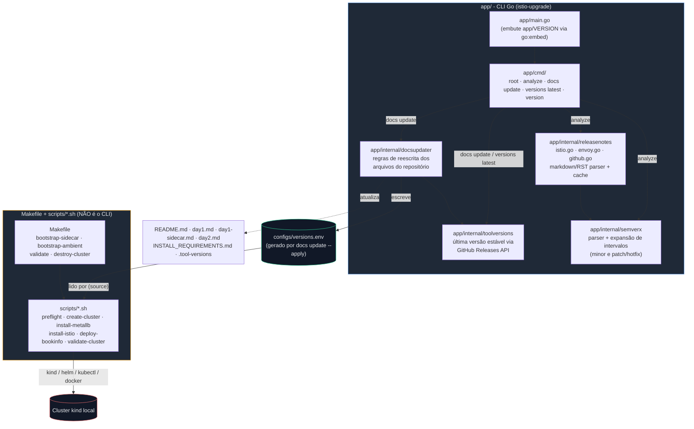
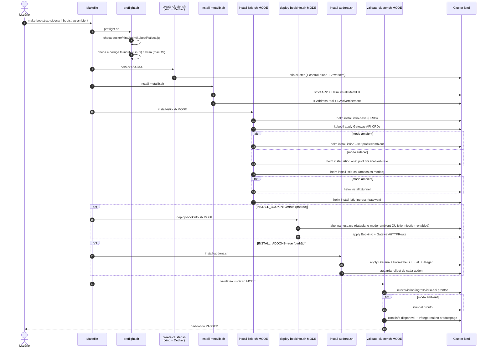

<!-- TOC -->

- [istio-upgrade CLI](#istio-upgrade-cli)
- [Diagramas](#diagramas)
  - [Componentes do CLI](#componentes-do-cli)
  - [Ordem de execução: `make bootstrap-sidecar` / `make bootstrap-ambient`](#ordem-de-execução-make-bootstrap-sidecar--make-bootstrap-ambient)
- [Escopo e limites (leia antes de usar)](#escopo-e-limites-leia-antes-de-usar)
- [Instalação / build](#instalação--build)
- [Uso do CLI](#uso-do-cli)
  - [`analyze` - relatório de release notes Istio/Envoy](#analyze---relatório-de-release-notes-istioenvoy)
  - [`docs update` - sincronizar versões nos arquivos do repositório](#docs-update---sincronizar-versões-nos-arquivos-do-repositório)
  - [`versions latest`](#versions-latest)
- [Automação de cluster (Makefile + scripts, não é o CLI)](#automação-de-cluster-makefile--scripts-não-é-o-cli)
- [Docker](#docker)
- [Testes](#testes)
- [Estrutura do projeto](#estrutura-do-projeto)
- [Limitações conhecidas](#limitações-conhecidas)

<!-- TOC -->

# istio-upgrade CLI

CLI em Go, com dois papéis bem separados:

1. **Planejamento de upgrade**: o comando `analyze` lê as release notes reais do
   Istio e do Envoy entre duas versões (incluindo intervalos de versão
   *minor* como `1.10` → `1.30`, e intervalos de *patch/hotfix* como
   `1.29.0` → `1.29.3`) e monta um relatório com breaking changes,
   depreciações, mudanças de instalação/Helm, mudanças de configuração/API/CRD,
   métricas/telemetria, componentes e correções de segurança/CVE.
2. **Sincronização de versões do repositório**: o comando `docs update`
   descobre a versão estável mais recente de cada ferramenta usada neste
   repositório (Istio, Envoy, kind, Helm, kubectl, MetalLB, Gateway API) e
   atualiza os arquivos de instalação/configuração do repositório.

**Importante:** este CLI **não cria cluster nem instala o Istio**. Isso é
feito pelo `Makefile` e pelos scripts em [scripts/](scripts/) - veja a seção
[Automação de cluster](#automação-de-cluster-makefile--scripts-não-é-o-cli).

# Diagramas

## Componentes do CLI

Mostra a separação deliberada entre o **CLI em Go** (análise de release
notes + sincronização de versões) e a **automação de cluster**
(Makefile + `scripts/*.sh`), conectadas apenas por
`configs/versions.env`.



## Ordem de execução: `make bootstrap-sidecar` / `make bootstrap-ambient`

Passo a passo real executado por `scripts/bootstrap.sh MODE` (validado
nesta sessão para os dois modos, incluindo a instalação do `istio-cni` em
ambos). `pilot.cni.enabled=true` faz o `istiod` não injetar mais o
container de init privilegiado `istio-init`, delegando o redirecionamento
de tráfego ao `istio-cni`, tanto no modo sidecar quanto no ambient.

Os passos de Bookinfo e addons são controláveis por variável de ambiente
(`INSTALL_BOOKINFO`/`INSTALL_ADDONS`, padrão `true` = instala tudo) - cada
um também tem seu próprio alvo `make` para rodar isoladamente, fora do
`bootstrap-*` (veja a tabela na seção seguinte).



# Escopo e limites (leia antes de usar)

- **Fonte dos dados do `analyze`**: páginas reais do istio.io (via
  `raw.githubusercontent.com/istio/istio.io`), a API de comparação de commits
  do GitHub (`istio/istio`) para notas de patch/hotfix, e as páginas de
  `version_history` do Envoy (`envoyproxy.io`). Tudo é buscado ao vivo pela
  rede na primeira execução e cacheado em disco (`--cache-dir`,
  `--refresh-cache`).
- **Envoy embarcado no Istio**: o Istio referencia um fork próprio do Envoy
  (`istio/proxy`), fixado por *commit SHA* no arquivo `istio.deps`, não por
  uma versão "limpa" do Envoy upstream. Por isso o `analyze` **não tenta
  adivinhar** a versão do Envoy usada por uma versão do Istio - use
  `--envoy-from`/`--envoy-to` (ou `--component envoy`) para analisar o Envoy
  separadamente.
- **Bump de versão MAJOR nunca é automático**: se a versão mais recente de
  Helm/kind/kubectl/Istio for um major novo (ex.: Helm 3 → 4), o
  `docs update` **não aplica** essa mudança sozinho - ela normalmente quebra
  os comandos exatos documentados neste repositório. Um aviso é impresso e o
  pin atual é mantido; use `--allow-major-bump` para aplicar mesmo assim.
- **Imagem do node do kind nunca é reescrita**: a tag+digest sha256 da
  imagem `kindest/node` em `INSTALL_REQUIREMENTS.md` precisa ser atualizada
  manualmente (usando o digest publicado em
  [kind releases](https://github.com/kubernetes-sigs/kind/releases)), pois
  não há como validar um digest sem baixá-lo.
- O `analyze` de patch/hotfix usa a API de *compare* do GitHub, então lista
  literalmente os commits entre duas tags - é uma lista mais "crua" (inclui
  commits de automação de dependências, por exemplo) do que as notas
  curadas de uma versão *minor*.

# Instalação / build

Pré-requisitos: Go 1.26+ (veja [app/go.mod](app/go.mod)). Para a automação de
cluster (não para o CLI em si): Docker, [kind](https://kind.sigs.k8s.io),
[Helm](https://helm.sh), `kubectl`, `istioctl` (útil para troubleshooting
da malha) e `jq` (veja
[INSTALL_REQUIREMENTS.md](../../INSTALL_REQUIREMENTS.md) na raiz do repo).
Depois de instalar o [mise](https://mise.jdx.dev)
(veja [INSTALL_REQUIREMENTS.md#mise](../../INSTALL_REQUIREMENTS.md#mise)),
`make install-tools` instala o `kind`/`helm`/`kubectl`/`istioctl` já
pinados em [.tool-versions](../../.tool-versions).

```bash
cd agents/upgrade

make build          # compila para bin/istio-upgrade
./bin/istio-upgrade --help
./bin/istio-upgrade --version

# ou, sem compilar:
make run ARGS="--help"

# ou instalar no $GOPATH/bin:
make install
```

A versão do CLI é controlada por um único arquivo: [app/VERSION](app/VERSION).
Ele é embarcado no binário via `go:embed` (não precisa de `ldflags` para
isso; o `make build` também injeta o commit git via `-ldflags` só para
fins informativos no `istio-upgrade version`). O código-fonte do CLI vive
todo em [app/](app/); o `Makefile` na raiz de `agents/upgrade/` continua
sendo o ponto de entrada único para compilar/testar/rodar (usa
`go build -C app`/`go test -C app`/etc. internamente).

## Build multiplataforma (Linux/macOS, amd64/arm64)

O CLI é Go puro (sem cgo, sem chamadas de sistema específicas de SO), então
compila nativamente para qualquer combinação abaixo a partir de qualquer
host, sem toolchain extra:

```bash
make build-linux-amd64     # bin/istio-upgrade-linux-amd64
make build-linux-arm64     # bin/istio-upgrade-linux-arm64
make build-darwin-amd64    # bin/istio-upgrade-darwin-amd64  (macOS Intel)
make build-darwin-arm64    # bin/istio-upgrade-darwin-arm64  (macOS Apple Silicon)
make build-all             # as 4 combinações de uma vez
```

> A imagem Docker (`make docker-build`) continua **só Linux** - o Docker
> Desktop no macOS executa containers Linux via VM, então não existe (nem
> faz sentido existir) uma "imagem Docker para macOS". Para usar o CLI no
> macOS, use os binários `darwin-*` acima, não a imagem Docker.

A automação de cluster (`scripts/*.sh`, próxima seção) também funciona em
macOS - veja as nuances específicas de macOS em
[INSTALL_REQUIREMENTS.md](../../INSTALL_REQUIREMENTS.md) (instalação do
Docker Desktop, `docker-mac-net-connect` para o LoadBalancer do MetalLB, e
por que o preflight não verifica `fs.inotify` no host no macOS).

# Uso do CLI

```
istio-upgrade [command]

Available Commands:
  analyze     Analyze Istio/Envoy release notes across a version range
  docs        Update this repo's installation/configuration files
  versions    Look up the latest stable version of each tool this repo pins
  version     Print the istio-upgrade CLI version
  help        Help about any command

Flags:
  -h, --help      help for istio-upgrade
  -v, --version   version for istio-upgrade
```

## `analyze` - relatório de release notes Istio/Envoy

```bash
# Intervalo minor a minor (breaking changes / upgrade notes de cada versão 1.10..1.30)
istio-upgrade analyze --from 1.10 --to 1.30

# Intervalo de patch/hotfix (bug fixes e CVEs entre 1.29.0 e 1.29.3)
istio-upgrade analyze --from 1.29.0 --to 1.29.3

# Só Envoy, intervalo explícito
istio-upgrade analyze --component envoy --envoy-from 1.31 --envoy-to 1.32

# Istio + Envoy juntos (Envoy precisa de range explícito - ver limitações acima)
istio-upgrade analyze --component all --from 1.10 --to 1.30 --envoy-from 1.20 --envoy-to 1.32

# JSON, salvando em arquivo
istio-upgrade analyze --from 1.10 --to 1.30 --format json --output report.json
```

Flags principais: `--component istio|envoy|all` (padrão `all`), `--from`,
`--to`, `--envoy-from`, `--envoy-to`, `--format markdown|json`, `--output`,
`--cache-dir`, `--refresh-cache`.

Exemplos de saída real (gerados nesta sessão) estão em
[app/examples/](app/examples/):
[istio-1.10-to-1.30.md](app/examples/istio-1.10-to-1.30.md),
[istio-1.29.0-to-1.29.3.md](app/examples/istio-1.29.0-to-1.29.3.md) e
[envoy-1.31-to-1.32.md](app/examples/envoy-1.31-to-1.32.md).

## `docs update` - sincronizar versões nos arquivos do repositório

```bash
# Dry-run (padrão): mostra o que mudaria, não escreve nada
istio-upgrade docs update

# Aplica de fato
istio-upgrade docs update --apply

# Aplica inclusive bumps de versão MAJOR (ex.: Helm 3 -> 4) - use com cautela
istio-upgrade docs update --apply --allow-major-bump
```

Atualiza: `README.md`, `day1.md`, `day1-sidecar.md`, `day2.md`,
`INSTALL_REQUIREMENTS.md`, `.tool-versions` (na raiz do repositório) e
[configs/versions.env](configs/versions.env) (consumido pelos scripts de
cluster - veja a próxima seção, inclusive as versões *informativas* dos
addons - `GRAFANA_VERSION`, `PROMETHEUS_VERSION`, `KIALI_VERSION`,
`JAEGER_VERSION`). `--repo-root` permite apontar para outro checkout; por
padrão o comando detecta a raiz do repositório subindo a partir do
diretório atual (procura por `.git/` + `README.md`).

## `versions latest`

```bash
istio-upgrade versions latest              # tabela
istio-upgrade versions latest --format json
```

# Automação de cluster (Makefile + scripts, não é o CLI)

A criação/instalação do ambiente de prática (kind + MetalLB + Istio +
Bookinfo + addons) é feita pelo **Makefile chamando scripts shell** em
[scripts/](scripts/), não pelo binário Go - são operações de
infraestrutura local (Docker) que não fazem sentido dentro do CLI/imagem
Docker do CLI. Os scripts leem os valores resolvidos em
[configs/versions.env](configs/versions.env) (gerado pelo `docs update`),
então rode `make docs-update-apply` pelo menos uma vez antes. Funciona em
Linux e macOS (Intel/amd64 e Apple Silicon/arm64) - veja
[INSTALL_REQUIREMENTS.md](../../INSTALL_REQUIREMENTS.md) para os
pré-requisitos de cada SO.

```bash
make install-tools          # instala kind/helm/kubectl/istioctl via mise (INSTALL_REQUIREMENTS.md#mise)
make preflight               # valida docker/kind/helm/kubectl/istioctl/jq instalados
make bootstrap-sidecar       # cluster + MetalLB + Istio (sidecar) + Bookinfo + addons + validação
make bootstrap-ambient       # idem, em modo ambient
make validate MODE=sidecar   # roda só a validação (funciona para os dois modos)
make destroy-cluster         # apaga o cluster kind
```

> `make preflight` também verifica os limites de `fs.inotify` do host (só
> no Linux - no macOS o kernel relevante é o da VM do Docker Desktop, não
> o host, então o preflight só avisa): em uma instalação padrão do Linux
> eles costumam ser baixos demais para o `istio-cni` - instalado em
> **ambos** os modos (no sidecar ele substitui o container de init
> privilegiado `istio-init`; no ambient ele captura os pods para o
> `ztunnel`) - que falha com
> `couldn't initialize inotify: too many open files` (problema real,
> reproduzido durante o desenvolvimento deste CLI - também documentado em
> [day1.md](../../day1.md)). Se houver sudo sem senha disponível, o
> preflight ajusta os limites automaticamente; caso contrário, imprime os
> comandos `sudo sysctl -w ...` para rodar manualmente antes do
> `make bootstrap-sidecar`/`make bootstrap-ambient`.

Por padrão, `bootstrap-sidecar`/`bootstrap-ambient` instalam **tudo**
(cluster, MetalLB, Istio, Bookinfo e addons). Cada etapa também tem seu
próprio alvo `make`, para rodar isoladamente ou depurar um passo
específico - e `INSTALL_BOOKINFO`/`INSTALL_ADDONS` deixam pular uma etapa
mesmo dentro do `bootstrap-*`:

| Etapa               | Alvo(s) isolado(s)                                      | Variável no `bootstrap-*`   |
|---------------------|-----------------------------------------------------------|------------------------------|
| Cluster kind         | `make create-cluster`                                     | (sempre roda)                 |
| MetalLB               | `make install-metallb`                                     | (sempre roda)                 |
| Istio                  | `make install-istio-sidecar` / `make install-istio-ambient` | (sempre roda, no `MODE` escolhido) |
| Bookinfo                | `make deploy-bookinfo-sidecar` / `make deploy-bookinfo-ambient` | `INSTALL_BOOKINFO=false` para pular |
| Addons (Grafana/Prometheus/Kiali/Jaeger) | `make install-addons` | `INSTALL_ADDONS=false` para pular |

```bash
# Exemplos
make install-addons                          # só os addons, num cluster já existente
INSTALL_ADDONS=false make bootstrap-sidecar   # tudo, menos os addons
INSTALL_BOOKINFO=false INSTALL_ADDONS=false make bootstrap-ambient  # só cluster + MetalLB + Istio
```

Os scripts espelham os passos manuais documentados em
[day1.md](../../day1.md) (modo ambient) e
[day1-sidecar.md](../../day1-sidecar.md) (modo sidecar), além de
[INSTALL_REQUIREMENTS.md](../../INSTALL_REQUIREMENTS.md), então servem
tanto para uso manual quanto como base dos testes de validação do cluster
(próxima seção). Para desinstalar manualmente, veja
[UNINSTALL_ISTIO.md](../../UNINSTALL_ISTIO.md).

Variáveis úteis (todas com defaults sensatos, sobrescrevíveis via
ambiente): `CLUSTER_NAME` (padrão `istio-upgrade`), `MY_NAMESPACE` (padrão
`myapp`), `ISTIO_MODE` (padrão `ambient`), `INSTALL_BOOKINFO` e
`INSTALL_ADDONS` (padrão `true` nos dois).

# Docker

A imagem Docker empacota **só o CLI** (`analyze`/`docs update`/`versions`) -
ela não inclui kind/helm/kubectl/docker, porque a automação de cluster
precisa do Docker do host (não containeriza bem). Para isso, use o
Makefile diretamente no host, não a imagem.

```bash
make docker-build
make docker-run ARGS="--version"
make docker-run ARGS="analyze --from 1.10 --to 1.30"
```

# Testes

```bash
make test           # testes unitários (rápidos, offline, sem docker/kind/helm/kubectl)
make test-verbose
make coverage
make lint           # gofmt -l + go vet + golangci-lint (se instalado)
```

Os testes unitários usam `httptest` e fixtures locais (sem rede real) para
cobrir: expansão de intervalos de versão (minor e patch/hotfix,
[app/internal/semverx](app/internal/semverx)), parsing de release notes do
Istio/Envoy ([app/internal/releasenotes](app/internal/releasenotes)),
resolução de versões via API do GitHub
([app/internal/toolversions](app/internal/toolversions)), as regras de
reescrita dos arquivos do repositório
([app/internal/docsupdater](app/internal/docsupdater)) e a camada de
comandos ([app/cmd](app/cmd)).

A validação de que o **cluster e o Istio realmente funcionam** (o
equivalente a "testes de integração") é feita pelos scripts shell, não por
`go test` - veja `make validate` e
[scripts/validate-cluster.sh](scripts/validate-cluster.sh), que checam:
cluster kind acessível, control plane do Istio (`istiod`, ingress gateway,
`istio-cni-node` nos dois modos, e `ztunnel` no modo ambient) pronto,
deployments do Bookinfo disponíveis, tráfego real chegando no
`productpage` de dentro da mesh, e o Gateway com status `Programmed=True`.

# Estrutura do projeto

```
agents/upgrade/
├── README.md                   # este arquivo
├── Makefile                    # build/test/docker do CLI (delega para app/) + ciclo de vida do cluster
├── configs/versions.env        # gerado por `docs update`; consumido por scripts/*.sh
├── scripts/                    # automação de cluster (Makefile chama isto, não o CLI)
│   ├── preflight.sh · create-cluster.sh · install-metallb.sh
│   ├── install-istio.sh · deploy-bookinfo.sh · install-addons.sh
│   ├── validate-cluster.sh · destroy-cluster.sh · bootstrap.sh
│   └── lib/common.sh            # env vars (versions.env), logging, helpers
├── plans/                      # histórico dos planos de implantação executados
├── bin/                        # binário compilado (make build; não versionado)
└── app/                        # TUDO que é específico do CLI em Go
    ├── VERSION                  # versão do CLI (fonte única, embarcada via go:embed)
    ├── CHANGELOG.md
    ├── Dockerfile / .dockerignore
    ├── go.mod / go.sum
    ├── main.go / cmd/            # entrypoint + comandos cobra (analyze, docs, versions, version)
    ├── internal/
    │   ├── semverx/               # parsing e expansão de intervalos de versão (minor + patch)
    │   ├── releasenotes/           # busca/parse das release notes Istio (istio.io+GitHub) e Envoy
    │   ├── toolversions/            # última versão estável de cada ferramenta via GitHub API
    │   └── docsupdater/              # regras de reescrita dos arquivos do repositório
    └── testdata/, examples/         # fixtures de teste e exemplos reais de saída do `analyze`
```

> Por que `app/` é uma subpasta separada, e não a raiz de `agents/upgrade/`?
> Para deixar explícito o que é código do CLI (movível, versionável como
> um módulo Go independente) e o que é orquestração/infraestrutura
> (`Makefile`, `scripts/`, `configs/versions.env`) - ver
> [Automação de cluster](#automação-de-cluster-makefile--scripts-não-é-o-cli)
> acima. O `Makefile` continua na raiz de `agents/upgrade/` e é o único
> ponto de entrada usado no dia a dia (`make build`, `make test`,
> `make bootstrap-sidecar`, etc.).

# Limitações conhecidas

- O parser de release notes usa heurísticas (títulos de seção, palavras-chave)
  para categorizar mudanças - é uma ferramenta de apoio ao planejamento, não
  substitui a leitura das notas oficiais linkadas em cada item do relatório.
- `analyze` de patch/hotfix pode ser "barulhento" para módulos com muitos
  commits de automação de dependência (`Automator: update proxy@release-X.Y`,
  etc.) - isso é esperado, é o histórico real de commits entre as duas tags.
- `docs update` cobre apenas os arquivos listados acima; não reescreve
  prosa (ex.: `ISTIO_ENVOY_GUIA_DE_ESTUDOS.md`) nem arquivos em `OLD/`.
- `GRAFANA_VERSION`/`PROMETHEUS_VERSION`/`KIALI_VERSION`/`JAEGER_VERSION`
  em `configs/versions.env` são **informativos**: os addons são instalados
  a partir dos manifests prontos do `istio/istio` (pinados por
  `ISTIO_RELEASE`, veja `scripts/install-addons.sh`), não há um número de
  versão independente para "escolher" nesse mecanismo - essas variáveis
  só sinalizam a última versão upstream de cada addon, para referência.
