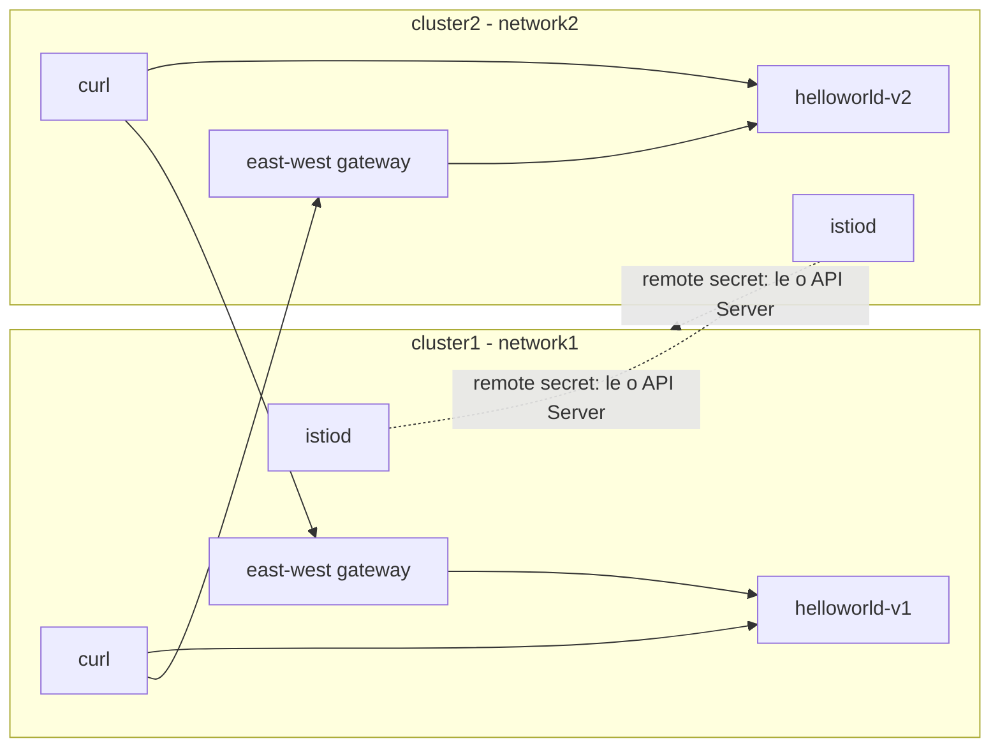

# Descomplicando Istio

<!-- TOC -->

- [Descomplicando Istio](#descomplicando-istio)
- [Day 3](#day-3)
- [Conceitos: o que faz de vários clusters uma mesh única](#conceitos-o-que-faz-de-vários-clusters-uma-mesh-única)
  - [Qual topologia escolher](#qual-topologia-escolher)
- [Preparando o ambiente](#preparando-o-ambiente)
  - [Variáveis de ambiente e download da release do Istio](#variáveis-de-ambiente-e-download-da-release-do-istio)
  - [Criando dois clusters kind](#criando-dois-clusters-kind)
  - [Confiança comum (cacerts)](#confiança-comum-cacerts)
- [Opção A - Multicluster no modo sidecar (multi-primary em redes diferentes)](#opção-a---multicluster-no-modo-sidecar-multi-primary-em-redes-diferentes)
  - [Instalando o control plane nos dois clusters](#instalando-o-control-plane-nos-dois-clusters)
  - [East-west gateway e exposição dos serviços](#east-west-gateway-e-exposição-dos-serviços)
  - [Habilitando a descoberta de endpoints (remote secrets)](#habilitando-a-descoberta-de-endpoints-remote-secrets)
  - [Validando o tráfego entre clusters (sidecar)](#validando-o-tráfego-entre-clusters-sidecar)
- [Opção B - Multicluster no modo ambient (multi-primary em redes diferentes)](#opção-b---multicluster-no-modo-ambient-multi-primary-em-redes-diferentes)
  - [Limitações conhecidas do ambient multicluster](#limitações-conhecidas-do-ambient-multicluster)
  - [Instalando o control plane e o data plane nos dois clusters](#instalando-o-control-plane-e-o-data-plane-nos-dois-clusters)
  - [East-west gateway do modo ambient](#east-west-gateway-do-modo-ambient)
  - [Remote secrets](#remote-secrets)
  - [Validando o tráfego entre clusters (ambient)](#validando-o-tráfego-entre-clusters-ambient)
- [Outras topologias (resumo)](#outras-topologias-resumo)
  - [Multi-primary na mesma rede](#multi-primary-na-mesma-rede)
  - [Primary-remote](#primary-remote)
- [Troubleshooting](#troubleshooting)
- [Removendo o ambiente](#removendo-o-ambiente)
- [Referências](#referências)

<!-- TOC -->

# Day 3

Neste dia vamos sair do cluster único usado no [Day 1](day1.md) e no [Day 2](day2.md) e montar uma **mesh única que se estende por dois clusters Kubernetes** (*multicluster*), primeiro no **modo sidecar** e depois no **modo ambient**.

> **Nível:** intermediário/avançado. Faça antes o [Day 1](day1.md) (ou [Day 1 - sidecar](day1-sidecar.md)) e leia a seção [2.6 do Guia de Estudos](ISTIO_ENVOY_GUIA_DE_ESTUDOS.md#26-topologias-de-implantação-da-mesh-multicluster-multi-network-multi-mesh), que explica os modelos de implantação (cluster, rede, control plane, mesh) com diagramas. Aqui o foco é a **prática**.

> Todos os comandos deste arquivo foram adaptados dos guias oficiais do Istio citados em cada seção e em [Referências](#referências). A adaptação consiste apenas em fixar a versão dos charts com `--version $VERSION_ISTIO` e em usar `helm upgrade --install` (idempotente), como já é feito no restante deste repositório.

# Conceitos: o que faz de vários clusters uma mesh única

Segundo a documentação oficial ([Deployment Models](https://istio.io/v1.32/docs/ops/deployment/deployment-models/) e [Install Multicluster](https://istio.io/v1.32/docs/setup/install/multicluster/)), para que dois ou mais clusters formem **uma única mesh** é preciso:

| Requisito | Como é atendido neste guia |
|---|---|
| **Confiança comum (common trust)** entre todos os clusters | Uma root CA comum assina uma CA intermediária por cluster; cada intermediária é instalada como o Secret `cacerts` no namespace `istio-system` (ver [Confiança comum](#confiança-comum-cacerts)) |
| **Mesmo `meshID`** em todos os control planes | `--set global.meshID=mesh1` nos dois clusters |
| **Identificação de cada cluster e da rede em que ele está** | `--set global.multiCluster.clusterName=clusterN` e `--set global.network=networkN` |
| **Descoberta de endpoints entre clusters** (o API Server de cada cluster precisa ser acessível pelos demais) | *Remote secrets* gerados com `istioctl create-remote-secret` |
| **Conectividade entre os workloads** | Direta (pod-a-pod) quando os clusters estão na **mesma rede**; via **east-west gateway** quando estão em **redes diferentes** |
| **DNS**: o nome do serviço precisa resolver no cluster do cliente | O `Service` é criado nos dois clusters, mesmo que só um deles tenha Pods |

Dois termos usados o tempo todo:

- **Cluster primário (primary)**: cluster que executa um control plane (`istiod`).
- **Cluster remoto (remote)**: cluster sem control plane próprio, gerenciado pelo `istiod` de um cluster primário.

## Qual topologia escolher

A documentação oficial oferece quatro guias de instalação para o modo sidecar, combinando o modelo de control plane com o modelo de rede:

| Guia oficial | Control plane | Rede | Tráfego entre clusters |
|---|---|---|---|
| [Multi-Primary](https://istio.io/v1.32/docs/setup/install/multicluster/multi-primary/) | Um `istiod` por cluster | Mesma rede | Direto, pod-a-pod |
| [Primary-Remote](https://istio.io/v1.32/docs/setup/install/multicluster/primary-remote/) | Um `istiod` compartilhado | Mesma rede | Direto, pod-a-pod |
| [Multi-Primary on different networks](https://istio.io/v1.32/docs/setup/install/multicluster/multi-primary_multi-network/) | Um `istiod` por cluster | Redes diferentes | Via east-west gateway |
| [Primary-Remote on different networks](https://istio.io/v1.32/docs/setup/install/multicluster/primary-remote_multi-network/) | Um `istiod` compartilhado | Redes diferentes | Via east-west gateway |

No **modo ambient**, a documentação oficial ([Ambient / Install Multicluster](https://istio.io/v1.32/docs/ambient/install/multicluster/)) é explícita: **apenas multi-primary em redes diferentes é suportado** (ver [Limitações](#limitações-conhecidas-do-ambient-multicluster)).

Por isso este guia usa **multi-primary em redes diferentes** nos dois modos: é a única topologia disponível em ambos, o que permite comparar o modo sidecar com o modo ambient lado a lado.



# Preparando o ambiente

## Variáveis de ambiente e download da release do Istio

Os guias oficiais de multicluster usam arquivos que vêm dentro do pacote da release do Istio (`samples/` e `tools/`). Baixe a release conforme a página [Download the Istio release](https://istio.io/v1.32/docs/setup/additional-setup/download-istio-release/):

```bash
export ISTIO_RELEASE=1.32
export VERSION_ISTIO="${ISTIO_RELEASE}.0"
export GATEWAY_API_VERSION="v1.6.1"

cd /tmp
curl -L https://istio.io/downloadIstio | ISTIO_VERSION=$VERSION_ISTIO sh -
export ISTIO_DIR="/tmp/istio-${VERSION_ISTIO}"
ls $ISTIO_DIR/samples/multicluster $ISTIO_DIR/samples/kind-lb $ISTIO_DIR/tools/certs
```

> O `istioctl` é obrigatório neste dia (comandos `create-remote-secret` e `remote-clusters`). Instale-o com as instruções da página [INSTALL_REQUIREMENTS.md#istioctl](INSTALL_REQUIREMENTS.md#istioctl).

Configure o repositório Helm do Istio (mesmo passo do Day 1):

```bash
helm repo add istio https://blob.istio.io/istio-release/charts --force-update
helm repo update
```

## Criando dois clusters kind

A documentação oficial ([Before you begin](https://istio.io/v1.32/docs/setup/install/multicluster/before-you-begin/)) recomenda, para testes de multicluster com kind, o script `samples/kind-lb/setupkind.sh` da própria release do Istio. Ele cria o cluster, instala o MetalLB (para que os `Services` do tipo `LoadBalancer` recebam um `EXTERNAL-IP`) e ajusta o kubeconfig para **não** usar o IP de loopback - o que é necessário para que o `istiod` de um cluster consiga acessar o API Server do outro.

> ATENÇÃO!!! Segundo o [README do script](https://github.com/istio/istio/tree/release-1.32/samples/kind-lb), ele funciona **apenas no Linux**. O parâmetro `--ip-space` define o 3º octeto da faixa de IPs que o MetalLB vai distribuir em cada cluster; use valores diferentes para os clusters não entregarem IPs sobrepostos.

```bash
cd $ISTIO_DIR

# Modo sidecar: 1 nó por cluster
./samples/kind-lb/setupkind.sh --cluster-name cluster-1 --ip-space 254
./samples/kind-lb/setupkind.sh --cluster-name cluster-2 --ip-space 255

# Para o modo ambient, o script exige no mínimo 2 nós por cluster (parâmetro --mode ambient):
# ./samples/kind-lb/setupkind.sh --cluster-name cluster-1 --ip-space 254 --mode ambient
# ./samples/kind-lb/setupkind.sh --cluster-name cluster-2 --ip-space 255 --mode ambient
```

Defina os contextos dos dois clusters, usados em todos os comandos a seguir:

```bash
export CTX_CLUSTER1=$(kubectl config get-contexts -o name | grep kind-cluster-1)
export CTX_CLUSTER2=$(kubectl config get-contexts -o name | grep kind-cluster-2)

kubectl --context="${CTX_CLUSTER1}" get nodes
kubectl --context="${CTX_CLUSTER2}" get nodes
```

## Confiança comum (cacerts)

Como cada cluster terá seu próprio `istiod` (e, portanto, sua própria CA), os dois precisam compartilhar a mesma raiz de confiança. A documentação oficial ([Plug in CA Certificates](https://istio.io/v1.32/docs/tasks/security/cert-management/plugin-ca-cert/)) fornece um `Makefile` para gerar uma root CA e uma CA intermediária por cluster:

```bash
mkdir -p /tmp/certs && cd /tmp/certs

make -f $ISTIO_DIR/tools/certs/Makefile.selfsigned.mk \
    ROOTCA_CN="Root CA" \
    ROOTCA_ORG=istio.io \
    root-ca
make -f $ISTIO_DIR/tools/certs/Makefile.selfsigned.mk \
    INTERMEDIATE_CN="Cluster 1 Intermediate CA" \
    INTERMEDIATE_ORG=istio.io \
    cluster1-cacerts
make -f $ISTIO_DIR/tools/certs/Makefile.selfsigned.mk \
    INTERMEDIATE_CN="Cluster 2 Intermediate CA" \
    INTERMEDIATE_ORG=istio.io \
    cluster2-cacerts
```

Cada diretório (`cluster1/`, `cluster2/`) recebe os arquivos `ca-cert.pem` (certificado da intermediária), `ca-key.pem` (chave da intermediária), `cert-chain.pem` (cadeia usada pelo istiod) e `root-cert.pem` (certificado raiz).

Crie o Secret `cacerts` **antes** de instalar o Istio em cada cluster:

```bash
kubectl --context="${CTX_CLUSTER1}" create namespace istio-system
kubectl --context="${CTX_CLUSTER1}" create secret generic cacerts -n istio-system \
    --from-file=ca-cert.pem=cluster1/ca-cert.pem \
    --from-file=ca-key.pem=cluster1/ca-key.pem \
    --from-file=root-cert.pem=cluster1/root-cert.pem \
    --from-file=cert-chain.pem=cluster1/cert-chain.pem

kubectl --context="${CTX_CLUSTER2}" create namespace istio-system
kubectl --context="${CTX_CLUSTER2}" create secret generic cacerts -n istio-system \
    --from-file=ca-cert.pem=cluster2/ca-cert.pem \
    --from-file=ca-key.pem=cluster2/ca-key.pem \
    --from-file=root-cert.pem=cluster2/root-cert.pem \
    --from-file=cert-chain.pem=cluster2/cert-chain.pem
```

> Este `Makefile` gera certificados autoassinados **para estudo**. Em produção, a root CA deve ficar offline/em um cofre e as intermediárias devem ser emitidas pela PKI da empresa. Veja as opções em [Certificate Management](https://istio.io/v1.32/docs/tasks/security/cert-management/) e a seção [8.3 do Guia de Estudos](ISTIO_ENVOY_GUIA_DE_ESTUDOS.md#83-certificados-mtls-plugando-uma-ca-própria-e-rotação).

> Se você já tem um cluster único com a CA autoassinada padrão (como o do Day 1), a documentação oficial avisa que trocar a CA normalmente exige **reinstalar o Istio**. Por isso este dia usa clusters novos.

# Opção A - Multicluster no modo sidecar (multi-primary em redes diferentes)

> Fonte: [Install Multi-Primary on different networks](https://istio.io/v1.32/docs/setup/install/multicluster/multi-primary_multi-network/) (aba *Helm*).

## Instalando o control plane nos dois clusters

Como o namespace `istio-system` já existe (criado para o Secret `cacerts`), defina nele a rede de cada cluster:

```bash
kubectl --context="${CTX_CLUSTER1}" label namespace istio-system topology.istio.io/network=network1
kubectl --context="${CTX_CLUSTER2}" label namespace istio-system topology.istio.io/network=network2
```

Instale os charts `base` e `istiod` em cada cluster. Repare que o `meshID` é **igual** nos dois (mesma mesh) e que `clusterName`/`network` são **diferentes**:

```bash
# cluster1
helm -n istio-system upgrade --install istio-base istio/base --version $VERSION_ISTIO \
  --kube-context "${CTX_CLUSTER1}" --wait --timeout 900s

helm -n istio-system upgrade --install istiod istio/istiod --version $VERSION_ISTIO \
  --kube-context "${CTX_CLUSTER1}" \
  --set global.meshID=mesh1 \
  --set global.multiCluster.clusterName=cluster1 \
  --set global.network=network1 \
  --wait --timeout 900s

# cluster2
helm -n istio-system upgrade --install istio-base istio/base --version $VERSION_ISTIO \
  --kube-context "${CTX_CLUSTER2}" --wait --timeout 900s

helm -n istio-system upgrade --install istiod istio/istiod --version $VERSION_ISTIO \
  --kube-context "${CTX_CLUSTER2}" \
  --set global.meshID=mesh1 \
  --set global.multiCluster.clusterName=cluster2 \
  --set global.network=network2 \
  --wait --timeout 900s
```

> Lembre-se: os charts do Istio **não têm** `profile=sidecar`. O modo sidecar é o padrão do chart; por isso nenhum `profile` é informado aqui.

## East-west gateway e exposição dos serviços

Em redes diferentes não há conectividade direta entre os Pods dos dois clusters. O tráfego entre clusters passa por um gateway dedicado ao tráfego **east-west**, que precisa ser alcançável a partir do outro cluster:

```bash
helm -n istio-system upgrade --install istio-eastwestgateway istio/gateway --version $VERSION_ISTIO \
  --kube-context "${CTX_CLUSTER1}" \
  --set name=istio-eastwestgateway \
  --set networkGateway=network1

helm -n istio-system upgrade --install istio-eastwestgateway istio/gateway --version $VERSION_ISTIO \
  --kube-context "${CTX_CLUSTER2}" \
  --set name=istio-eastwestgateway \
  --set networkGateway=network2

# Aguarde o EXTERNAL-IP ser atribuído (pelo MetalLB) nos dois clusters
kubectl --context="${CTX_CLUSTER1}" get svc istio-eastwestgateway -n istio-system
kubectl --context="${CTX_CLUSTER2}" get svc istio-eastwestgateway -n istio-system
```

Exponha todos os serviços (`*.local`) no east-west gateway dos dois clusters:

```bash
kubectl --context="${CTX_CLUSTER1}" apply -n istio-system -f $ISTIO_DIR/samples/multicluster/expose-services.yaml
kubectl --context="${CTX_CLUSTER2}" apply -n istio-system -f $ISTIO_DIR/samples/multicluster/expose-services.yaml
```

O arquivo `expose-services.yaml` cria um `Gateway` (API do Istio) na porta **15443**, protocolo TLS, modo **`AUTO_PASSTHROUGH`**: o gateway **não termina o mTLS**, apenas encaminha a conexão (pelo SNI) até o proxy de destino. Por isso a documentação oficial reforça dois pontos:

- Mesmo que o gateway fique público, os serviços atrás dele só podem ser acessados por quem tem um certificado mTLS confiável e uma identidade de workload válida.
- **Não exponha um east-west gateway atrás de um load balancer de camada 7**: ele terminaria o TLS, o que é incompatível com `AUTO_PASSTHROUGH` e causa falhas de handshake mTLS e erros 503.

## Habilitando a descoberta de endpoints (remote secrets)

Cada `istiod` precisa ler o API Server do outro cluster para descobrir os endpoints. Isso é feito instalando, em um cluster, um *remote secret* que dá acesso ao API Server do outro:

```bash
# Secret no cluster2 que dá acesso ao API Server do cluster1
istioctl create-remote-secret \
  --context="${CTX_CLUSTER1}" \
  --name=cluster1 | \
  kubectl apply -f - --context="${CTX_CLUSTER2}"

# Secret no cluster1 que dá acesso ao API Server do cluster2
istioctl create-remote-secret \
  --context="${CTX_CLUSTER2}" \
  --name=cluster2 | \
  kubectl apply -f - --context="${CTX_CLUSTER1}"
```

Confirme que cada `istiod` enxerga os dois clusters. Todos devem estar com o status `synced`:

```bash
istioctl remote-clusters --context="${CTX_CLUSTER1}"
istioctl remote-clusters --context="${CTX_CLUSTER2}"
```

> Um status `timeout` significa que o `istiod` daquele cluster não consegue falar com o API Server do cluster remoto. Veja os logs do istiod (`kubectl logs -n istio-system deploy/istiod`).

## Validando o tráfego entre clusters (sidecar)

> Fonte: [Verify the installation](https://istio.io/v1.32/docs/setup/install/multicluster/verify/).

Vamos implantar o `helloworld` **v1 no cluster1** e **v2 no cluster2**, e um Pod `curl` em cada cluster como cliente.

```bash
# Namespace com injeção automática de sidecar nos dois clusters
kubectl create --context="${CTX_CLUSTER1}" namespace sample
kubectl create --context="${CTX_CLUSTER2}" namespace sample
kubectl label --context="${CTX_CLUSTER1}" namespace sample istio-injection=enabled
kubectl label --context="${CTX_CLUSTER2}" namespace sample istio-injection=enabled

# O Service helloworld precisa existir nos DOIS clusters (resolução de DNS)
kubectl apply --context="${CTX_CLUSTER1}" -f $ISTIO_DIR/samples/helloworld/helloworld.yaml -l service=helloworld -n sample
kubectl apply --context="${CTX_CLUSTER2}" -f $ISTIO_DIR/samples/helloworld/helloworld.yaml -l service=helloworld -n sample

# v1 somente no cluster1; v2 somente no cluster2
kubectl apply --context="${CTX_CLUSTER1}" -f $ISTIO_DIR/samples/helloworld/helloworld.yaml -l version=v1 -n sample
kubectl apply --context="${CTX_CLUSTER2}" -f $ISTIO_DIR/samples/helloworld/helloworld.yaml -l version=v2 -n sample

# Cliente curl nos dois clusters
kubectl apply --context="${CTX_CLUSTER1}" -f $ISTIO_DIR/samples/curl/curl.yaml -n sample
kubectl apply --context="${CTX_CLUSTER2}" -f $ISTIO_DIR/samples/curl/curl.yaml -n sample

# Aguarde os Pods ficarem Running (2/2 = aplicação + sidecar)
kubectl get pod --context="${CTX_CLUSTER1}" -n sample
kubectl get pod --context="${CTX_CLUSTER2}" -n sample
```

Envie várias requisições a partir do `curl` do cluster1 (e depois repita a partir do cluster2):

```bash
for i in $(seq 1 10); do
  kubectl exec --context="${CTX_CLUSTER1}" -n sample -c curl \
    "$(kubectl get pod --context="${CTX_CLUSTER1}" -n sample -l app=curl -o jsonpath='{.items[0].metadata.name}')" \
    -- curl -sS helloworld.sample:5000/hello
done
```

O resultado esperado é a versão alternar entre `v1` e `v2`, provando que o mesmo nome de serviço está sendo balanceado entre endpoints dos **dois** clusters:

```text
Hello version: v2, instance: helloworld-v2-758dd55874-6x4t8
Hello version: v1, instance: helloworld-v1-86f77cd7bd-cpxhv
```

Próximo passo sugerido pela documentação oficial: [Locality Load Balancing](https://istio.io/v1.32/docs/tasks/traffic-management/locality-load-balancing/), para controlar a distribuição (failover/pesos) entre clusters.

# Opção B - Multicluster no modo ambient (multi-primary em redes diferentes)

> Fonte: [Ambient / Install Multi-Primary on different networks](https://istio.io/v1.32/docs/ambient/install/multicluster/multi-primary_multi-network/) (aba *Helm*).
>
> Use **clusters novos** para esta opção (remova os clusters da Opção A - ver [Removendo o ambiente](#removendo-o-ambiente) - e recrie-os com `--mode ambient`, refazendo os passos de [Preparando o ambiente](#preparando-o-ambiente), inclusive o Secret `cacerts`).

## Limitações conhecidas do ambient multicluster

A documentação oficial informa que o ambient **multicluster multi-network** atingiu o status **beta** e é considerado pronto para produção, mas lista limitações conhecidas. Confira antes de planejar um ambiente real:

- **Interoperabilidade com sidecar**: há problemas conhecidos ao habilitar o ambient multicluster junto de implantações com sidecar; a documentação **não recomenda** habilitá-lo em uma implantação sidecar de produção já existente.
- **Topologia de rede**: configurações multicluster em **rede única** não são testadas e podem não funcionar; apenas **multi-network** é suportado.
- **Control plane**: **primary-remote não é suportado**; todos os clusters precisam ser primários.
- **Waypoints**: assume-se que todos os clusters têm waypoints com **nomes idênticos**, e a configuração dos waypoints precisa ser sincronizada manualmente entre os clusters (ex.: Flux, ArgoCD).
- **Escopo dos serviços**: a configuração de escopo de serviço precisa ser uniforme entre os clusters; só a configuração do cluster local é usada como fonte de verdade.
- **Distribuição de carga em rede remota**: no failover para uma rede remota, um único endpoint remoto pode receber uma quantidade desproporcional de requisições.

A lista completa e atualizada está em [Ambient / Install Multicluster](https://istio.io/v1.32/docs/ambient/install/multicluster/).

## Instalando o control plane e o data plane nos dois clusters

Este guia exige os CRDs do Kubernetes Gateway API (o east-west gateway do modo ambient é um recurso `Gateway`):

```bash
for CTX in "${CTX_CLUSTER1}" "${CTX_CLUSTER2}"; do
  kubectl --context="${CTX}" get crd gateways.gateway.networking.k8s.io &> /dev/null || \
    kubectl --context="${CTX}" apply --server-side -f "https://github.com/kubernetes-sigs/gateway-api/releases/download/$GATEWAY_API_VERSION/experimental-install.yaml"
done
```

Defina a rede de cada cluster no namespace `istio-system`:

```bash
kubectl --context="${CTX_CLUSTER1}" label namespace istio-system topology.istio.io/network=network1
kubectl --context="${CTX_CLUSTER2}" label namespace istio-system topology.istio.io/network=network2
```

Instale `base`, `istiod`, `istio-cni` e `ztunnel` em cada cluster. Além dos mesmos parâmetros de multicluster da Opção A, o `istiod` recebe `profile=ambient` e as variáveis `AMBIENT_ENABLE_MULTI_NETWORK` e `AMBIENT_ENABLE_BAGGAGE`; o `ztunnel` também precisa saber o nome do cluster e da rede:

```bash
# cluster1
helm -n istio-system upgrade --install istio-base istio/base --version $VERSION_ISTIO \
  --kube-context "${CTX_CLUSTER1}" --wait --timeout 900s

helm -n istio-system upgrade --install istiod istio/istiod --version $VERSION_ISTIO \
  --kube-context "${CTX_CLUSTER1}" \
  --set global.meshID=mesh1 \
  --set global.multiCluster.clusterName=cluster1 \
  --set global.network=network1 \
  --set profile=ambient \
  --set env.AMBIENT_ENABLE_MULTI_NETWORK="true" \
  --set env.AMBIENT_ENABLE_BAGGAGE="true" \
  --wait --timeout 900s

helm -n istio-system upgrade --install istio-cni istio/cni --version $VERSION_ISTIO \
  --kube-context "${CTX_CLUSTER1}" --set profile=ambient --wait --timeout 900s

helm -n istio-system upgrade --install ztunnel istio/ztunnel --version $VERSION_ISTIO \
  --kube-context "${CTX_CLUSTER1}" \
  --set multiCluster.clusterName=cluster1 \
  --set global.network=network1 \
  --wait --timeout 900s

# cluster2
helm -n istio-system upgrade --install istio-base istio/base --version $VERSION_ISTIO \
  --kube-context "${CTX_CLUSTER2}" --wait --timeout 900s

helm -n istio-system upgrade --install istiod istio/istiod --version $VERSION_ISTIO \
  --kube-context "${CTX_CLUSTER2}" \
  --set global.meshID=mesh1 \
  --set global.multiCluster.clusterName=cluster2 \
  --set global.network=network2 \
  --set profile=ambient \
  --set env.AMBIENT_ENABLE_MULTI_NETWORK="true" \
  --set env.AMBIENT_ENABLE_BAGGAGE="true" \
  --wait --timeout 900s

helm -n istio-system upgrade --install istio-cni istio/cni --version $VERSION_ISTIO \
  --kube-context "${CTX_CLUSTER2}" --set profile=ambient --wait --timeout 900s

helm -n istio-system upgrade --install ztunnel istio/ztunnel --version $VERSION_ISTIO \
  --kube-context "${CTX_CLUSTER2}" \
  --set multiCluster.clusterName=cluster2 \
  --set global.network=network2 \
  --wait --timeout 900s
```

> Se o `istio-cni` entrar em `CrashLoopBackOff` com o erro `too many open files`, aplique a correção de `fs.inotify` descrita no [Day 1](day1.md).

## East-west gateway do modo ambient

No modo ambient o east-west gateway é um `Gateway` (Kubernetes Gateway API) com `gatewayClassName: istio-east-west`, escutando na porta **15008** com o protocolo **HBONE** (o túnel mTLS do modo ambient). O label `topology.istio.io/network` diz a qual rede o gateway pertence:

```bash
for N in 1 2; do
  CTX_VAR="CTX_CLUSTER${N}"
  cat <<EOF | kubectl apply --context="${!CTX_VAR}" -f -
kind: Gateway
apiVersion: gateway.networking.k8s.io/v1
metadata:
  name: istio-eastwestgateway
  namespace: istio-system
  labels:
    topology.istio.io/network: "network${N}"
spec:
  gatewayClassName: istio-east-west
  listeners:
  - name: mesh
    port: 15008
    protocol: HBONE
    tls:
      mode: Terminate # represents double-HBONE
      options:
        gateway.istio.io/tls-terminate-mode: ISTIO_MUTUAL
EOF
done

# Aguarde o EXTERNAL-IP ser atribuído nos dois clusters
kubectl --context="${CTX_CLUSTER1}" get svc istio-eastwestgateway -n istio-system
kubectl --context="${CTX_CLUSTER2}" get svc istio-eastwestgateway -n istio-system
```

Diferenças importantes em relação ao east-west gateway do modo sidecar (Opção A):

| | Modo sidecar | Modo ambient |
|---|---|---|
| Recurso | Chart `istio/gateway` + `Gateway` da API do Istio (`expose-services.yaml`) | `Gateway` do Kubernetes Gateway API, classe `istio-east-west` |
| Porta / protocolo | 15443 / TLS `AUTO_PASSTHROUGH` | 15008 / HBONE (*double HBONE*) |
| Quais serviços atravessam clusters | Todos os `*.local` expostos pelo `Gateway` | Somente os serviços marcados com o label `istio.io/global="true"` |
| Pode expor o API Server do cluster? | Sim (a documentação cita essa possibilidade) | **Não** - só suporta tráfego double HBONE |

> **Novidade do Istio 1.32** ([anúncio da release](https://istio.io/latest/news/releases/1.32.x/announcing-1.32/)): um gateway `istio-east-west` também pode atender o tráfego multi-network de **sidecars**, por meio de um listener `AUTO_PASSTHROUGH` na porta 15443. Assim, uma mesh com workloads ambient **e** sidecar não precisa mais de um east-west gateway separado para os sidecars em cada cluster. Requer `AMBIENT_ENABLE_MULTI_NETWORK`.

## Remote secrets

Idêntico ao modo sidecar:

```bash
istioctl create-remote-secret \
  --context="${CTX_CLUSTER1}" \
  --name=cluster1 | \
  kubectl apply -f - --context="${CTX_CLUSTER2}"

istioctl create-remote-secret \
  --context="${CTX_CLUSTER2}" \
  --name=cluster2 | \
  kubectl apply -f - --context="${CTX_CLUSTER1}"

istioctl remote-clusters --context="${CTX_CLUSTER1}"
istioctl remote-clusters --context="${CTX_CLUSTER2}"
```

## Validando o tráfego entre clusters (ambient)

> Fonte: [Ambient / Verify the installation](https://istio.io/v1.32/docs/ambient/install/multicluster/verify/).

O roteiro é o mesmo da Opção A, com duas diferenças: o namespace entra na mesh pelo label `istio.io/dataplane-mode=ambient` (sem sidecar, então os Pods ficam `1/1`) e o serviço precisa ser marcado como **global** em cada cluster.

```bash
kubectl create --context="${CTX_CLUSTER1}" namespace sample
kubectl create --context="${CTX_CLUSTER2}" namespace sample
kubectl label --context="${CTX_CLUSTER1}" namespace sample istio.io/dataplane-mode=ambient
kubectl label --context="${CTX_CLUSTER2}" namespace sample istio.io/dataplane-mode=ambient

kubectl apply --context="${CTX_CLUSTER1}" -f $ISTIO_DIR/samples/helloworld/helloworld.yaml -l service=helloworld -n sample
kubectl apply --context="${CTX_CLUSTER2}" -f $ISTIO_DIR/samples/helloworld/helloworld.yaml -l service=helloworld -n sample

kubectl apply --context="${CTX_CLUSTER1}" -f $ISTIO_DIR/samples/helloworld/helloworld.yaml -l version=v1 -n sample
kubectl apply --context="${CTX_CLUSTER2}" -f $ISTIO_DIR/samples/helloworld/helloworld.yaml -l version=v2 -n sample

# Marca o serviço como global, para que possa ser acessado a partir dos outros clusters da mesh
kubectl label --context="${CTX_CLUSTER1}" svc helloworld -n sample istio.io/global="true"
kubectl label --context="${CTX_CLUSTER2}" svc helloworld -n sample istio.io/global="true"

kubectl apply --context="${CTX_CLUSTER1}" -f $ISTIO_DIR/samples/curl/curl.yaml -n sample
kubectl apply --context="${CTX_CLUSTER2}" -f $ISTIO_DIR/samples/curl/curl.yaml -n sample

kubectl get pod --context="${CTX_CLUSTER1}" -n sample
kubectl get pod --context="${CTX_CLUSTER2}" -n sample
```

Teste a partir dos dois clusters; a versão deve alternar entre `v1` e `v2`:

```bash
for i in $(seq 1 10); do
  kubectl exec --context="${CTX_CLUSTER1}" -n sample -c curl \
    "$(kubectl get pod --context="${CTX_CLUSTER1}" -n sample -l app=curl -o jsonpath='{.items[0].metadata.name}')" \
    -- curl -sS helloworld.sample:5000/hello
done
```

Próximos passos sugeridos pela documentação oficial: [failover por localidade](https://istio.io/v1.32/docs/ambient/install/multicluster/failover/) e [Kiali em ambient multicluster](https://istio.io/v1.32/docs/ambient/install/multicluster/observability/).

# Outras topologias (resumo)

Os passos abaixo são um resumo das diferenças em relação à Opção A. Siga o guia oficial de cada topologia para os comandos completos.

## Multi-primary na mesma rede

> Fonte: [Install Multi-Primary](https://istio.io/v1.32/docs/setup/install/multicluster/multi-primary/).

- Os dois clusters usam `global.network=network1` (a **mesma** rede).
- **Não há east-west gateway** nem `expose-services.yaml`: os workloads se comunicam diretamente, pod-a-pod.
- Em contrapartida, a rede precisa ser realmente roteável entre os clusters e os CIDRs de Pod e de Service **não podem se sobrepor**. Para kind, a documentação oficial mostra como criar os clusters com sub-redes distintas e adicionar as rotas entre os nós:

```bash
cd $ISTIO_DIR
./samples/kind-lb/setupkind.sh --cluster-name cluster-1 --ip-space 254 --pod-subnet 10.10.0.0/16 --service-subnet 10.96.0.0/20
./samples/kind-lb/setupkind.sh --cluster-name cluster-2 --ip-space 255 --pod-subnet 10.20.0.0/16 --service-subnet 10.96.16.0/20

CLUSTER1_NODE_IP=$(docker inspect cluster-1-control-plane --format '{{.NetworkSettings.Networks.kind.IPAddress}}')
CLUSTER2_NODE_IP=$(docker inspect cluster-2-control-plane --format '{{.NetworkSettings.Networks.kind.IPAddress}}')
docker exec cluster-1-control-plane ip route add 10.20.0.0/16 via $CLUSTER2_NODE_IP
docker exec cluster-1-control-plane ip route add 10.96.16.0/20 via $CLUSTER2_NODE_IP
docker exec cluster-2-control-plane ip route add 10.10.0.0/16 via $CLUSTER1_NODE_IP
docker exec cluster-2-control-plane ip route add 10.96.0.0/20 via $CLUSTER1_NODE_IP
```

## Primary-remote

> Fonte: [Install Primary-Remote](https://istio.io/v1.32/docs/setup/install/multicluster/primary-remote/).

Um único `istiod` (no `cluster1`) gerencia os dois clusters. Diferenças principais:

- No `cluster1`, o `istiod` é instalado com `--set global.externalIstiod=true`, o que permite que ele também atue como control plane externo de clusters remotos.
- O `cluster1` ainda precisa de um east-west gateway, mas aqui para **expor o control plane** ao cluster remoto (`samples/multicluster/expose-istiod.yaml`), mesmo estando na mesma rede.
- No `cluster2`, o namespace `istio-system` recebe a annotation `topology.istio.io/controlPlaneClusters=cluster1`, e os charts `base` e `istiod` são instalados com `--set profile=remote`, apontando `global.remotePilotAddress` para o IP do east-west gateway do `cluster1`. O perfil `remote` dos charts Helm só existe a partir do Istio 1.24.
- Como há uma única CA (o `istiod` do `cluster1`) emitindo certificados para os dois clusters, a documentação oficial permite pular a geração do `cacerts` e usar a CA autoassinada padrão.
- A documentação avisa que essas instruções **não servem para um cluster primário no AWS EKS** (os load balancers da AWS são expostos como FQDN, e o cluster remoto usa um `Service` do tipo `ExternalName`).
- **Não é suportado no modo ambient.**

# Troubleshooting

```bash
# Os clusters estão se enxergando? (STATUS deve ser "synced")
istioctl remote-clusters --context="${CTX_CLUSTER1}"

# Os remote secrets existem?
kubectl --context="${CTX_CLUSTER1}" get secrets -n istio-system -l istio/multiCluster=true

# O east-west gateway recebeu um EXTERNAL-IP?
kubectl --context="${CTX_CLUSTER1}" get svc istio-eastwestgateway -n istio-system

# O label de rede está no namespace istio-system?
kubectl --context="${CTX_CLUSTER1}" get ns istio-system --show-labels

# (sidecar) O proxy do cliente conhece endpoints dos dois clusters?
# Em redes diferentes, o endpoint remoto aparece como o IP do east-west gateway do outro cluster (porta 15443).
istioctl --context="${CTX_CLUSTER1}" proxy-config endpoint -n sample \
  "$(kubectl get pod --context="${CTX_CLUSTER1}" -n sample -l app=curl -o jsonpath='{.items[0].metadata.name}')" | grep helloworld

# (ambient) O ztunnel conhece os workloads/serviços?
istioctl --context="${CTX_CLUSTER1}" ztunnel-config workloads
istioctl --context="${CTX_CLUSTER1}" ztunnel-config services

# Os dois clusters compartilham a mesma raiz de confiança?
diff \
  <(kubectl --context="${CTX_CLUSTER1}" -n istio-system get secret cacerts -o jsonpath='{.data.root-cert\.pem}') \
  <(kubectl --context="${CTX_CLUSTER2}" -n istio-system get secret cacerts -o jsonpath='{.data.root-cert\.pem}') \
  && echo "mesma root CA"
```

| Sintoma | Causa provável |
|---|---|
| `istioctl remote-clusters` mostra `timeout` | O `istiod` não alcança o API Server do outro cluster (em kind, o kubeconfig aponta para `127.0.0.1` - por isso o uso do `setupkind.sh`) |
| A resposta do `helloworld` nunca alterna de versão | *Remote secret* ausente, `Service` não criado nos dois clusters ou, no ambient, serviço sem o label `istio.io/global="true"` |
| Erros 503 / falha de handshake mTLS entre clusters | Secrets `cacerts` gerados a partir de root CAs diferentes, ou east-west gateway atrás de um load balancer de camada 7 |
| East-west gateway com `EXTERNAL-IP` em `<pending>` | Cluster sem implementação de `LoadBalancer` (MetalLB) |

Guia oficial de diagnóstico: [Troubleshooting Multicluster](https://istio.io/v1.32/docs/ops/diagnostic-tools/multicluster/).

# Removendo o ambiente

Como os clusters deste dia são descartáveis, o mais simples é removê-los:

```bash
kind delete cluster --name cluster-1
kind delete cluster --name cluster-2
rm -rf /tmp/certs
```

Para desinstalar somente o Istio (mantendo os clusters), siga a seção *Cleanup* do guia oficial da topologia escolhida.

# Referências

- https://istio.io/v1.32/docs/ops/deployment/deployment-models/
- https://istio.io/v1.32/docs/setup/install/multicluster/
- https://istio.io/v1.32/docs/setup/install/multicluster/before-you-begin/
- https://istio.io/v1.32/docs/setup/install/multicluster/multi-primary/
- https://istio.io/v1.32/docs/setup/install/multicluster/primary-remote/
- https://istio.io/v1.32/docs/setup/install/multicluster/multi-primary_multi-network/
- https://istio.io/v1.32/docs/setup/install/multicluster/primary-remote_multi-network/
- https://istio.io/v1.32/docs/setup/install/multicluster/verify/
- https://istio.io/v1.32/docs/ambient/install/multicluster/
- https://istio.io/v1.32/docs/ambient/install/multicluster/before-you-begin/
- https://istio.io/v1.32/docs/ambient/install/multicluster/multi-primary_multi-network/
- https://istio.io/v1.32/docs/ambient/install/multicluster/verify/
- https://istio.io/v1.32/docs/ops/diagnostic-tools/multicluster/
- https://istio.io/v1.32/docs/tasks/security/cert-management/plugin-ca-cert/
- https://istio.io/v1.32/docs/setup/additional-setup/download-istio-release/
- https://github.com/istio/istio/tree/release-1.32/samples/kind-lb
- https://github.com/istio/istio/tree/release-1.32/samples/multicluster
- https://istio.io/latest/news/releases/1.32.x/announcing-1.32/
