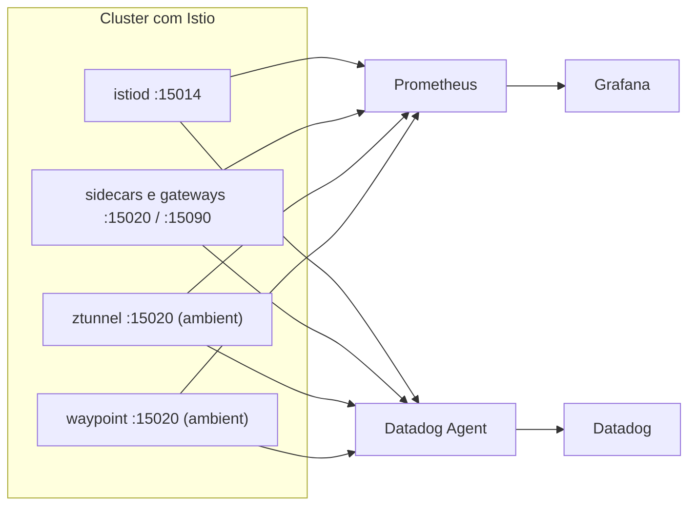
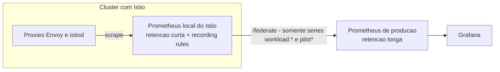

# Descomplicando Istio

<!-- TOC -->

- [Descomplicando Istio](#descomplicando-istio)
- [Day 4](#day-4)
- [De onde vêm as métricas](#de-onde-vêm-as-métricas)
  - [Sidecar x ambient: o que muda nas métricas](#sidecar-x-ambient-o-que-muda-nas-métricas)
- [Nível iniciante: Prometheus e Grafana dos addons](#nível-iniciante-prometheus-e-grafana-dos-addons)
- [Nível intermediário: exportando para um Prometheus e um Grafana já existentes](#nível-intermediário-exportando-para-um-prometheus-e-um-grafana-já-existentes)
  - [Opção 1 - Metrics merging (annotations prometheus.io)](#opção-1---metrics-merging-annotations-prometheusio)
  - [Opção 2 - Jobs de scrape customizados](#opção-2---jobs-de-scrape-customizados)
  - [Prometheus Operator (PodMonitor e ServiceMonitor)](#prometheus-operator-podmonitor-e-servicemonitor)
  - [Scrape de aplicações com mTLS STRICT](#scrape-de-aplicações-com-mtls-strict)
  - [Importando os dashboards oficiais em um Grafana existente](#importando-os-dashboards-oficiais-em-um-grafana-existente)
- [Nível avançado: Prometheus em escala de produção](#nível-avançado-prometheus-em-escala-de-produção)
  - [Recording rules (agregação por workload)](#recording-rules-agregação-por-workload)
  - [Federação](#federação)
  - [Reduzindo a cardinalidade com a Telemetry API](#reduzindo-a-cardinalidade-com-a-telemetry-api)
- [Exportando métricas para o Datadog](#exportando-métricas-para-o-datadog)
  - [Instalando o Datadog Agent](#instalando-o-datadog-agent)
  - [Data plane no modo sidecar](#data-plane-no-modo-sidecar)
  - [Control plane (istiod)](#control-plane-istiod)
  - [Modo ambient (ztunnel e waypoint)](#modo-ambient-ztunnel-e-waypoint)
  - [Logs do istiod e access logs do Envoy](#logs-do-istiod-e-access-logs-do-envoy)
  - [Validando](#validando)
- [Referências](#referências)

<!-- TOC -->

# Day 4

Neste dia o assunto é **exportar as métricas do Istio e do Envoy** para fora da mesh: primeiro para o **Prometheus + Grafana** (do jeito rápido dos addons até um desenho de produção) e depois para o **Datadog**, cobrindo o **modo sidecar** e o **modo ambient**.

> **Nível:** do iniciante ao avançado - cada seção indica o nível. Pré-requisito: ambiente do [Day 1](day1.md) (ambient) ou [Day 1 - sidecar](day1-sidecar.md) com o Bookinfo instalado e recebendo tráfego.
>
> Este arquivo é a parte **prática**. O significado de cada métrica, as estatísticas internas do Envoy, as *response flags* e as consultas PromQL de troubleshooting estão na [seção 5 do Guia de Estudos](ISTIO_ENVOY_GUIA_DE_ESTUDOS.md#5-observabilidade-métricas-com-prometheus-grafana-e-datadog).

# De onde vêm as métricas

Segundo a documentação oficial ([Prometheus integration](https://istio.io/v1.32/docs/ops/integrations/prometheus/)), para coletar métricas da mesh inteira é preciso fazer *scrape* de:

1. O control plane (deployment `istiod`).
2. Os gateways (ingress e egress).
3. Os sidecars Envoy.
4. As aplicações (se expõem métricas no formato Prometheus).

| Componente | Endpoint | O que expõe |
|---|---|---|
| `istiod` | `:15014/metrics` | Métricas do control plane (`pilot_*`) |
| Sidecar / gateway (porta do agente) | `:15020/stats/prometheus` | Métricas do agente do Istio + Envoy + aplicação, **mescladas** (*merged*) |
| Sidecar / gateway (porta do Envoy) | `:15090/stats/prometheus` | Somente as estatísticas do Envoy |
| `ztunnel` (modo ambient) | `:15020` | Métricas TCP (L4) padrão do Istio |

> As portas acima estão documentadas em [Application Requirements - Ports used by Istio](https://istio.io/v1.32/docs/ops/deployment/application-requirements/) e na seção [2.4 do Guia de Estudos](ISTIO_ENVOY_GUIA_DE_ESTUDOS.md#24-portas-usadas-pelo-istio-e-pelo-envoy).



## Sidecar x ambient: o que muda nas métricas

| | Modo sidecar | Modo ambient |
|---|---|---|
| Quem gera as métricas de requisição | O Envoy de cada Pod (origem **e** destino) | O `ztunnel` (L4) e, se existir, o **waypoint** (L7) |
| Métricas L4 (`istio_tcp_*`) | Sim | Sim - o ztunnel emite o conjunto completo das métricas TCP padrão do Istio |
| Métricas L7 (`istio_requests_total`, latência, etc.) | Sim | **Somente com waypoint** para o serviço/namespace |

A documentação oficial ([Troubleshoot ztunnel](https://istio.io/v1.32/docs/ambient/usage/troubleshoot-ztunnel/)) é explícita: se um serviço usa apenas a camada segura do ztunnel, as métricas do Istio reportadas são **apenas as métricas TCP de L4** (`istio_tcp_sent_bytes_total`, `istio_tcp_received_bytes_total`, `istio_tcp_connections_opened_total` e `istio_tcp_connections_closed_total`). Para obter métricas HTTP no ambient, crie um waypoint:

```bash
# Cria um waypoint para o namespace e o associa a todos os serviços dele
istioctl waypoint apply -n $MY_NAMESPACE --enroll-namespace --wait
```

# Nível iniciante: Prometheus e Grafana dos addons

O [Day 1](day1.md) já instala o Prometheus e o Grafana a partir dos manifestos de exemplo do próprio Istio (`samples/addons`). O Grafana desse exemplo já vem com todos os dashboards do Istio.

```bash
kubectl apply -f "$ISTIO_ADDONS_URL/prometheus.yaml"
kubectl apply -f "$ISTIO_ADDONS_URL/grafana.yaml"

kubectl -n istio-system port-forward service/grafana 3000:3000 &
kubectl -n istio-system port-forward service/prometheus 9090:9090 &
```

> ATENÇÃO!!! A documentação oficial avisa que essa instalação é **apenas para demonstração**: não é ajustada para desempenho nem para segurança, usa uma janela de retenção curta (6 horas) e adiciona labels que aumentam a cardinalidade das métricas. Ela serve para clusters pequenos e monitoramento de curto prazo, **não** para meshes grandes ou para dias/semanas de histórico.

Os dashboards oficiais (também publicados no grafana.com):

| Dashboard | ID | Para quê |
|---|---|---|
| [Mesh Dashboard](https://grafana.com/grafana/dashboards/7639) | 7639 | Visão geral de todos os serviços da mesh |
| [Service Dashboard](https://grafana.com/grafana/dashboards/7636) | 7636 | Detalhamento das métricas de um serviço |
| [Workload Dashboard](https://grafana.com/grafana/dashboards/7630) | 7630 | Detalhamento das métricas de um workload |
| [Performance Dashboard](https://grafana.com/grafana/dashboards/11829) | 11829 | Uso de recursos da mesh |
| [Control Plane Dashboard](https://grafana.com/grafana/dashboards/7645) | 7645 | Saúde e desempenho do control plane |
| [WASM Extension Dashboard](https://grafana.com/grafana/dashboards/13277) | 13277 | Estado das extensões WebAssembly da mesh |
| [Ztunnel Dashboard](https://grafana.com/grafana/dashboards/21306) | 21306 | Componente `ztunnel` do modo ambient |

Confira direto no Prometheus (http://localhost:9090) se as métricas estão chegando:

```promql
# Requisições HTTP por serviço de destino (sidecar, ou ambient COM waypoint)
sum(rate(istio_requests_total[5m])) by (destination_service_name, response_code)

# Bytes TCP enviados (existe nos dois modos; no ambient sem waypoint é o que há)
sum(rate(istio_tcp_sent_bytes_total[5m])) by (destination_service_name)

# Tempo de convergência do control plane (p99)
histogram_quantile(0.99, sum(rate(pilot_proxy_convergence_time_bucket[5m])) by (le))
```

# Nível intermediário: exportando para um Prometheus e um Grafana já existentes

Em um ambiente real, normalmente já existe um Prometheus (e um Grafana) da empresa. O Istio oferece dois modos para que ele colete as métricas da mesh.

## Opção 1 - Metrics merging (annotations prometheus.io)

É o modo **habilitado por padrão**. O Istio adiciona as annotations `prometheus.io/*` em todos os Pods do data plane, e o agente do sidecar passa a servir, em `:15020/stats/prometheus`, as métricas do Istio **mescladas** com as métricas da própria aplicação. Qualquer Prometheus que respeite as annotations `prometheus.io` (padrão de fato) coleta tudo sem configuração extra.

```bash
# Veja as annotations adicionadas pelo Istio em um Pod com sidecar
kubectl -n $MY_NAMESPACE get pod -l app=productpage \
  -o jsonpath='{.items[0].metadata.annotations}' | tr ',' '\n' | grep prometheus

# Veja as métricas mescladas direto no Pod
kubectl -n $MY_NAMESPACE exec deploy/productpage-v1 -c istio-proxy -- \
  curl -s localhost:15020/stats/prometheus | head -20
```

Segundo a documentação, esse modo **pode não servir** quando:

- É necessário fazer o scrape das métricas usando TLS (o modo expõe tudo em texto plano).
- A aplicação expõe métricas com o mesmo nome das métricas do Istio (ex.: a própria aplicação roda um Envoy e expõe `istio_requests_total`).
- O Prometheus não está configurado para fazer scrape com base nas annotations `prometheus.io`.

Para desabilitar: globalmente com `--set meshConfig.enablePrometheusMerge=false` na instalação, ou por workload com a annotation `prometheus.istio.io/merge-metrics: "false"` no Pod.

**Vários endpoints de métricas no mesmo Pod (a partir do Istio 1.31):** por padrão o merge coleta um único endpoint da aplicação (o das annotations `prometheus.io/port` e `prometheus.io/path`). A annotation `prometheus.istio.io/scrape-targets` permite declarar mais de um, em uma lista de pares `porta:caminho` separados por vírgula (caminho omitido = `/metrics`):

```yaml
metadata:
  annotations:
    prometheus.io/scrape: "true"
    prometheus.istio.io/scrape-targets: "8080:/metrics,9100:/metrics"
```

Limitações documentadas: as portas não podem ser portas reservadas do Istio (ex.: `15020`, `15090`); dois alvos não podem expor uma família de métricas com o mesmo nome; cada resposta é limitada a 10 MiB; e falhas de um alvo são contadas em `istio_agent_scrape_failures_total{type="application"}`.

> **Novidade do Istio 1.32** ([anúncio da release](https://istio.io/latest/news/releases/1.32.x/announcing-1.32/)): o merge do `pilot-agent` repassa o formato protobuf do Prometheus quando o scraper o solicita, o que permite **histogramas nativos** do Prometheus. O contador `istio_agent_scrape_format_total` informa o formato negociado.

## Opção 2 - Jobs de scrape customizados

Para configurar um Prometheus existente "na mão", a documentação oficial fornece os jobs abaixo (arquivo de configuração do Prometheus, seção `scrape_configs`).

Métricas do `istiod` (porta `http-monitoring`):

```yaml
- job_name: 'istiod'
  kubernetes_sd_configs:
  - role: endpoints
    namespaces:
      names:
      - istio-system
  relabel_configs:
  - source_labels: [__meta_kubernetes_service_name, __meta_kubernetes_endpoint_port_name]
    action: keep
    regex: istiod;http-monitoring
```

Estatísticas do Envoy (sidecars e gateways), pelas portas cujo nome termina em `-envoy-prom`:

```yaml
- job_name: 'envoy-stats'
  metrics_path: /stats/prometheus
  kubernetes_sd_configs:
  - role: pod
  relabel_configs:
  - source_labels: [__meta_kubernetes_pod_container_port_name]
    action: keep
    regex: '.*-envoy-prom'
```

## Prometheus Operator (PodMonitor e ServiceMonitor)

Se o seu Prometheus é gerenciado pelo [Prometheus Operator](https://github.com/prometheus-operator/prometheus-operator) (ex.: chart `kube-prometheus-stack`), a release do Istio traz um exemplo pronto com um `PodMonitor` (proxies Envoy) e um `ServiceMonitor` (componentes do Istio):

```bash
# Veja o conteúdo antes de aplicar
curl -sL "$ISTIO_ADDONS_URL/extras/prometheus-operator.yaml"

kubectl apply -f "$ISTIO_ADDONS_URL/extras/prometheus-operator.yaml"
```

Pontos de atenção ao ler esse arquivo:

- O `PodMonitor` `envoy-stats-monitor` seleciona os containers chamados `istio-proxy` de todos os namespaces, só de Pods que tenham a annotation `prometheus.io/scrape`, e usa a porta da annotation `prometheus.io/port`.
- O `ServiceMonitor` `istio-component-monitor` seleciona os Services com o label `istio=pilot` e a porta `http-monitoring`.
- Os dois objetos têm o label `release: istio`. O Prometheus Operator só carrega monitores que casem com o seletor configurado no seu recurso `Prometheus` - ajuste esse label para o que a sua instalação espera.

## Scrape de aplicações com mTLS STRICT

As métricas do control plane, dos gateways e do sidecar Envoy são coletadas em texto plano. Já as métricas **da aplicação** seguem a política de autenticação do workload:

| Modo do `PeerAuthentication` | O que fazer no Prometheus |
|---|---|
| `STRICT` | Configurar o Prometheus para fazer scrape **com certificados do Istio** (abaixo) |
| `PERMISSIVE` | **Não** configurar TLS no Prometheus (ele não consegue enviar a variante de TLS que o Istio exige nesse modo) |
| `DISABLE` | Nenhuma configuração de TLS é necessária |

Para o modo `STRICT`, a forma documentada é injetar um sidecar no Prometheus que **apenas** rotacione os certificados e os grave em um volume compartilhado, **sem** interceptar o tráfego (o modelo de acesso direto a endpoints do Prometheus é incompatível com o modelo de proxy do sidecar).

Volume no container do Prometheus:

```yaml
containers:
  - name: prometheus-server
    ...
    volumeMounts:
      mountPath: /etc/prom-certs/
      name: istio-certs
volumes:
  - emptyDir:
      medium: Memory
    name: istio-certs
```

Annotations no template do Pod do Prometheus (implantado com injeção de sidecar):

```yaml
spec:
  template:
    metadata:
      annotations:
        traffic.sidecar.istio.io/includeInboundPorts: ""   # do not intercept any inbound ports
        traffic.sidecar.istio.io/includeOutboundIPRanges: ""  # do not intercept any outbound traffic
        proxy.istio.io/config: |  # configure an env variable `OUTPUT_CERTS` to write certificates to the given folder
          proxyMetadata:
            OUTPUT_CERTS: /etc/istio-output-certs
        sidecar.istio.io/userVolumeMount: '[{"name": "istio-certs", "mountPath": "/etc/istio-output-certs"}]' # mount the shared volume at sidecar proxy
```

Contexto TLS do job de scrape:

```yaml
scheme: https
tls_config:
  ca_file: /etc/prom-certs/root-cert.pem
  cert_file: /etc/prom-certs/cert-chain.pem
  key_file: /etc/prom-certs/key.pem
  insecure_skip_verify: true  # Prometheus does not support Istio security naming, thus skip verifying target pod certificate
```

> Isso vale para o TLS terminado pelo Istio. Se a própria aplicação trata TLS, o modo `STRICT` não é suportado para scrape (o Prometheus precisaria enviar duas camadas de TLS).

## Importando os dashboards oficiais em um Grafana existente

Há três caminhos documentados em [Grafana integration](https://istio.io/v1.32/docs/ops/integrations/grafana/): o exemplo dos addons (já visto), o botão **Import** da interface do Grafana (informando os IDs da tabela acima e escolhendo o data source Prometheus) e um script que importa todos de uma vez. A cada versão do Istio é publicada uma nova **revisão** dos dashboards; o script abaixo (da documentação oficial) escolhe a revisão correspondente à versão instalada:

```bash
# Address of Grafana
GRAFANA_HOST="http://localhost:3000"
# Login credentials, if authentication is used
GRAFANA_CRED="USER:PASSWORD"
# The name of the Prometheus data source to use
GRAFANA_DATASOURCE="Prometheus"
# The version of Istio to deploy
VERSION=$VERSION_ISTIO
# Import all Istio dashboards
for DASHBOARD in 7639 11829 7636 7630 7645 13277 21306; do
    REVISION="$(curl -s https://grafana.com/api/dashboards/${DASHBOARD}/revisions -s | jq ".items[] | select(.description | contains(\"${VERSION}\")) | .revision" | tail -n 1)"
    curl -s https://grafana.com/api/dashboards/${DASHBOARD}/revisions/${REVISION}/download > /tmp/dashboard.json
    echo "Importing $(cat /tmp/dashboard.json | jq -r '.title') (revision ${REVISION}, id ${DASHBOARD})..."
    curl -s -k -u "$GRAFANA_CRED" -XPOST \
        -H "Accept: application/json" \
        -H "Content-Type: application/json" \
        -d "{\"dashboard\":$(cat /tmp/dashboard.json),\"overwrite\":true, \
            \"inputs\":[{\"name\":\"DS_PROMETHEUS\",\"type\":\"datasource\", \
            \"pluginId\":\"prometheus\",\"value\":\"$GRAFANA_DATASOURCE\"}]}" \
        $GRAFANA_HOST/api/dashboards/import
    echo -e "\nDone\n"
done
```

# Nível avançado: Prometheus em escala de produção

A abordagem recomendada pela documentação oficial ([Observability Best Practices](https://istio.io/v1.32/docs/ops/best-practices/observability/)) para monitorar meshes em escala de produção é usar **federação hierárquica** combinada com **recording rules**:



## Recording rules (agregação por workload)

O Prometheus local coleta cada proxy Envoy e adiciona labels de origem (`instance`, `pod`, `namespace`). As regras abaixo agregam as métricas **entre instâncias e Pods**, gerando séries `workload:*` muito menos numerosas. Exemplo (a lista completa, com todas as métricas padrão, está na documentação oficial):

```yaml
groups:
- name: "istio.recording-rules"
  interval: 5s
  rules:
  - record: "workload:istio_requests_total"
    expr: |
      sum without(instance, kubernetes_namespace, kubernetes_pod_name) (istio_requests_total)
  - record: "workload:istio_request_duration_milliseconds_bucket"
    expr: |
      sum without(instance, kubernetes_namespace, kubernetes_pod_name) (istio_request_duration_milliseconds_bucket)
  - record: "workload:istio_tcp_sent_bytes_total"
    expr: |
      sum without(instance, kubernetes_namespace, kubernetes_pod_name) (istio_tcp_sent_bytes_total)
  - record: "workload:istio_tcp_received_bytes_total"
    expr: |
      sum without(instance, kubernetes_namespace, kubernetes_pod_name) (istio_tcp_received_bytes_total)
```

Com o Prometheus Operator, as mesmas regras vão em um recurso `PrometheusRule` (`apiVersion: monitoring.coreos.com/v1`), também mostrado na documentação.

> Essas regras só agregam entre Pods e instâncias: elas preservam todas as dimensões das [métricas padrão do Istio](https://istio.io/v1.32/docs/reference/config/metrics/). A documentação sugere ir além e otimizá-las de acordo com os seus dashboards, alertas e consultas.

## Federação

O Prometheus de produção coleta, pelo endpoint `/federate` do Prometheus local, **apenas** as séries já agregadas (`workload:*`) e as do control plane (`pilot*`), renomeando-as de volta para o nome original:

```yaml
- job_name: 'istio-prometheus'
  honor_labels: true
  metrics_path: '/federate'
  kubernetes_sd_configs:
  - role: pod
    namespaces:
      names: ['istio-system']
  metric_relabel_configs:
  - source_labels: [__name__]
    regex: 'workload:(.*)'
    target_label: __name__
    action: replace
  params:
    'match[]':
    - '{__name__=~"workload:(.*)"}'
    - '{__name__=~"pilot(.*)"}'
```

## Reduzindo a cardinalidade com a Telemetry API

A [Telemetry API](https://istio.io/v1.32/docs/tasks/observability/metrics/telemetry-api/) permite remover dimensões (labels), adicionar dimensões customizadas ou desabilitar métricas - no mesh inteiro (namespace raiz, ex.: `istio-system`), em um namespace ou em um workload.

> A documentação avisa que a Telemetry API **não funciona junto com `EnvoyFilter`** para customizar a telemetria (issue [istio/istio#39772](https://github.com/istio/istio/issues/39772)). Desde o Istio 1.18 o provider `prometheus` é habilitado via `meshConfig.defaultProviders`, e a Telemetry API é o caminho para customizações.

Remover a dimensão `grpc_response_status` da métrica `REQUEST_COUNT` (`istio_requests_total`) em toda a mesh:

```yaml
apiVersion: telemetry.istio.io/v1
kind: Telemetry
metadata:
  name: remove-tags
  namespace: istio-system
spec:
  metrics:
    - providers:
        - name: prometheus
      overrides:
        - match:
            mode: CLIENT_AND_SERVER
            metric: REQUEST_COUNT
          tagOverrides:
            grpc_response_status:
              operation: REMOVE
```

Desabilitar a métrica `REQUEST_COUNT` apenas no lado cliente (no modo sidecar, cada requisição é reportada duas vezes: pelo proxy de origem e pelo de destino):

```yaml
apiVersion: telemetry.istio.io/v1
kind: Telemetry
metadata:
  name: remove-client
  namespace: istio-system
spec:
  metrics:
    - providers:
        - name: prometheus
      overrides:
        - disabled: true
          match:
            mode: CLIENT
            metric: REQUEST_COUNT
```

Mais exemplos (incluindo `ALL_METRICS` e tags customizadas) na seção [8.1 do Guia de Estudos](ISTIO_ENVOY_GUIA_DE_ESTUDOS.md#81-telemetry-habilitandocustomizando-métricas-por-workload).

# Exportando métricas para o Datadog

> Fonte desta seção: [Datadog / Istio integration](https://docs.datadoghq.com/integrations/istio/). É necessário ter uma conta no Datadog e uma **API key**.

A integração `istio` já vem embutida no **Datadog Agent** e é baseada em OpenMetrics (ou seja, o Agent faz scrape dos mesmos endpoints Prometheus vistos acima). Ela tem dois componentes, configurados separadamente:

- **Data plane**: os containers sidecar `istio-proxy` - gera as métricas `istio.mesh.*`.
- **Control plane**: o serviço `istiod` - gera as métricas do control plane (`istio.pilot.*`, entre outras).

> A integração tem um modo *latest* (`use_openmetrics: true`, recomendado pelo Datadog) e um modo *legacy* (`use_openmetrics: false`). Se houver mais de uma instância do Datadog coletando métricas do Istio, use o **mesmo modo** em todas - caso contrário os dados podem flutuar.

## Instalando o Datadog Agent

Via Helm, conforme [Install the Datadog Agent on Kubernetes](https://docs.datadoghq.com/containers/kubernetes/installation/):

```bash
helm repo add datadog https://helm.datadoghq.com
helm repo update

# NUNCA versione a API key no Git. Crie o Secret direto no cluster.
kubectl create secret generic datadog-secret --from-literal api-key="<DATADOG_API_KEY>"
```

Crie o arquivo `datadog-values.yaml`:

```yaml
datadog:
  apiKeyExistingSecret: datadog-secret
  clusterName: <CLUSTER_NAME>
  site: <DATADOG_SITE>
```

```bash
helm install datadog-agent -f datadog-values.yaml datadog/datadog
```

Substitua `<CLUSTER_NAME>` por um nome para o cluster e `<DATADOG_SITE>` pelo seu [site do Datadog](https://docs.datadoghq.com/getting_started/site/).

**Desabilite a injeção de sidecar nos Pods do Datadog Agent** (recomendação do Datadog). Para Istio 1.10 ou superior, use o **label** `sidecar.istio.io/inject: "false"` no DaemonSet:

```bash
kubectl patch daemonset datadog-agent -p '{"spec":{"template":{"metadata":{"labels":{"sidecar.istio.io/inject":"false"}}}}}'
```

## Data plane no modo sidecar

Não é preciso configurar nada: o arquivo padrão `istio.d/auto_conf.yaml` do Agent configura automaticamente o monitoramento de **cada** container sidecar `istio-proxy` que ele detecta, reportando as métricas `istio.mesh.*`.

Para customizar, crie uma configuração própria. Ela **precisa** conter:

```yaml
ad_identifiers:
  - proxyv2
  - proxyv2-rhel8
init_config:
instances:
  - use_openmetrics: true
    send_histograms_buckets: false
    istio_mesh_endpoint: http://%%host%%:15020/stats/prometheus
    tag_by_endpoint: false
```

Com o chart Helm do Datadog, essa configuração vai na seção `datadog.confd` do `datadog-values.yaml` (conforme [Configure integrations on Kubernetes](https://docs.datadoghq.com/containers/kubernetes/integrations/)):

```yaml
datadog:
  confd:
    istio.yaml: |-
      ad_identifiers:
        - proxyv2
        - proxyv2-rhel8
      init_config:
      instances:
        - use_openmetrics: true
          send_histograms_buckets: false
          istio_mesh_endpoint: http://%%host%%:15020/stats/prometheus
          tag_by_endpoint: false
```

Todas as opções disponíveis estão no [conf.yaml.example](https://github.com/DataDog/integrations-core/blob/master/istio/datadog_checks/istio/data/conf.yaml.example) da integração.

Para monitorar também cada proxy Envoy individualmente, o Datadog indica configurar a [integração Envoy](https://github.com/DataDog/integrations-core/tree/master/envoy#istio).

## Control plane (istiod)

O Agent descobre o `istiod` por meio de uma annotation de Autodiscovery no Pod do `istiod`. O nome `discovery` na annotation é o nome do container do `istiod`:

```yaml
ad.datadoghq.com/discovery.checks: |
  {
    "istio": {
      "instances": [
        {
          "istiod_endpoint": "http://%%host%%:15014/metrics",
          "use_openmetrics": "true"
        }
      ]
    }
  }
```

> A sintaxe de Autodiscovery Annotations v2 é suportada a partir do Agent v7.36.

Como este repositório instala o Istio via Helm, a annotation pode ser aplicada pelo valor `podAnnotations` do chart `istiod` (campo existente no [values.yaml do chart](https://github.com/istio/istio/blob/release-1.32/manifests/charts/istio-control/istio-discovery/values.yaml)). Crie o arquivo `istiod-datadog-values.yaml`:

```yaml
podAnnotations:
  ad.datadoghq.com/discovery.checks: |
    {
      "istio": {
        "instances": [
          {
            "istiod_endpoint": "http://%%host%%:15014/metrics",
            "use_openmetrics": "true"
          }
        ]
      }
    }
```

```bash
# Modo sidecar (sem profile). No modo ambient, acrescente: --set profile=ambient
helm -n istio-system upgrade --install istiod istio/istiod --version $VERSION_ISTIO \
  -f istiod-datadog-values.yaml --wait --timeout 900s

# Confirme a annotation no Pod
kubectl -n istio-system get pod -l app=istiod -o jsonpath='{.items[0].metadata.annotations}'
```

## Modo ambient (ztunnel e waypoint)

No modo ambient não há sidecars para o `auto_conf.yaml` descobrir. A integração tem uma configuração específica: defina `istio_mode: ambient` e um ou mais dos endpoints `ztunnel_endpoint`, `waypoint_endpoint` e `istiod_endpoint` na mesma instância - o check faz scrape de cada endpoint definido. Exemplo estático do `istio.d/conf.yaml` cobrindo os três componentes (da documentação do Datadog):

```yaml
init_config:
instances:
  - istio_mode: ambient
    use_openmetrics: true
    ztunnel_endpoint: http://ztunnel.istio-system.svc:15020/stats/prometheus
    waypoint_endpoint: http://waypoint.<NAMESPACE>.svc:15020/stats/prometheus
    istiod_endpoint: http://istiod.istio-system.svc:15014/metrics
```

- Substitua `<NAMESPACE>` pelo namespace onde o waypoint foi criado (`istioctl waypoint apply`). Omita `waypoint_endpoint` se não houver waypoint.
- A própria documentação pede para **ajustar as URLs aos hostnames e portas do seu cluster**. Confirme antes quais `Services` existem (`kubectl -n istio-system get svc`) - o `ztunnel` é um DaemonSet, e as mesmas opções também podem ser definidas via annotations de Autodiscovery (como na seção do control plane).

## Logs do istiod e access logs do Envoy

Primeiro habilite a coleta de logs do Agent no Kubernetes ([Kubernetes Log Collection](https://docs.datadoghq.com/agent/kubernetes/log/)). Depois:

Logs do control plane - annotation no Pod do `istiod`:

```yaml
ad.datadoghq.com/discovery.logs: |
  [
    {
      "source": "istio",
      "service": "<SERVICE_NAME>"
    }
  ]
```

Access logs do Envoy - habilite o [access log no Istio](https://istio.io/v1.32/docs/tasks/observability/logs/access-log/) (veja também a seção [6.3 do Guia de Estudos](ISTIO_ENVOY_GUIA_DE_ESTUDOS.md#63-access-log-habilitar-e-customizar-campos)) e aplique a annotation no Pod em que o container `istio-proxy` foi injetado:

```yaml
ad.datadoghq.com/istio-proxy.logs: |
  [
    {
      "source": "envoy",
      "service": "<SERVICE_NAME>"
    }
  ]
```

## Validando

Execute o subcomando de status do Agent e procure por `istio` na seção *Checks*:

```bash
kubectl exec -it "$(kubectl get pod -l app=datadog-agent -o jsonpath='{.items[0].metadata.name}')" -c agent -- agent status | grep -A15 istio
```

> O label `app=datadog-agent` e o container `agent` dependem de como o Agent foi instalado (nome do release Helm). Ajuste o seletor se necessário (`kubectl get pods --show-labels`).

No Datadog, as métricas do data plane aparecem com o prefixo `istio.mesh.` e as do control plane com prefixos como `istio.pilot.`. A lista completa das métricas coletadas está na seção *Data Collected* da página da integração.

# Referências

- https://istio.io/v1.32/docs/ops/integrations/prometheus/
- https://istio.io/v1.32/docs/ops/integrations/grafana/
- https://istio.io/v1.32/docs/ops/best-practices/observability/
- https://istio.io/v1.32/docs/reference/config/metrics/
- https://istio.io/v1.32/docs/tasks/observability/metrics/telemetry-api/
- https://istio.io/v1.32/docs/tasks/observability/metrics/using-istio-dashboard/
- https://istio.io/v1.32/docs/ops/deployment/application-requirements/
- https://istio.io/v1.32/docs/ambient/usage/troubleshoot-ztunnel/
- https://istio.io/v1.32/docs/ambient/architecture/data-plane/
- https://istio.io/latest/news/releases/1.32.x/announcing-1.32/
- https://github.com/istio/istio/tree/release-1.32/samples/addons
- https://docs.datadoghq.com/integrations/istio/
- https://docs.datadoghq.com/containers/kubernetes/installation/
- https://docs.datadoghq.com/containers/kubernetes/integrations/
- https://github.com/DataDog/integrations-core/tree/master/istio
