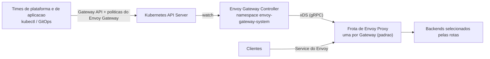

# Descomplicando Istio

<!-- TOC -->

- [Descomplicando Istio](#descomplicando-istio)
- [Day 6](#day-6)
- [O que é o Envoy Gateway](#o-que-é-o-envoy-gateway)
  - [Arquitetura](#arquitetura)
  - [Envoy Gateway x Istio](#envoy-gateway-x-istio)
  - [Recursos (APIs)](#recursos-apis)
- [Nível iniciante: instalação e primeiro Gateway](#nível-iniciante-instalação-e-primeiro-gateway)
  - [Ambiente e versões](#ambiente-e-versões)
  - [Instalando o Envoy Gateway](#instalando-o-envoy-gateway)
  - [Testando](#testando)
  - [E se o cluster já tem os CRDs do Gateway API (ex.: cluster com Istio)?](#e-se-o-cluster-já-tem-os-crds-do-gateway-api-ex-cluster-com-istio)
- [Nível intermediário: políticas](#nível-intermediário-políticas)
  - [Compressão de respostas](#compressão-de-respostas)
  - [Rate limit local](#rate-limit-local)
  - [Outras tarefas oficiais](#outras-tarefas-oficiais)
- [Nível intermediário: observabilidade (Prometheus e Grafana)](#nível-intermediário-observabilidade-prometheus-e-grafana)
- [Nível avançado: EnvoyPatchPolicy (o "EnvoyFilter" do Envoy Gateway)](#nível-avançado-envoypatchpolicy-o-envoyfilter-do-envoy-gateway)
- [Troubleshooting](#troubleshooting)
- [Removendo o ambiente](#removendo-o-ambiente)
- [Referências](#referências)

<!-- TOC -->

# Day 6

Neste dia vamos conhecer o **[Envoy Gateway](https://gateway.envoyproxy.io)**: um projeto da comunidade Envoy que usa o **Envoy Proxy como API Gateway/ingress**, configurado pelo **Kubernetes Gateway API** - sem service mesh.

> **Nível:** do iniciante ao avançado - cada seção indica o nível. É um bom complemento ao [Day 5](day5.md): lá customizamos o Envoy do Istio com `EnvoyFilter`; aqui o mesmo Envoy é configurado por outro control plane, com APIs de mais alto nível.
>
> Todos os comandos foram extraídos da documentação oficial do Envoy Gateway **v1.10** citada em cada seção e em [Referências](#referências).

# O que é o Envoy Gateway

A documentação oficial ([Concepts](https://gateway.envoyproxy.io/v1.10/concepts/)) define o Envoy Gateway como um **control plane de API Gateway e proxy reverso nativo do Kubernetes**, que simplifica a implantação e a operação do Envoy Proxy como data plane usando o Gateway API padrão e as suas próprias APIs de extensão.

A motivação: configurar o Envoy "na mão" exige conhecimento profundo de redes e arquivos de configuração complexos. O Envoy Gateway remove essa barreira ao:

- Integrar-se ao Kubernetes por meio do Gateway API.
- Fornecer CRDs próprios para políticas avançadas de tráfego.
- Traduzir automaticamente os recursos do Kubernetes em configuração do Envoy.
- Gerenciar o ciclo de vida das instâncias do Envoy Proxy.

## Arquitetura

| Camada | Descrição |
|---|---|
| **Configuração do usuário** | Roteamento, segurança e políticas de tráfego definidos com recursos do Gateway API, opcionalmente estendidos com os CRDs do Envoy Gateway |
| **Envoy Gateway Controller** | Control plane que observa esses recursos, os traduz e gera a configuração do Envoy Proxy |
| **Envoy Proxy (data plane)** | Proxy que recebe e trata o tráfego real conforme a configuração gerada |



Pontos da arquitetura de referência oficial:

- O controller observa os recursos pela API do Kubernetes, traduz para configuração do Envoy e **escreve o status de volta** nos recursos.
- Por padrão, o Envoy Gateway provisiona **uma frota de Envoy Proxy por `Gateway`** (ou por `GatewayClass`, quando `mergeGateways` está habilitado), com o `Service` que a expõe, no namespace do Envoy Gateway (`envoy-gateway-system`) - ou no namespace de cada `Gateway`, no *Gateway Namespace Mode*.
- Os proxies recebem a configuração do Envoy Gateway via **xDS (gRPC)** - o mesmo protocolo que o istiod usa com os sidecars (seção [3.3 do Guia de Estudos](ISTIO_ENVOY_GUIA_DE_ESTUDOS.md#33-xds-como-o-istio-configura-o-envoy)).
- Quando o rate limit **global** é habilitado, o Envoy Gateway também implanta um serviço de rate limit, apoiado em uma instância de Redis fornecida por você.

## Envoy Gateway x Istio

Os dois projetos programam o Envoy via xDS e implementam o Kubernetes Gateway API, mas resolvem problemas diferentes:

| | Envoy Gateway | Istio |
|---|---|---|
| Escopo | Tráfego de **entrada** (norte-sul): API Gateway / ingress | **Service mesh**: tráfego entre serviços (leste-oeste) **e** gateways de entrada/saída |
| Onde roda o proxy | Frota de Envoy dedicada por `Gateway` | Sidecar por Pod (modo sidecar) ou ztunnel por nó + waypoints (modo ambient), além dos gateways |
| API principal | Gateway API + políticas do Envoy Gateway (`BackendTrafficPolicy`, `ClientTrafficPolicy`, `SecurityPolicy`, ...) | Gateway API e/ou APIs do Istio (`VirtualService`, `DestinationRule`, `AuthorizationPolicy`, ...) |
| `controllerName` do `GatewayClass` | `gateway.envoyproxy.io/gatewayclass-controller` | Classes `istio`, `istio-waypoint`, `istio-east-west` |
| Patch de baixo nível no xDS | `EnvoyPatchPolicy` (JSON Patch) | `EnvoyFilter` ([Day 5](day5.md)) |

> Este repositório **não** documenta o uso combinado dos dois (ex.: Envoy Gateway como ingress de uma mesh Istio): não encontramos um guia oficial para esse cenário na documentação do Envoy Gateway v1.10 nem na do Istio 1.32, então ele fica fora deste material.

## Recursos (APIs)

Resumo da tabela oficial de recursos:

| Recurso | API | Finalidade | Anexa em |
|---|---|---|---|
| `GatewayClass` | Gateway API | Define uma classe de Gateways com configuração comum | - |
| `Gateway` | Gateway API | Especifica como o tráfego entra no cluster | `GatewayClass` |
| `HTTPRoute`, `GRPCRoute`, `TLSRoute`, `TCPRoute`, `UDPRoute` | Gateway API | Regras de roteamento por tipo de tráfego | `Gateway` |
| `BackendTLSPolicy` | Gateway API | TLS nas conexões com os backends | `Service` |
| `ClientTrafficPolicy` | Envoy Gateway | Como o Envoy se comporta com os **clientes** (downstream): TLS/mTLS, keepalive, timeouts, IP do cliente, HTTP/1, HTTP/2 e HTTP/3 | `Gateway` |
| `BackendTrafficPolicy` | Envoy Gateway | Como o Envoy fala com os **backends**: load balancing, health checks, circuit breaker, retries, rate limit, fault injection, **compressão** | `Gateway`, rotas |
| `SecurityPolicy` | Envoy Gateway | Autenticação e autorização: mTLS, JWT, API key, Basic Auth, OIDC, autorização externa, CORS | `Gateway`, rotas |
| `EnvoyExtensionPolicy` | Envoy Gateway | Extensões do proxy (Wasm, Lua, ext_proc, ...) | `Gateway`, rotas, `Backend` |
| `EnvoyProxy` | Envoy Gateway | Implantação e configuração do próprio Envoy Proxy (réplicas, imagem, telemetria, ...) | `GatewayClass`, `Gateway` |
| `EnvoyPatchPolicy` | Envoy Gateway | Patches customizados no xDS gerado | `GatewayClass`, `Gateway` |
| `Backend` | Envoy Gateway | Roteamento para backends fora do cluster (FQDN ou IP) | - |
| `HTTPRouteFilter` | Envoy Gateway | Processamento adicional de requisição/resposta | `HTTPRoute` |

Para políticas que podem ser anexadas em mais de um nível, a regra documentada é: **a configuração mais específica vence**.

# Nível iniciante: instalação e primeiro Gateway

> Fonte: [Quickstart](https://gateway.envoyproxy.io/v1.10/tasks/quickstart/).

## Ambiente e versões

Use um cluster kind **novo e dedicado** a este dia, com o MetalLB instalado (para o `Gateway` receber um endereço), seguindo [INSTALL_REQUIREMENTS.md](INSTALL_REQUIREMENTS.md#kind). O motivo de não reaproveitar o cluster do Day 1 está explicado [mais abaixo](#e-se-o-cluster-já-tem-os-crds-do-gateway-api-ex-cluster-com-istio).

Segundo a [matriz de compatibilidade](https://gateway.envoyproxy.io/news/releases/matrix/) oficial, o Envoy Gateway **v1.10** usa o Envoy Proxy **1.40.x**, o Gateway API **v1.6.1** e suporta o Kubernetes **v1.34 a v1.37** - compatível com o Kubernetes 1.37 usado neste repositório.

```bash
# Esta versão NÃO é atualizada automaticamente pela CLI agents/upgrade.
# Consulte a matriz de compatibilidade antes de alterar.
export ENVOY_GATEWAY_VERSION="v1.10.0"
```

## Instalando o Envoy Gateway

O chart instala os CRDs do Gateway API **e** o Envoy Gateway:

```bash
helm install eg oci://docker.io/envoyproxy/gateway-helm --version $ENVOY_GATEWAY_VERSION -n envoy-gateway-system --create-namespace

kubectl wait --timeout=5m -n envoy-gateway-system deployment/envoy-gateway --for=condition=Available
```

Instale o `GatewayClass`, o `Gateway`, o `HTTPRoute` e a aplicação de exemplo:

```bash
kubectl apply -f https://github.com/envoyproxy/gateway/releases/download/$ENVOY_GATEWAY_VERSION/quickstart.yaml -n default

kubectl get gatewayclass,gateway,httproute -n default
kubectl get pods -n envoy-gateway-system
```

O `quickstart.yaml` cria: um `GatewayClass` chamado `eg` (com o `controllerName` `gateway.envoyproxy.io/gatewayclass-controller`), um `Gateway` chamado `eg` escutando HTTP na porta 80, a aplicação `backend` (ServiceAccount, Service e Deployment) e um `HTTPRoute` chamado `backend` para o hostname `www.example.com`.

> A documentação observa que, ao ver um listener em porta privilegiada (<1024), o Envoy Gateway a mapeia internamente para uma porta não privilegiada - assim o proxy não precisa de privilégios adicionais. Lembre-se desse mapeamento ao depurar.

## Testando

Com suporte a LoadBalancer (MetalLB):

```bash
export GATEWAY_HOST=$(kubectl get gateway/eg -o jsonpath='{.status.addresses[0].value}')
curl --verbose --header "Host: www.example.com" http://$GATEWAY_HOST/get
```

Sem LoadBalancer (port-forward):

```bash
export ENVOY_SERVICE=$(kubectl get svc -n envoy-gateway-system --selector=gateway.envoyproxy.io/owning-gateway-namespace=default,gateway.envoyproxy.io/owning-gateway-name=eg -o jsonpath='{.items[0].metadata.name}')
kubectl -n envoy-gateway-system port-forward service/${ENVOY_SERVICE} 8888:80 &
curl --verbose --header "Host: www.example.com" http://localhost:8888/get
```

Repare que o Deployment e o Service do Envoy Proxy foram criados **pelo Envoy Gateway**, no namespace `envoy-gateway-system`, a partir do `Gateway` `eg` do namespace `default`.

## E se o cluster já tem os CRDs do Gateway API (ex.: cluster com Istio)?

O Day 1 deste repositório instala os CRDs do Gateway API (canal *standard*) para o Istio, e o chart do Envoy Gateway também instala os CRDs do Gateway API. A documentação oficial de [instalação via Helm](https://gateway.envoyproxy.io/v1.10/install/install-helm/) trata do caso em que os CRDs já existem e são gerenciados por outra parte, e é categórica: **não misture** uma cópia existente dos CRDs com outra cópia instalada pelo Envoy Gateway.

O procedimento documentado é:

1. Verificar a versão e o **canal** dos CRDs já instalados e compará-los com a matriz de compatibilidade e com os recursos do Gateway API que a sua configuração exige:

```bash
kubectl get crd gateways.gateway.networking.k8s.io \
  -o go-template='version={{ index .metadata.annotations "gateway.networking.k8s.io/bundle-version" }} channel={{ index .metadata.annotations "gateway.networking.k8s.io/channel" }}{{ "\n" }}'
```

2. Se forem compatíveis, instalar **somente** os CRDs do Envoy Gateway:

```bash
helm template eg-crds oci://docker.io/envoyproxy/gateway-crds-helm \
  --version $ENVOY_GATEWAY_VERSION \
  --set crds.gatewayAPI.enabled=false \
  --set crds.envoyGateway.enabled=true \
  | kubectl apply --server-side -f -
```

3. Instalar o chart principal **sem** reaplicar CRDs:

```bash
helm install eg oci://docker.io/envoyproxy/gateway-helm \
  --version $ENVOY_GATEWAY_VERSION \
  -n envoy-gateway-system \
  --create-namespace \
  --set crds.enabled=false
```

Tanto o Istio 1.32 quanto o Envoy Gateway v1.10 são testados com o Gateway API **v1.6.1** (conforme a tabela de [releases suportadas do Istio](https://istio.io/latest/docs/releases/supported-releases/) e a matriz do Envoy Gateway), mas a compatibilidade de **canal** e dos recursos exigidos precisa ser avaliada caso a caso. Por isso este dia usa um cluster dedicado.

# Nível intermediário: políticas

## Compressão de respostas

> Fonte: [Response Compression](https://gateway.envoyproxy.io/v1.10/tasks/traffic/response-compression/).

No Istio, habilitar compressão exigiu um `EnvoyFilter` inserindo o filtro `compressor` ([Day 5](day5.md)). No Envoy Gateway é um campo de alto nível: `compressor`, no `BackendTrafficPolicy`. O Envoy Gateway suporta **Brotli, Gzip e Zstd**, e vários tipos podem ser definidos ao mesmo tempo - o Envoy Gateway escolhe o mais adequado com base no header `Accept-Encoding` do cliente.

```bash
cat <<EOF | kubectl apply -f -
apiVersion: gateway.envoyproxy.io/v1alpha1
kind: BackendTrafficPolicy
metadata:
  name: response-compression
spec:
  targetRef:
    group: gateway.networking.k8s.io
    kind: HTTPRoute
    name: backend
  compressor:
    - type: Brotli
      brotli: {}
    - type: Gzip
      gzip: {}
    - type: Zstd
      zstd: {}
EOF
```

Teste com os pesos (`q`) do `Accept-Encoding` - é escolhido o tipo de maior `q` que esteja configurado na política:

```bash
# Prefere Brotli -> content-encoding: br
curl --verbose --header "Host: www.example.com" --header "Accept-Encoding: br;q=1.0, gzip;q=0.8" http://$GATEWAY_HOST/

# Prefere Gzip -> content-encoding: gzip
curl --verbose --header "Host: www.example.com" --header "Accept-Encoding: br;q=0.8, gzip;q=1.0" http://$GATEWAY_HOST/
```

A resposta comprimida traz `content-encoding`, `vary: Accept-Encoding` e `transfer-encoding: chunked` - o mesmo comportamento do filtro `compressor` do Envoy visto no Day 5, porque por baixo é o mesmo filtro.

Detalhes documentados:

- O campo antigo **`compression` está obsoleto** (*deprecated*); use `compressor`, que dá controle mais granular.
- **`minContentLength`**: tamanho mínimo da resposta para comprimir. O mínimo permitido é 30 bytes (imposto pelo Envoy Proxy), e esse também é o padrão quando o campo é omitido:

```yaml
  compressor:
    - type: Gzip
      gzip: {}
      minContentLength: 1024
```

- **ETag**: ao comprimir, o Envoy remove por padrão as ETags fortes (as fracas, com prefixo `W/`, são preservadas), porque a compressão altera o corpo da resposta.
- **Trade-off**: menos banda de rede, mais uso de CPU no Envoy.

## Rate limit local

> Fonte: [Local Rate Limit](https://gateway.envoyproxy.io/v1.10/tasks/traffic/local-rate-limit/).

Também no `BackendTrafficPolicy`. Exemplo da documentação: limitar a 3 requisições por hora as chamadas com o header `x-user-id: one`, em um `HTTPRoute` chamado `http-ratelimit`:

```yaml
apiVersion: gateway.envoyproxy.io/v1alpha1
kind: BackendTrafficPolicy
metadata:
  name: policy-httproute
spec:
  targetRefs:
  - group: gateway.networking.k8s.io
    kind: HTTPRoute
    name: http-ratelimit
  rateLimit:
    local:
      rules:
      - clientSelectors:
        - headers:
          - name: x-user-id
            value: one
        limit:
          requests: 3
          unit: Hour
```

Compare com o [Laboratório 5 do Day 5](day5.md#laboratório-5-avançado-rate-limit-local), em que o mesmo resultado no Istio exigiu um `EnvoyFilter` com a configuração bruta do filtro `local_ratelimit`. O rate limit **global** (compartilhado entre todas as réplicas, com Redis) está em [Global Rate Limit](https://gateway.envoyproxy.io/v1.10/tasks/traffic/global-rate-limit/).

## Outras tarefas oficiais

A documentação organiza as tarefas por categoria. Sugestão de sequência de estudo:

| Categoria | Tarefas |
|---|---|
| Tráfego | [HTTP Routing](https://gateway.envoyproxy.io/v1.10/tasks/traffic/http-routing/), [Traffic Splitting](https://gateway.envoyproxy.io/v1.10/tasks/traffic/http-traffic-splitting/), [Retry](https://gateway.envoyproxy.io/v1.10/tasks/traffic/retry/), [Circuit Breaker](https://gateway.envoyproxy.io/v1.10/tasks/traffic/circuit-breaker/), [Fault Injection](https://gateway.envoyproxy.io/v1.10/tasks/traffic/fault-injection/), [Request Mirroring](https://gateway.envoyproxy.io/v1.10/tasks/traffic/http-request-mirroring/) |
| Segurança | [Secure Gateways](https://gateway.envoyproxy.io/v1.10/tasks/security/secure-gateways/), [JWT Authentication](https://gateway.envoyproxy.io/v1.10/tasks/security/jwt-authentication/), [OIDC](https://gateway.envoyproxy.io/v1.10/tasks/security/oidc/), [External Authorization](https://gateway.envoyproxy.io/v1.10/tasks/security/ext-auth/), [CORS](https://gateway.envoyproxy.io/v1.10/tasks/security/cors/) |
| Extensibilidade | [Lua](https://gateway.envoyproxy.io/v1.10/tasks/extensibility/lua/), [Wasm](https://gateway.envoyproxy.io/v1.10/tasks/extensibility/wasm/), [External Processing](https://gateway.envoyproxy.io/v1.10/tasks/extensibility/ext-proc/) |
| Operação | [Deployment Mode](https://gateway.envoyproxy.io/v1.10/tasks/operations/deployment-mode/), [Customize EnvoyProxy](https://gateway.envoyproxy.io/v1.10/tasks/operations/customize-envoyproxy/), [egctl](https://gateway.envoyproxy.io/v1.10/tasks/operations/egctl/) |

Vários desses temas (traffic splitting, fault injection, mirroring) são os mesmos do [Day 2](day2.md), o que permite comparar a mesma funcionalidade nas duas ferramentas.

# Nível intermediário: observabilidade (Prometheus e Grafana)

> Fontes: [Proxy Metrics](https://gateway.envoyproxy.io/v1.10/tasks/observability/proxy-metric/), [Gateway Observability](https://gateway.envoyproxy.io/v1.10/tasks/observability/gateway-observability/) e [Visualising metrics using Grafana](https://gateway.envoyproxy.io/v1.10/tasks/observability/grafana-integration/).

O Envoy Gateway oferece observabilidade tanto do **control plane** (o controller) quanto do **data plane** (as instâncias do Envoy Proxy). O projeto fornece um chart de *add-ons* que instala os componentes de observabilidade (Prometheus e Grafana, entre outros; o OpenTelemetry Collector vem **desabilitado** por padrão):

```bash
helm install eg-addons oci://docker.io/envoyproxy/gateway-addons-helm --version $ENVOY_GATEWAY_VERSION -n monitoring --create-namespace

# Com o OpenTelemetry Collector habilitado:
# helm install eg-addons oci://docker.io/envoyproxy/gateway-addons-helm --version $ENVOY_GATEWAY_VERSION --set opentelemetry-collector.enabled=true -n monitoring --create-namespace
```

Métricas do **data plane** direto do endpoint de admin do Envoy (`/stats/prometheus`):

```bash
export ENVOY_POD_NAME=$(kubectl get pod -n envoy-gateway-system --selector=gateway.envoyproxy.io/owning-gateway-namespace=default,gateway.envoyproxy.io/owning-gateway-name=eg -o jsonpath='{.items[0].metadata.name}')
kubectl port-forward pod/$ENVOY_POD_NAME -n envoy-gateway-system 19001:19001 &

curl -s localhost:19001/stats/prometheus | grep "default/backend/rule/0"
```

Métricas do **control plane** (as métricas Prometheus do Envoy Gateway vêm habilitadas por padrão). Use outra porta local para não conflitar com o port-forward anterior:

```bash
export EG_POD_NAME=$(kubectl get pod -n envoy-gateway-system --selector=control-plane=envoy-gateway,app.kubernetes.io/instance=eg -o jsonpath='{.items[0].metadata.name}')
kubectl port-forward pod/$EG_POD_NAME -n envoy-gateway-system 19002:19001 &

curl -s localhost:19002/metrics | head -20
```

Consultando pelo Prometheus dos add-ons:

```bash
export PROMETHEUS_PORT=$(kubectl get service prometheus -n monitoring -o jsonpath='{.spec.ports[0].port}')
kubectl port-forward service/prometheus -n monitoring 19003:$PROMETHEUS_PORT &

curl -s 'http://localhost:19003/api/v1/query?query=topk(1,envoy_cluster_upstream_cx_connect_ms_sum)' | jq .
```

Grafana dos add-ons (credenciais `admin:admin`, com o data source Prometheus já configurado):

```bash
GRAFANA_IP=$(kubectl get svc grafana -n monitoring -o jsonpath='{.status.loadBalancer.ingress[0].ip}')
echo "http://${GRAFANA_IP}"
```

Os dashboards de exemplo ficam em `Dashboards/envoy-gateway`: **Envoy Proxy Global** (estatísticas de downstream e upstream por instância do proxy), **Envoy Clusters** (estatísticas por cluster), **Envoy Gateway Global** (estatísticas do control plane: componentes de watch, status updater, servidor xDS, infrastructure manager) e **Resources Monitor** (recursos do Envoy Gateway e dos proxies). Eles são mantidos no repositório do projeto, em `charts/gateway-addons-helm/dashboards`.

> Repare na diferença em relação ao Istio ([Day 4](day4.md)): aqui as métricas são as **estatísticas nativas do Envoy** (`envoy_cluster_*`, `envoy_http_*`, ...), e não as métricas padrão do Istio (`istio_requests_total`, ...). A leitura dessas estatísticas está na seção [5.2 do Guia de Estudos](ISTIO_ENVOY_GUIA_DE_ESTUDOS.md#52-estatísticas-internas-do-envoy).

# Nível avançado: EnvoyPatchPolicy (o "EnvoyFilter" do Envoy Gateway)

> Fonte: [Envoy Patch Policy](https://gateway.envoyproxy.io/v1.10/tasks/extensibility/envoy-patch-policy/).

A API `EnvoyPatchPolicy` permite modificar o xDS gerado pelo Envoy Gateway usando a semântica de **JSON Patch**, para usar funcionalidades do Envoy ainda não expostas pelas APIs do Envoy Gateway. Assim como o `EnvoyFilter` no Istio, é o último recurso - e a documentação é ainda mais enfática:

- É uma API para quem conhece **muito bem** a semântica do xDS do Envoy.
- É **instável**: o resultado pode mudar entre versões, porque a API do Envoy pode remover campos e o Envoy Gateway pode alterar a tradução para xDS (inclusive o campo `name` dos recursos).
- **Aviso de segurança**: habilitar o `EnvoyPatchPolicy` pode levar ao comprometimento completo do sistema - quem tem permissão sobre esse recurso pode injetar configuração arbitrária nos proxies. A documentação recomenda restringir o acesso com RBAC do Kubernetes, desabilitar extensões do Envoy que não são necessárias, usar network policies, validar os recursos com admission control e auditar periodicamente.
- Vem **desabilitada por padrão**. Para habilitar, edite a configuração `EnvoyGateway` (ConfigMap `envoy-gateway-config`):

```bash
cat <<EOF | kubectl apply -f -
apiVersion: v1
kind: ConfigMap
metadata:
  name: envoy-gateway-config
  namespace: envoy-gateway-system
data:
  envoy-gateway.yaml: |
    apiVersion: gateway.envoyproxy.io/v1alpha1
    kind: EnvoyGateway
    provider:
      type: Kubernetes
    gateway:
      controllerName: gateway.envoyproxy.io/gatewayclass-controller
    extensionApis:
      enableEnvoyPatchPolicy: true
EOF

# Reinicie o controller para carregar a nova configuração
kubectl rollout restart deployment envoy-gateway -n envoy-gateway-system
```

Exemplo da documentação: trocar a resposta `404` por um `406` com corpo customizado, alterando o listener gerado para o `Gateway` `eg`:

```bash
cat <<EOF | kubectl apply -f -
apiVersion: gateway.envoyproxy.io/v1alpha1
kind: EnvoyPatchPolicy
metadata:
  name: custom-response-patch-policy
  namespace: default
spec:
  targetRef:
    group: gateway.networking.k8s.io
    kind: Gateway
    name: eg
  type: JSONPatch
  jsonPatches:
    - type: "type.googleapis.com/envoy.config.listener.v3.Listener"
      # The listener name is of the form <GatewayNamespace>/<GatewayName>/<GatewayListenerName>
      name: default/eg/http
      operation:
        op: add
        path: "/default_filter_chain/filters/0/typed_config/local_reply_config"
        value:
          mappers:
          - filter:
              status_code_filter:
                comparison:
                  op: EQ
                  value:
                    default_value: 404
                    runtime_key: key_b
            status_code: 406
            body:
              inline_string: "could not find what you are looking for"
EOF

# Uma rota inexistente agora devolve 406
curl --verbose --header "Host: www.example.com" http://$GATEWAY_HOST/find

# O patch foi aceito e programado? (Accepted=True e Programmed=True)
kubectl get envoypatchpolicy custom-response-patch-policy -o yaml
```

| | `EnvoyFilter` (Istio) | `EnvoyPatchPolicy` (Envoy Gateway) |
|---|---|---|
| Semântica | `match` + `patch.operation` (`MERGE`, `INSERT_BEFORE`, ...) | JSON Patch (`op`, `path`, `value`) sobre um recurso xDS nomeado |
| Alvo | `workloadSelector` ou `targetRefs` | `targetRef` para `Gateway` ou `GatewayClass` |
| Habilitada por padrão | Sim | **Não** (`extensionApis.enableEnvoyPatchPolicy`) |
| Feedback de aplicação | Sem status por padrão (ver [Day 5](day5.md#troubleshooting)) | Condições `Accepted` e `Programmed` no status do recurso |

# Troubleshooting

```bash
# Status dos recursos do Gateway API (procure Accepted / Programmed / ResolvedRefs)
kubectl get gatewayclass eg -o yaml
kubectl describe gateway eg
kubectl describe httproute backend

# Status das políticas
kubectl get backendtrafficpolicy,clienttrafficpolicy,securitypolicy,envoypatchpolicy -A

# Logs do control plane e do data plane
kubectl logs -n envoy-gateway-system deployment/envoy-gateway
kubectl logs -n envoy-gateway-system -l gateway.envoyproxy.io/owning-gateway-name=eg

# Configuração xDS efetiva do Envoy (CLI egctl - ver a página "Use egctl")
egctl config envoy-proxy route
```

| Sintoma | O que verificar |
|---|---|
| `Gateway` sem endereço | Falta uma implementação de `LoadBalancer` no cluster (MetalLB) |
| `404` em toda requisição | Header `Host` diferente do `hostnames` do `HTTPRoute` (`www.example.com` no quickstart) |
| Política sem efeito | `targetRef`/`targetRefs` apontando para um recurso inexistente ou de outro namespace; confira as condições do status |
| Resposta sem compressão | `Accept-Encoding` ausente, ou resposta menor que o `minContentLength` |
| Proxy não aplica a configuração | A matriz de compatibilidade alerta: fixar uma imagem do Envoy de outra versão *minor* pode gerar configuração rejeitada pelo proxy |

# Removendo o ambiente

```bash
kubectl delete -f https://github.com/envoyproxy/gateway/releases/download/$ENVOY_GATEWAY_VERSION/quickstart.yaml --ignore-not-found=true
helm uninstall eg-addons -n monitoring
helm uninstall eg -n envoy-gateway-system
```

Ou simplesmente remova o cluster kind dedicado a este dia.

# Referências

- https://gateway.envoyproxy.io
- https://gateway.envoyproxy.io/v1.10/concepts/
- https://gateway.envoyproxy.io/v1.10/tasks/quickstart/
- https://gateway.envoyproxy.io/v1.10/install/install-helm/
- https://gateway.envoyproxy.io/news/releases/matrix/
- https://gateway.envoyproxy.io/v1.10/tasks/traffic/response-compression/
- https://gateway.envoyproxy.io/v1.10/tasks/traffic/local-rate-limit/
- https://gateway.envoyproxy.io/v1.10/tasks/observability/proxy-metric/
- https://gateway.envoyproxy.io/v1.10/tasks/observability/gateway-observability/
- https://gateway.envoyproxy.io/v1.10/tasks/observability/grafana-integration/
- https://gateway.envoyproxy.io/v1.10/tasks/extensibility/envoy-patch-policy/
- https://gateway.envoyproxy.io/v1.10/tasks/operations/deployment-mode/
- https://gateway.envoyproxy.io/v1.10/tasks/operations/egctl/
- https://gateway-api.sigs.k8s.io
- https://github.com/envoyproxy/gateway
