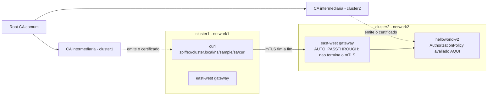

# Descomplicando Istio

<!-- TOC -->

- [Descomplicando Istio](#descomplicando-istio)
- [Day 7](#day-7)
- [Conceitos](#conceitos)
  - [Identidade de workload e SPIFFE](#identidade-de-workload-e-spiffe)
  - [Por que a identidade atravessa clusters](#por-que-a-identidade-atravessa-clusters)
  - [Duas autenticações diferentes: peer (mTLS) e request (JWT)](#duas-autenticações-diferentes-peer-mtls-e-request-jwt)
  - [O que um AuthorizationPolicy consegue casar](#o-que-um-authorizationpolicy-consegue-casar)
- [Preparando o ambiente](#preparando-o-ambiente)
- [Laboratório 1 (iniciante): vendo a identidade SPIFFE no certificado](#laboratório-1-iniciante-vendo-a-identidade-spiffe-no-certificado)
- [Laboratório 2 (intermediário): autorizando por identidade entre clusters](#laboratório-2-intermediário-autorizando-por-identidade-entre-clusters)
  - [Exigindo mTLS](#exigindo-mtls)
  - [Liberando apenas uma aplicação](#liberando-apenas-uma-aplicação)
  - [Testando a partir dos dois clusters](#testando-a-partir-dos-dois-clusters)
  - [E se eu quiser diferenciar o cluster de origem?](#e-se-eu-quiser-diferenciar-o-cluster-de-origem)
- [JWT: o que é e como o Istio o lê](#jwt-o-que-é-e-como-o-istio-o-lê)
  - [Estrutura do token](#estrutura-do-token)
  - [Nomes de claims e como aparecem no AuthorizationPolicy](#nomes-de-claims-e-como-aparecem-no-authorizationpolicy)
  - [Gerando chaves e tokens com a CLI deste repositório](#gerando-chaves-e-tokens-com-a-cli-deste-repositório)
  - [Inspecionando um token no jwt.io](#inspecionando-um-token-no-jwtio)
- [Laboratório 3 (intermediário): validando JWT com RequestAuthentication](#laboratório-3-intermediário-validando-jwt-com-requestauthentication)
- [Laboratório 4 (avançado): autorização por claims, um token por aplicação](#laboratório-4-avançado-autorização-por-claims-um-token-por-aplicação)
- [Modo ambient: o que muda](#modo-ambient-o-que-muda)
- [Troubleshooting](#troubleshooting)
- [Limpeza](#limpeza)
- [Referências](#referências)

<!-- TOC -->

# Day 7

Neste dia vamos controlar **quem pode falar com quem** quando as aplicações estão em **clusters diferentes** da mesma mesh: primeiro pela identidade do workload (**SPIFFE**, via mTLS) e depois pela identidade da requisição (**JWT**, incluindo autorização por *claims*).

> **Nível:** do iniciante ao avançado - cada laboratório indica o nível. Pré-requisito: o ambiente multicluster do [Day 3](day3.md), **Opção A (modo sidecar)**, com o `helloworld` e o `curl` do namespace `sample` implantados nos dois clusters e as variáveis `CTX_CLUSTER1`, `CTX_CLUSTER2` e `ISTIO_DIR` definidas. As diferenças para o modo ambient estão em [Modo ambient: o que muda](#modo-ambient-o-que-muda).
>
> Os conceitos de `AuthorizationPolicy` e `RequestAuthentication` em um único cluster estão nas seções [8.5](ISTIO_ENVOY_GUIA_DE_ESTUDOS.md#85-authorizationpolicy-autorizando-apenas-aplicações-específicas) e [8.6](ISTIO_ENVOY_GUIA_DE_ESTUDOS.md#86-autorizando-por-jwt-eou-mtls-requestauthentication--authorizationpolicy) do Guia de Estudos. Aqui o foco é o cenário **entre clusters** e os **claims**.

# Conceitos

## Identidade de workload e SPIFFE

Segundo a documentação oficial ([Security - Istio identity](https://istio.io/v1.32/docs/concepts/security/#istio-identity)), a identidade é o conceito fundamental de qualquer infraestrutura de segurança: no início de uma comunicação entre workloads, as duas partes trocam credenciais com a sua identidade para se autenticarem mutuamente. No Kubernetes, a identidade de serviço usada pelo Istio é a **service account**.

O **SPIFFE** (*Secure Production Identity Framework For Everyone*) é, na definição do [glossário do Istio](https://istio.io/v1.32/docs/reference/glossary/#spiffe), um projeto que define um framework e um conjunto de padrões para identificar e proteger a comunicação entre serviços. O glossário também registra que os *principals* de workload do Istio seguem, por padrão, o **formato de ID do SPIFFE**:

```text
spiffe://<trust-domain>/ns/<namespace>/sa/<service-account>

spiffe://cluster.local/ns/sample/sa/curl
         └────┬─────┘     └──┬─┘    └─┬┘
         trust domain   namespace   service account
```

- **Trust domain**: corresponde à raiz de confiança de um sistema e faz parte da identidade do workload. O Istio usa um trust domain para criar todas as identidades de uma mesh (o padrão é `cluster.local`).
- A identidade é entregue ao workload em um **certificado X.509**: o agente do Istio gera a chave privada e um CSR, o `istiod` valida as credenciais e assina o certificado, e o Envoy o recebe via SDS. O processo se repete periodicamente para rotacionar chave e certificado ([Identity and certificate management](https://istio.io/v1.32/docs/concepts/security/#pki)).

No `AuthorizationPolicy`, essa identidade é escrita **sem** o prefixo `spiffe://`:

```yaml
principals: ["cluster.local/ns/sample/sa/curl"]
```

## Por que a identidade atravessa clusters

No Day 3, os dois clusters receberam CAs intermediárias assinadas pela **mesma root CA** (Secret `cacerts`). É isso que faz um workload do `cluster1` conseguir validar o certificado de um workload do `cluster2`, e vice-versa. O glossário resume a regra: *você pode ter um ou mais trust domains em uma mesh multicluster, desde que os clusters compartilhem a mesma raiz de confiança*.

Como os dois clusters usam o trust domain padrão (`cluster.local`), o `curl` da service account `curl` do namespace `sample` tem **exatamente a mesma identidade nos dois clusters**:



Dois detalhes desse desenho:

- O east-west gateway do modo sidecar opera em `AUTO_PASSTHROUGH` (Day 3): ele **não termina** o mTLS. Por isso o sidecar de destino enxerga o certificado do **cliente original**, e não o do gateway.
- A política é avaliada pelo proxy do **destino**. Em multi-primary, cada cluster tem o seu próprio `istiod`, que configura os proxies daquele cluster; por isso, neste dia, toda política é aplicada **nos dois clusters** (em cada um deles há Pods do `helloworld`). Em produção, isso costuma ser feito por uma ferramenta de GitOps, como o Argo CD usado em [agents/upgrade](agents/upgrade/README.md#deploy-com-argo-cd-gitops).

## Duas autenticações diferentes: peer (mTLS) e request (JWT)

| | Peer authentication | Request authentication |
|---|---|---|
| O que autentica | O **workload** que abriu a conexão | O **usuário final ou aplicação** que originou a requisição |
| Credencial | Certificado X.509 com a identidade SPIFFE (mTLS) | JSON Web Token (JWT) em um header da requisição |
| Recurso do Istio | `PeerAuthentication` | `RequestAuthentication` |
| Camada | L4 (vale para TCP e HTTP) | L7 (somente HTTP) |
| Campo no `AuthorizationPolicy` | `principals`, `namespaces` | `requestPrincipals`, `request.auth.claims[...]` |
| Quem emite | O `istiod` (ou a CA plugada) | Um emissor de tokens (IdP) externo ao Istio |

As duas se complementam: o mTLS prova **de qual workload** veio a conexão; o JWT carrega **em nome de quem** (e com quais atributos) a requisição foi feita.

## O que um AuthorizationPolicy consegue casar

Resumo da referência oficial de [condições](https://istio.io/v1.32/docs/reference/config/security/conditions/):

| Chave em `when` | O que é | Requer |
|---|---|---|
| `source.principal` | Identidade do workload de origem | mTLS habilitado |
| `source.namespace` | Namespace do workload de origem | mTLS habilitado |
| `request.auth.principal` | Principal do JWT autenticado, no formato `<iss>/<sub>` | `RequestAuthentication` |
| `request.auth.audiences` | Audiências do JWT (claim `aud`) | `RequestAuthentication` |
| `request.auth.presenter` | Apresentador autorizado do JWT (claim `azp`) | `RequestAuthentication` |
| `request.auth.claims[<nome>]` | Claim bruto do JWT. Claims aninhados: `request.auth.claims[a][b]` | `RequestAuthentication` |
| `request.headers[<nome>]` | Header HTTP | - |

# Preparando o ambiente

Confirme o ambiente do Day 3 (Opção A) e crie um **segundo cliente** em outro namespace, para ter duas identidades diferentes:

```bash
kubectl --context="${CTX_CLUSTER1}" -n sample get pods
kubectl --context="${CTX_CLUSTER2}" -n sample get pods
istioctl remote-clusters --context="${CTX_CLUSTER1}"

# Segundo cliente: mesmo manifesto do curl, em outro namespace (outra identidade)
for CTX in "${CTX_CLUSTER1}" "${CTX_CLUSTER2}"; do
  kubectl --context="${CTX}" get namespace outros &> /dev/null || kubectl --context="${CTX}" create namespace outros
  kubectl --context="${CTX}" label namespace outros istio-injection=enabled --overwrite
  kubectl --context="${CTX}" apply -n outros -f $ISTIO_DIR/samples/curl/curl.yaml
done
kubectl --context="${CTX_CLUSTER1}" -n outros rollout status deploy/curl
```

Duas funções auxiliares para os testes. Cada uma imprime o código HTTP de 10 chamadas ao `helloworld` (que tem a `v1` no `cluster1` e a `v2` no `cluster2`), a partir do cluster e do namespace informados; o terceiro argumento, opcional, é um token JWT:

```bash
# uso: chamar <contexto> <namespace-do-cliente> [token]
chamar() {
  local ctx="$1" ns="$2" token="${3:-}"
  local -a auth=()
  [[ -n "$token" ]] && auth=(-H "Authorization: Bearer $token")
  for i in $(seq 1 10); do
    kubectl exec --context="$ctx" -n "$ns" -c curl deploy/curl -- \
      curl -s -o /dev/null -w '%{http_code} ' "${auth[@]}" helloworld.sample:5000/hello
  done
  echo
}

# uso: versoes <contexto> <namespace-do-cliente>   (mostra qual versao respondeu)
versoes() {
  for i in $(seq 1 10); do
    kubectl exec --context="$1" -n "$2" -c curl deploy/curl -- curl -s helloworld.sample:5000/hello
  done | sort | uniq -c
}

# Antes de qualquer política: tudo liberado (200), respondido pelos dois clusters
chamar "${CTX_CLUSTER1}" sample
chamar "${CTX_CLUSTER1}" outros
versoes "${CTX_CLUSTER1}" sample
```

# Laboratório 1 (iniciante): vendo a identidade SPIFFE no certificado

O comando abaixo vem da página oficial [Security Problems](https://istio.io/v1.32/docs/ops/common-problems/security-issues/): ele extrai do Envoy o certificado do workload e o decodifica.

```bash
CURL_POD=$(kubectl --context="${CTX_CLUSTER1}" -n sample get pod -l app=curl -o jsonpath='{.items[0].metadata.name}')

istioctl --context="${CTX_CLUSTER1}" proxy-config secret "$CURL_POD" -n sample -o json \
  | jq '[.dynamicActiveSecrets[] | select(.name == "default")][0].secret.tlsCertificate.certificateChain.inlineBytes' -r \
  | base64 -d | openssl x509 -noout -text \
  | grep -E 'Issuer:|Not After|URI:'
```

O que observar:

- **`URI:spiffe://cluster.local/ns/sample/sa/curl`** no campo *Subject Alternative Name*: é a identidade SPIFFE do workload.
- **`Issuer`**: a CA intermediária do cluster (`Cluster 1 Intermediate CA`, criada no Day 3).
- **`Not After`**: a validade é curta, porque o certificado é rotacionado automaticamente.

Repita no `cluster2` e compare: o `URI` é **idêntico**, o `Issuer` é a intermediária do `cluster2`, e as duas cadeias terminam na mesma root CA.

```bash
CURL_POD2=$(kubectl --context="${CTX_CLUSTER2}" -n sample get pod -l app=curl -o jsonpath='{.items[0].metadata.name}')

istioctl --context="${CTX_CLUSTER2}" proxy-config secret "$CURL_POD2" -n sample -o json \
  | jq '[.dynamicActiveSecrets[] | select(.name == "default")][0].secret.tlsCertificate.certificateChain.inlineBytes' -r \
  | base64 -d | openssl x509 -noout -text \
  | grep -E 'Issuer:|URI:'

# Resumo dos certificados carregados pelo proxy
istioctl --context="${CTX_CLUSTER1}" proxy-config secret "$CURL_POD" -n sample
```

# Laboratório 2 (intermediário): autorizando por identidade entre clusters

Objetivo: somente o `curl` do namespace `sample` pode chamar o `helloworld` - **de qualquer um dos clusters**. O `curl` do namespace `outros` deve ser negado.

## Exigindo mTLS

As chaves `source.principal` e `source.namespace` **exigem mTLS** (tabela acima). Aplique o modo `STRICT` no namespace `sample` dos dois clusters, para que o `helloworld` só aceite conexões com mTLS:

```bash
for CTX in "${CTX_CLUSTER1}" "${CTX_CLUSTER2}"; do
kubectl --context="${CTX}" apply -f - <<EOF
apiVersion: security.istio.io/v1
kind: PeerAuthentication
metadata:
  name: default
  namespace: sample
spec:
  mtls:
    mode: STRICT
EOF
done
```

## Liberando apenas uma aplicação

Quando não há nenhuma política, a ação padrão é permitir. A partir do momento em que existe uma política `ALLOW` para um workload, ele só aceita o tráfego **explicitamente permitido**.

```bash
for CTX in "${CTX_CLUSTER1}" "${CTX_CLUSTER2}"; do
kubectl --context="${CTX}" apply -f - <<EOF
apiVersion: security.istio.io/v1
kind: AuthorizationPolicy
metadata:
  name: helloworld-somente-curl
  namespace: sample
spec:
  selector:
    matchLabels:
      app: helloworld
  action: ALLOW
  rules:
  - from:
    - source:
        principals: ["cluster.local/ns/sample/sa/curl"]
    to:
    - operation:
        methods: ["GET"]
        paths: ["/hello"]
EOF
done
```

## Testando a partir dos dois clusters

```bash
# Permitido: mesma identidade nos dois clusters -> 200 em todas, respondido por v1 e v2
chamar "${CTX_CLUSTER1}" sample
chamar "${CTX_CLUSTER2}" sample
versoes "${CTX_CLUSTER1}" sample

# Negado: identidade cluster.local/ns/outros/sa/curl -> 403 em todas, dos dois clusters
chamar "${CTX_CLUSTER1}" outros
chamar "${CTX_CLUSTER2}" outros

# A mensagem de uma requisição negada
kubectl exec --context="${CTX_CLUSTER1}" -n outros -c curl deploy/curl -- curl -s helloworld.sample:5000/hello; echo
```

A requisição negada devolve `RBAC: access denied`. Repare no primeiro teste: o `curl` do `cluster1` foi autorizado também pelo `helloworld-v2`, que roda no **`cluster2`** - a política de lá reconheceu a identidade emitida pela CA do `cluster1`.

> Experimente remover a política de **um** dos clusters (`kubectl --context="${CTX_CLUSTER2}" -n sample delete authorizationpolicy helloworld-somente-curl`) e repita o teste com o namespace `outros`: parte das requisições volta a passar (as que caem na `v2`). É o efeito de a política ser avaliada pelo proxy do destino, em cada cluster. Reaplique a política antes de continuar.

## E se eu quiser diferenciar o cluster de origem?

Com o mesmo trust domain nos dois clusters, o *principal* **não diz** de qual cluster veio a chamada: `cluster.local/ns/sample/sa/curl` é o mesmo nos dois. As opções dentro do que a documentação descreve:

- **Identidades diferentes por cluster**: usar namespaces ou service accounts distintos para os workloads de cada cluster, e escrever as políticas com esses *principals*.
- **Um trust domain por cluster**: o glossário permite mais de um trust domain na mesma mesh multicluster, desde que a raiz de confiança seja compartilhada. O trust domain é definido em `meshConfig.trustDomain` e passa a fazer parte do *principal* (`<trust-domain>/ns/<namespace>/sa/<service-account>`). A opção `meshConfig.trustDomainAliases` existe para **migração** de trust domain: com ela, uma política escrita com o trust domain antigo continua valendo para o novo ([Trust Domain Migration](https://istio.io/v1.32/docs/tasks/security/authorization/authz-td-migration/)).
- **Meshes separadas (federação)**: quando os clusters pertencem a meshes com CAs diferentes, é preciso trocar os *trust bundles* entre elas - o Istio não fornece ferramenta para isso ([Deployment Models - Trust between meshes](https://istio.io/v1.32/docs/ops/deployment/deployment-models/#trust-between-meshes)).

# JWT: o que é e como o Istio o lê

## Estrutura do token

Um JWT ([RFC 7519](https://datatracker.ietf.org/doc/html/rfc7519)) tem três partes codificadas em base64url, separadas por ponto:

```text
eyJhbGciOiJSUzI1NiIsImtpZCI6Imxl...   .   eyJhcHAiOiJjdXJsIiwiYXVkIjpb...   .   Qm9k2c...
└────────────── header ────────────┘       └──────────── payload ──────────┘       └ assinatura ┘
   {"alg":"RS256","kid":"...",                  os claims (JSON)                     do header + payload
    "typ":"JWT"}
```

- O **header** diz o algoritmo (`alg`) e qual chave assinou (`kid`).
- O **payload** contém os *claims*: afirmações sobre quem é o portador e o que ele pode fazer.
- A **assinatura** garante que header e payload não foram alterados. O conteúdo **não é criptografado**: qualquer um que tenha o token consegue ler os claims. Nunca coloque segredos em um JWT.

Quem valida o token precisa da **chave pública** do emissor, publicada como um **JWKS** (*JSON Web Key Set*). No Istio, o `RequestAuthentication` recebe o JWKS por `jwksUri` (URL) ou `jwks` (conteúdo inline) - apenas um dos dois.

## Nomes de claims e como aparecem no AuthorizationPolicy

| Claim | Nome | Significado (RFC 7519) | Como o Istio usa |
|---|---|---|---|
| `iss` | Issuer | Quem emitiu o token | Precisa ser igual ao `issuer` da `jwtRules`; um JWT com outro `iss` é rejeitado. Forma o *request principal* |
| `sub` | Subject | Sobre quem é o token | Forma o *request principal*: `requestPrincipals: ["<iss>/<sub>"]` |
| `aud` | Audience | A quem o token se destina | Conferido contra `audiences` da `jwtRules`; disponível como `request.auth.audiences` |
| `exp` | Expiration Time | Quando expira | Token expirado é inválido |
| `nbf` | Not Before | A partir de quando vale | Token ainda não válido é inválido |
| `iat` | Issued At | Quando foi emitido | Informativo |
| `azp` | Authorized party | Quem pode apresentar o token | Disponível como `request.auth.presenter` |
| *qualquer outro* | Claim customizado | Definido pelo emissor (ex.: `app`, `groups`, `role`) | `request.auth.claims[<nome>]` |

Regras documentadas para os claims customizados:

- Só são suportados claims do tipo **string** ou **lista de strings** (e claims aninhados, com `request.auth.claims[nivel1][nivel2]`).
- Em um claim do tipo lista, a condição casa se **algum** dos valores da lista for igual a um dos `values`.
- Os claims `scope` e `permission` são sempre tratados como strings **separadas por espaço** (`"scope": "read write"` casa com `read` ou com `write`). Outros claims podem receber o mesmo tratamento com o campo `spaceDelimitedClaims` da `jwtRules`.
- **Não use aspas** no nome do claim: `request.auth.claims[groups]`, e não `request.auth.claims["groups"]`.
- `outputClaimToHeaders` copia um claim para um header HTTP entregue à aplicação, e `forwardOriginalToken: true` mantém o token original na requisição enviada ao destino (por padrão ele é removido).

## Gerando chaves e tokens com a CLI deste repositório

A CLI de [agents/upgrade](agents/upgrade/README.md#jwt---chaves-e-tokens-para-o-day-7) tem o subcomando `jwt`, construído sobre a biblioteca [golang-jwt/jwt](https://github.com/golang-jwt/jwt). Ele roda **offline** e faz o papel do emissor de tokens (IdP) neste laboratório.

> ATENÇÃO!!! As chaves e os tokens gerados aqui são **apenas para estudo**. A chave privada fica em `.jwt/private.pem`, na raiz do repositório, e o diretório `.jwt/` está no `.gitignore` - nunca faça commit dele. Requer o Go instalado ([INSTALL_REQUIREMENTS.md#go-opcional](INSTALL_REQUIREMENTS.md#go-opcional)).

```bash
cd agents/upgrade

# 1. Par de chaves RSA + JWKS (grava em ../../.jwt/: private.pem, public.pem e jwks.json)
make jwt-keygen

# 2. O JWKS (chave pública) que será entregue ao Istio
make jwt-jwks

# 3. Um token por aplicação, cada um com os seus claims
export TOKEN_CURL=$(make -s jwt-sign JWT_SUBJECT=curl \
  JWT_AUDIENCE=helloworld \
  JWT_CLAIMS="--claim app=curl --claim-list groups=leitores,time-a")

export TOKEN_OUTROS=$(make -s jwt-sign JWT_SUBJECT=outros \
  JWT_AUDIENCE=helloworld \
  JWT_CLAIMS="--claim app=outros --claim-list groups=escritores")

# 4. Decodifica E verifica (assinatura + validade) com a chave pública
make jwt-decode TOKEN=$TOKEN_CURL
```

Saída do `jwt-decode` para o primeiro token (os valores de `exp` e `iat` mudam a cada execução):

```json
{
  "header": {
    "alg": "RS256",
    "kid": "learning-istio",
    "typ": "JWT"
  },
  "claims": {
    "app": "curl",
    "aud": [
      "helloworld"
    ],
    "exp": 1794547839,
    "groups": [
      "leitores",
      "time-a"
    ],
    "iat": 1794544239,
    "iss": "learning-istio@example.com",
    "sub": "curl"
  },
  "verified": true
}
```

Variáveis aceitas pelo `make jwt-sign`:

| Variável | Padrão | Vira |
|---|---|---|
| `JWT_ISSUER` | `learning-istio@example.com` | claim `iss` |
| `JWT_SUBJECT` | `curl` | claim `sub` |
| `JWT_AUDIENCE` | *(vazio)* | claim `aud` (separe vários por vírgula) |
| `JWT_EXPIRES` | `1h` | claim `exp` (ex.: `30m`, `24h`) |
| `JWT_CLAIMS` | *(vazio)* | claims customizados: `--claim nome=valor` (string) e `--claim-list nome=a,b` (lista de strings), repetíveis |
| `JWT_KID` | `learning-istio` | header `kid` (tem que ser o mesmo do JWKS) |

> Os tokens valem **1 hora** por padrão. Se os testes começarem a devolver `401` depois de um tempo, gere os tokens de novo (ou use `JWT_EXPIRES=24h`).

## Inspecionando um token no jwt.io

O site [jwt.io](https://www.jwt.io/) decodifica um JWT no navegador e é útil para **conferir** o header e os claims de um token gerado acima:

1. Cole o conteúdo de `$TOKEN_CURL` no campo do token: o header e o payload aparecem decodificados.
2. Para validar a assinatura, cole o conteúdo de `.jwt/public.pem` no campo da chave pública (algoritmo `RS256`).

O site também permite **montar** um token à mão; para ele ser aceito pelo laboratório, precisa ser assinado em `RS256` com a chave privada de `.jwt/private.pem` e ter no header o mesmo `kid` do JWKS. O `make jwt-sign` faz exatamente isso, sem que a chave privada saia da sua máquina.

> Nunca cole em sites tokens ou chaves privadas de ambientes reais. O equivalente local e offline é o `make jwt-decode` (com verificação) ou, sem verificar a assinatura, o subcomando direto: `go run -C app . jwt decode --token "$TOKEN_CURL"`.

# Laboratório 3 (intermediário): validando JWT com RequestAuthentication

O `RequestAuthentication` diz ao proxy **como validar** um JWT: de qual emissor, com qual chave pública e para qual audiência. Aplique-o ao `helloworld` nos dois clusters, com o JWKS gerado acima embutido no campo `jwks`:

```bash
# Execute na raiz do repositório (onde está o diretório .jwt/)
cd ../..
JWKS=$(jq -c . .jwt/jwks.json)

for CTX in "${CTX_CLUSTER1}" "${CTX_CLUSTER2}"; do
kubectl --context="${CTX}" apply -f - <<EOF
apiVersion: security.istio.io/v1
kind: RequestAuthentication
metadata:
  name: helloworld-jwt
  namespace: sample
spec:
  selector:
    matchLabels:
      app: helloworld
  jwtRules:
  - issuer: "learning-istio@example.com"
    audiences:
    - helloworld
    jwks: '${JWKS}'
EOF
done
```

Teste os três casos (ainda com a política do Laboratório 2 ativa, então use o cliente do namespace `sample`):

```bash
# 1. Token válido -> 200
chamar "${CTX_CLUSTER1}" sample "$TOKEN_CURL"

# 2. Token inválido -> 401 (a assinatura não confere)
chamar "${CTX_CLUSTER1}" sample "tokenInvalido"

# 3. SEM token -> 200 (!)
chamar "${CTX_CLUSTER1}" sample
```

O terceiro resultado é o ponto mais importante deste laboratório, e é o comportamento documentado: o `RequestAuthentication` **rejeita tokens inválidos** (`401`), mas **não exige** que um token exista. Uma requisição sem token é aceita, apenas sem identidade de requisição. Há duas formas de exigir o token:

- Um `AuthorizationPolicy` que exija um *request principal* (Laboratório 4) - o padrão mais usado.
- A partir do **Istio 1.32**, o campo `presence: REQUIRED` na própria `jwtRules`: requisições sem aquele token passam a ser rejeitadas com `401`, mesmo que outras regras de JWT sejam satisfeitas. O padrão é `OPTIONAL`.

Outros campos úteis da `jwtRules` (todos na [referência](https://istio.io/v1.32/docs/reference/config/security/request_authentication/)): `fromHeaders` (token em outro header, com prefixo configurável), `fromParams` (em um parâmetro da query string), `fromCookies`, `jwksUri` (JWKS buscado em uma URL, o usual com um IdP real), `outputPayloadToHeader`, `outputClaimToHeaders` e `forwardOriginalToken`.

# Laboratório 4 (avançado): autorização por claims, um token por aplicação

Objetivo: o `helloworld` só aceita a chamada quando **as duas identidades** conferem:

1. A conexão vem do workload `cluster.local/ns/sample/sa/curl` (**mTLS / SPIFFE**).
2. A requisição traz um JWT do emissor do laboratório, com `sub` igual a `curl` (**request principal**), o claim `app` igual a `curl` e o claim `groups` contendo `leitores` (**claims**).

Substitua a política do Laboratório 2 por esta, nos dois clusters:

```bash
for CTX in "${CTX_CLUSTER1}" "${CTX_CLUSTER2}"; do
kubectl --context="${CTX}" apply -f - <<EOF
apiVersion: security.istio.io/v1
kind: AuthorizationPolicy
metadata:
  name: helloworld-somente-curl
  namespace: sample
spec:
  selector:
    matchLabels:
      app: helloworld
  action: ALLOW
  rules:
  - from:
    - source:
        principals: ["cluster.local/ns/sample/sa/curl"]
        requestPrincipals: ["learning-istio@example.com/curl"]
    to:
    - operation:
        methods: ["GET"]
        paths: ["/hello"]
    when:
    - key: request.auth.claims[app]
      values: ["curl"]
    - key: request.auth.claims[groups]
      values: ["leitores"]
EOF
done
```

Como ler a regra: dentro de um mesmo `source`, os campos são combinados com **E** (`principals` **e** `requestPrincipals`); `from`, `to` e cada item de `when` também precisam casar **todos**. Dentro de uma lista de valores, basta **um** casar.

Matriz de testes - execute cada linha a partir do `cluster1` e depois do `cluster2`:

```bash
# A. Workload certo + token certo -> 200
chamar "${CTX_CLUSTER1}" sample "$TOKEN_CURL"

# B. Workload certo + SEM token -> 403 (não há request principal)
chamar "${CTX_CLUSTER1}" sample

# C. Workload certo + token de OUTRA aplicação (sub=outros, groups=escritores) -> 403
chamar "${CTX_CLUSTER1}" sample "$TOKEN_OUTROS"

# D. Workload ERRADO + token certo (token "roubado") -> 403
chamar "${CTX_CLUSTER1}" outros "$TOKEN_CURL"

# E. Token inválido -> 401 (barrado na autenticação, antes da autorização)
chamar "${CTX_CLUSTER1}" sample "tokenInvalido"
```

| Caso | Identidade do workload (mTLS) | Identidade da requisição (JWT) | Resultado | Por quê |
|---|---|---|---|---|
| A | `sample/sa/curl` | `sub=curl`, `app=curl`, `groups` contém `leitores` | `200` | Tudo casa |
| B | `sample/sa/curl` | *(nenhuma)* | `403` | Falta o `requestPrincipals` |
| C | `sample/sa/curl` | `sub=outros`, `groups=[escritores]` | `403` | Token válido, mas de outra aplicação |
| D | `outros/sa/curl` | `sub=curl` (válido) | `403` | O `principals` não casa: o token sozinho não basta |
| E | `sample/sa/curl` | Token malformado | `401` | Rejeitado pelo `RequestAuthentication` |

O caso **D** mostra por que vale combinar as duas identidades: um JWT é uma credencial ao portador (quem o tem, usa). Exigir também o *principal* do workload garante que o token só funcione a partir da aplicação para a qual foi emitido.

Variações para praticar (gere novos tokens com `make jwt-sign` e ajuste a política):

- **Um grupo por operação**: duas regras na mesma política - `GET` para quem tem `groups` contendo `leitores`, e `POST` para quem tem `escritores`.
- **Negar explicitamente**: uma política `action: DENY` com `when: request.auth.claims[app]` em `values: ["outros"]`. Políticas `DENY` são avaliadas antes das `ALLOW`.
- **Audiência**: gere um token com `JWT_AUDIENCE=outra-api` e veja o `RequestAuthentication` rejeitá-lo com `401`, porque `audiences` só aceita `helloworld`.
- **Claim aninhado**: a referência documenta `request.auth.claims[nivel1][nivel2]`; a CLI deste repositório gera apenas claims de primeiro nível.

# Modo ambient: o que muda

Na Opção B do Day 3 (ambient multicluster) não há sidecars. A documentação oficial ([Ambient - L4 policy](https://istio.io/v1.32/docs/ambient/usage/l4-policy/) e [L7 features](https://istio.io/v1.32/docs/ambient/usage/l7-features/)) define onde cada política é aplicada:

| Política | Quem aplica | Como é associada |
|---|---|---|
| `AuthorizationPolicy` só com atributos **L4** (`principals`, `namespaces`, `ipBlocks`, `ports`, `source.principal`, `source.namespace`, ...) | **ztunnel** do lado do destino | `selector` (como no modo sidecar) |
| `AuthorizationPolicy` com atributos **L7** (`methods`, `paths`, `requestPrincipals`, `request.auth.claims`, ...) | **waypoint** | `targetRefs` |
| `RequestAuthentication` | **waypoint** | `targetRefs` |

Consequências práticas para os laboratórios deste dia:

- A parte **L4** do Laboratório 2 (somente `principals`) funciona no ambient **sem waypoint**. A documentação mostra exatamente esse tipo de política e afirma que ela pode ser usada nos dois modos. Remova o bloco `to` (métodos e caminhos são atributos L7).
- **O ztunnel não avalia atributos L7.** Se uma política com atributos L7 for direcionada por `selector`, o ztunnel **pula** as regras que não consegue avaliar, e o resultado depende da ação:
  - `ALLOW` com atributos L7: a regra nunca casa, então o tráfego é **negado**.
  - `DENY` só com atributos L7 (por exemplo o clássico `notRequestPrincipals: ["*"]`): a regra nunca casa, então o tráfego é **liberado** - a política simplesmente não protege nada.
- Os Laboratórios 3 e 4 (JWT) exigem um **waypoint**, com as políticas associadas a ele por `targetRefs`:

```yaml
spec:
  targetRefs:
  - kind: Gateway
    group: gateway.networking.k8s.io
    name: waypoint
```

- **O waypoint não personifica a origem.** Com um waypoint no caminho, o ztunnel do destino enxerga a identidade **do waypoint**, e não a do cliente. Por isso a documentação recomenda que, havendo waypoint, as políticas que dependem da identidade de origem sejam associadas **ao waypoint**.
- **Multicluster**: a documentação do ambient multicluster exige que todos os clusters tenham waypoints com **nomes idênticos** e que a configuração dos waypoints seja **sincronizada manualmente** entre os clusters (Day 3, [Limitações](day3.md#limitações-conhecidas-do-ambient-multicluster)). O mesmo vale para as políticas associadas a eles.

# Troubleshooting

```bash
# Quais políticas existem em cada cluster?
kubectl --context="${CTX_CLUSTER1}" -n sample get peerauthentication,requestauthentication,authorizationpolicy
kubectl --context="${CTX_CLUSTER2}" -n sample get peerauthentication,requestauthentication,authorizationpolicy

# O istioctl aponta algum problema de configuração?
istioctl --context="${CTX_CLUSTER1}" analyze -n sample

# Quais políticas afetam o Pod de destino?
HW_POD=$(kubectl --context="${CTX_CLUSTER1}" -n sample get pod -l app=helloworld -o jsonpath='{.items[0].metadata.name}')
istioctl --context="${CTX_CLUSTER1}" x describe pod "$HW_POD" -n sample

# Log de decisão do filtro de autorização (RBAC) no proxy de destino
istioctl --context="${CTX_CLUSTER1}" proxy-config log "$HW_POD" -n sample --level rbac:debug,jwt:debug
kubectl --context="${CTX_CLUSTER1}" -n sample logs "$HW_POD" -c istio-proxy --tail=50 | grep -i -E 'rbac|jwt'
istioctl --context="${CTX_CLUSTER1}" proxy-config log "$HW_POD" -n sample --level rbac:warning,jwt:warning

# O token ainda é válido? (falha se a assinatura não confere ou se expirou)
( cd agents/upgrade && make jwt-decode TOKEN=$TOKEN_CURL )
```

| Sintoma | Causa provável |
|---|---|
| `401` com um token que "deveria" funcionar | Token expirado (padrão de 1h); `iss` diferente do `issuer`; `aud` fora de `audiences`; `kid` do token diferente do `kid` do JWKS; JWKS de outro par de chaves (rodou `jwt-keygen --force` depois de aplicar o `RequestAuthentication`) |
| `403` com token válido | *Request principal* diferente de `<iss>/<sub>`; claim com outro nome ou valor; `principals` do workload não casa |
| `200` sem token | Só existe `RequestAuthentication`: falta o `AuthorizationPolicy` exigindo `requestPrincipals` (ou `presence: REQUIRED`) |
| Resultado alterna entre `200` e `403` | A política foi aplicada em um cluster só - metade das requisições cai no outro |
| `principals` nunca casa | mTLS não está em uso entre origem e destino (cliente fora da mesh, ou namespace do cliente sem injeção) |
| Falha de conexão (*connection reset*) após o `PeerAuthentication` `STRICT` | Cliente sem sidecar tentando falar em texto plano com o destino (veja o Lab 2 do Guia de Estudos) |
| (ambient) política com JWT nega tudo | Política L7 associada por `selector` em vez de `targetRefs` a um waypoint |

Guia oficial: [Security Problems](https://istio.io/v1.32/docs/ops/common-problems/security-issues/).

# Limpeza

```bash
for CTX in "${CTX_CLUSTER1}" "${CTX_CLUSTER2}"; do
  kubectl --context="${CTX}" -n sample delete authorizationpolicy helloworld-somente-curl --ignore-not-found
  kubectl --context="${CTX}" -n sample delete requestauthentication helloworld-jwt --ignore-not-found
  kubectl --context="${CTX}" -n sample delete peerauthentication default --ignore-not-found
  kubectl --context="${CTX}" delete namespace outros --ignore-not-found
done

# Remove as chaves e o JWKS do laboratório
rm -rf .jwt
```

Para remover os clusters, siga a seção [Removendo o ambiente](day3.md#removendo-o-ambiente) do Day 3.

# Referências

- https://istio.io/v1.32/docs/concepts/security/
- https://istio.io/v1.32/docs/reference/glossary/
- https://istio.io/v1.32/docs/reference/config/security/authorization-policy/
- https://istio.io/v1.32/docs/reference/config/security/conditions/
- https://istio.io/v1.32/docs/reference/config/security/request_authentication/
- https://istio.io/v1.32/docs/reference/config/security/peer_authentication/
- https://istio.io/v1.32/docs/tasks/security/authentication/authn-policy/
- https://istio.io/v1.32/docs/tasks/security/authorization/authz-http/
- https://istio.io/v1.32/docs/tasks/security/authorization/authz-jwt/
- https://istio.io/v1.32/docs/tasks/security/authorization/authz-td-migration/
- https://istio.io/v1.32/docs/ops/common-problems/security-issues/
- https://istio.io/v1.32/docs/ops/deployment/deployment-models/
- https://istio.io/v1.32/docs/ambient/usage/l4-policy/
- https://istio.io/v1.32/docs/ambient/usage/l7-features/
- https://istio.io/latest/news/releases/1.32.x/announcing-1.32/
- https://spiffe.io/docs/latest/spiffe-about/spiffe-concepts/
- https://datatracker.ietf.org/doc/html/rfc7519
- https://www.jwt.io/
- https://github.com/golang-jwt/jwt
