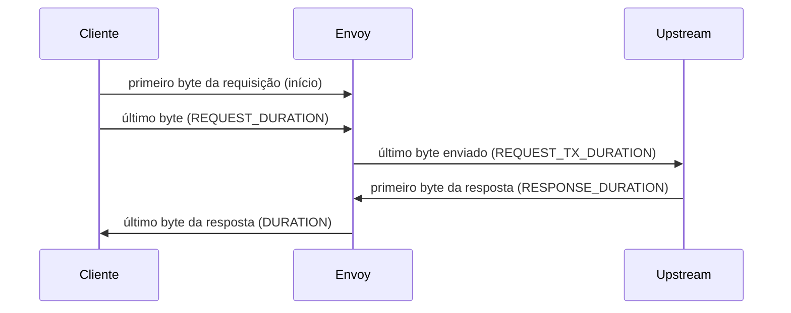

# Descomplicando Istio

<!-- TOC -->

- [Descomplicando Istio](#descomplicando-istio)
- [Day 8](#day-8)
- [Conceitos](#conceitos)
  - [Access log x métricas](#access-log-x-métricas)
  - [Onde configurar](#onde-configurar)
  - [Os campos de duração e o REQUEST\_TX\_DURATION](#os-campos-de-duração-e-o-request_tx_duration)
- [Preparando o ambiente](#preparando-o-ambiente)
- [Laboratório 1 (iniciante): access log padrão só no gateway](#laboratório-1-iniciante-access-log-padrão-só-no-gateway)
- [Laboratório 2 (intermediário): JSON com REQUEST\_TX\_DURATION](#laboratório-2-intermediário-json-com-request_tx_duration)
- [Laboratório 3 (intermediário): vendo o REQUEST\_TX\_DURATION crescer](#laboratório-3-intermediário-vendo-o-request_tx_duration-crescer)
- [Laboratório 4 (intermediário): formato texto e filtros](#laboratório-4-intermediário-formato-texto-e-filtros)
- [Laboratório 5 (avançado): escolhendo quem gera o log](#laboratório-5-avançado-escolhendo-quem-gera-o-log)
  - [Toda a mesh](#toda-a-mesh)
  - [Gateway instalado com o chart istio/gateway](#gateway-instalado-com-o-chart-istiogateway)
- [Modo ambient: access log no waypoint](#modo-ambient-access-log-no-waypoint)
- [Enviando os logs para o Datadog](#enviando-os-logs-para-o-datadog)
  - [Coletando os logs do gateway](#coletando-os-logs-do-gateway)
  - [Transformando o campo em métrica](#transformando-o-campo-em-métrica)
  - [Alternativa: log em texto com Grok](#alternativa-log-em-texto-com-grok)
- [Troubleshooting](#troubleshooting)
- [Limpeza](#limpeza)
- [Referências](#referências)

<!-- TOC -->

# Day 8

Neste dia vamos customizar os **access logs do Envoy** no Istio: incluir o campo `%REQUEST_TX_DURATION%` no log do gateway, gerar o log em **JSON**, escolher quais proxies e quais requisições registram, e enviar o resultado ao **Datadog** para transformar o campo em métrica.

> **Nível:** do iniciante ao avançado - cada seção indica o nível. Pré-requisito: ambiente do [Day 1 - sidecar](day1-sidecar.md) ou do [Day 1](day1.md) (ambient) com o Bookinfo e o gateway `bookinfo-gateway`. A parte do Datadog usa o Agent instalado no [Day 4](day4.md#exportando-métricas-para-o-datadog).

# Conceitos

## Access log x métricas

| | Métricas (`istio_requests_total` etc.) | Access log |
|---|---|---|
| O que registra | Valores **agregados** | **Uma linha por requisição** |
| Melhor uso | Tendências, alertas, SLOs | Investigar uma requisição específica |
| Custo | Cresce com a cardinalidade dos labels | Cresce com o volume de requisições |

O `%REQUEST_TX_DURATION%` é um **campo do access log do Envoy**. Ele não existe como métrica padrão do Istio no Prometheus. Para gráficos, é preciso gerar uma métrica a partir dos logs, como faremos no [Datadog](#transformando-o-campo-em-métrica).

## Onde configurar

| Forma | Alcance | Quando usar |
|---|---|---|
| [`Telemetry`](https://istio.io/v1.32/docs/tasks/observability/logs/telemetry-api/) + provider | Mesh, namespace, workload ou gateway | **Recomendada** pela documentação do Istio |
| `extensionProviders[].envoyFileAccessLog` no `meshConfig` | Só **define** um formato, sem ativar nada | Formato customizado, usado depois pelo `Telemetry` |
| `meshConfig.accessLogFile` | **Todos** os proxies da mesh | Ativação simples e global |

> ATENÇÃO!!! Definir `meshConfig.accessLogFile: /dev/stdout` liga o log em **todos** os sidecars, não só no gateway. Para customizar apenas o gateway, como neste dia, não use esse campo: basta o provider e um `Telemetry` direcionado.

Segundo a [referência do Telemetry](https://istio.io/v1.32/docs/reference/config/telemetry/), gateways e waypoints são selecionados com **`targetRefs`**. Um mesmo recurso aceita `selector` **ou** `targetRefs`, nunca os dois, e waypoints ignoram políticas com `selector`.

## Os campos de duração e o REQUEST_TX_DURATION

Definições da [documentação do Envoy](https://www.envoyproxy.io/docs/envoy/latest/configuration/advanced/substitution_formatter#config-advanced-substitution-operators), todas em milissegundos e contadas para HTTP:

| Campo | Intervalo medido |
|---|---|
| `%REQUEST_DURATION%` | Do início até o **último byte da requisição recebido** do cliente |
| `%REQUEST_TX_DURATION%` | Do início até o **último byte da requisição enviado** ao upstream |
| `%RESPONSE_DURATION%` | Do início até o **primeiro byte da resposta lido** do upstream |
| `%RESPONSE_TX_DURATION%` | Do **primeiro byte lido** do upstream até o **último byte enviado** ao cliente |
| `%DURATION%` | Do início até o **último byte de saída** (duração total) |



Como ler o campo:

- `REQUEST_TX_DURATION` alto com `REQUEST_DURATION` alto: o **cliente** demorou para enviar a requisição (upload lento).
- `REQUEST_TX_DURATION` bem maior que `REQUEST_DURATION`: o proxy demorou para entregar a requisição ao **upstream**.
- `RESPONSE_DURATION` bem maior que `REQUEST_TX_DURATION`: o tempo foi gasto **esperando o upstream** responder.

Em TCP e UDP esses campos não são implementados. Eles também ficam sem valor quando a requisição nem chega a um upstream, como em um `404` sem rota: aparecem como `-` no formato texto e `null` no JSON.

# Preparando o ambiente

Use as variáveis do Day 1 e localize o gateway:

```bash
export ISTIO_RELEASE=1.32
export VERSION_ISTIO="${ISTIO_RELEASE}.0"
export MY_NAMESPACE='myapp'

export GATEWAY_IP=$(kubectl -n $MY_NAMESPACE get gateway bookinfo-gateway -o jsonpath='{.status.addresses[0].value}')
export GW_POD=$(kubectl -n $MY_NAMESPACE get pod -l gateway.networking.k8s.io/gateway-name=bookinfo-gateway -o jsonpath='{.items[0].metadata.name}')
echo "$GATEWAY_IP $GW_POD"
```

> No macOS, se o IP do gateway não estiver acessível, siga a orientação do [Day 1](day1.md) (`docker-mac-net-connect` ou `kubectl port-forward`).

Na instalação do Day 1 o access log vem **desligado**. Confirme que uma requisição não gera nenhuma linha nova:

```bash
curl -s -o /dev/null http://${GATEWAY_IP}/productpage
kubectl -n $MY_NAMESPACE logs deploy/bookinfo-gateway-istio --tail=3
```

# Laboratório 1 (iniciante): access log padrão só no gateway

Ative o provider embutido `envoy` apenas para o `bookinfo-gateway`:

```bash
kubectl apply -f - <<EOF
apiVersion: telemetry.istio.io/v1
kind: Telemetry
metadata:
  name: bookinfo-gateway-access-log
  namespace: $MY_NAMESPACE
spec:
  targetRefs:
    - group: gateway.networking.k8s.io
      kind: Gateway
      name: bookinfo-gateway
  accessLogging:
    - providers:
        - name: envoy
EOF

# Aguarde alguns segundos: a configuração leva um tempo para chegar ao proxy
sleep 10

curl -s -o /dev/null http://${GATEWAY_IP}/productpage
kubectl -n $MY_NAMESPACE logs deploy/bookinfo-gateway-istio --tail=1
```

A saída segue o [formato padrão do Istio](https://istio.io/v1.32/docs/tasks/observability/logs/access-log/#default-access-log-format). Não foi preciso reiniciar nada: a mudança chega ao proxy por xDS. Os sidecars continuam sem access log.

# Laboratório 2 (intermediário): JSON com REQUEST_TX_DURATION

Crie um provider com o formato desejado. Em `logFormat.labels`, a [referência do MeshConfig](https://istio.io/v1.32/docs/reference/config/istio.mesh.v1alpha1/#MeshConfig-ExtensionProvider-EnvoyFileAccessLogProvider-LogFormat) gera JSON com valores do tipo adequado: string, número ou booleano.

```bash
cat <<'EOF' > istiod-access-log-values.yaml
meshConfig:
  extensionProviders:
    - name: gateway-json-log
      envoyFileAccessLog:
        path: /dev/stdout
        logFormat:
          labels:
            timestamp: "%START_TIME%"
            method: "%REQ(:METHOD)%"
            path: "%REQ(X-ENVOY-ORIGINAL-PATH?:PATH)%"
            protocol: "%PROTOCOL%"
            response_code: "%RESPONSE_CODE%"
            response_code_details: "%RESPONSE_CODE_DETAILS%"
            response_flags: "%RESPONSE_FLAGS%"
            bytes_received: "%BYTES_RECEIVED%"
            bytes_sent: "%BYTES_SENT%"
            duration: "%DURATION%"
            request_duration: "%REQUEST_DURATION%"
            request_tx_duration: "%REQUEST_TX_DURATION%"
            response_duration: "%RESPONSE_DURATION%"
            response_tx_duration: "%RESPONSE_TX_DURATION%"
            upstream_service_time: "%RESP(X-ENVOY-UPSTREAM-SERVICE-TIME)%"
            x_forwarded_for: "%REQ(X-FORWARDED-FOR)%"
            user_agent: "%REQ(USER-AGENT)%"
            request_id: "%REQ(X-REQUEST-ID)%"
            authority: "%REQ(:AUTHORITY)%"
            upstream_host: "%UPSTREAM_HOST%"
            upstream_cluster: "%UPSTREAM_CLUSTER%"
    - name: gateway-text-log
      envoyFileAccessLog:
        path: /dev/stdout
        logFormat:
          text: |
            [%START_TIME%] "%REQ(:METHOD)% %REQ(X-ENVOY-ORIGINAL-PATH?:PATH)% %PROTOCOL%" %RESPONSE_CODE% %RESPONSE_FLAGS% %RESPONSE_CODE_DETAILS% %BYTES_RECEIVED% %BYTES_SENT% %DURATION% %RESP(X-ENVOY-UPSTREAM-SERVICE-TIME)% "%REQ(X-FORWARDED-FOR)%" "%REQ(USER-AGENT)%" "%REQ(X-REQUEST-ID)%" "%REQ(:AUTHORITY)%" "%UPSTREAM_HOST%" %REQUEST_TX_DURATION%
EOF

# --reuse-values preserva o que foi definido na instalação do Day 1
helm -n istio-system upgrade istiod istio/istiod --version $VERSION_ISTIO \
  --reuse-values -f istiod-access-log-values.yaml --wait --timeout 900s
```

> O provider `gateway-text-log` será usado no [Laboratório 4](#laboratório-4-intermediário-formato-texto-e-filtros). Como listas não são mescladas pelo Helm, um novo `-f` com `extensionProviders` **substitui** a lista inteira: mantenha todos os providers no mesmo arquivo.

Aponte o `Telemetry` do gateway para o novo provider:

```bash
kubectl apply -f - <<EOF
apiVersion: telemetry.istio.io/v1
kind: Telemetry
metadata:
  name: bookinfo-gateway-access-log
  namespace: $MY_NAMESPACE
spec:
  targetRefs:
    - group: gateway.networking.k8s.io
      kind: Gateway
      name: bookinfo-gateway
  accessLogging:
    - providers:
        - name: gateway-json-log
EOF

sleep 10
```

Confirme na **configuração ativa do proxy**, e não em arquivos do container, que o campo foi aplicado:

```bash
istioctl proxy-config listener $GW_POD.$MY_NAMESPACE --port 80 -o json | grep -c REQUEST_TX_DURATION
```

Um resultado maior que zero indica que o formato chegou ao Envoy. Gere uma requisição com sucesso e outra sem rota, e leia o log. O `grep '^{'` descarta as linhas do `pilot-agent`, que não são JSON:

```bash
curl -s -o /dev/null http://${GATEWAY_IP}/productpage
curl -s -o /dev/null http://${GATEWAY_IP}/nao-existe
sleep 2

kubectl -n $MY_NAMESPACE logs deploy/bookinfo-gateway-istio --tail=20 | grep '^{' | tail -2 | \
  jq '{path, response_code, response_flags, duration, request_duration, request_tx_duration, response_duration, upstream_host}'
```

Observe na saída:

- `request_tx_duration` e `response_code` são **números**, sem aspas.
- Na rota inexistente, `response_flags` é `NR` e `request_tx_duration` é `null`, porque nada foi enviado a um upstream.
- `upstream_service_time` continua sendo **string**, pois vem de um header HTTP.

# Laboratório 3 (intermediário): vendo o REQUEST_TX_DURATION crescer

Em um `GET` simples o campo fica perto de zero. Para vê-lo crescer, envie um corpo grande com a velocidade limitada. São 200 KB a 50 KB/s, ou seja, alguns segundos de upload:

```bash
head -c 200000 /dev/zero | tr '\0' a > /tmp/corpo.txt

curl -s -o /dev/null -w 'http=%{http_code} tempo=%{time_total}s\n' --limit-rate 50k \
  -H 'Content-Type: application/x-www-form-urlencoded' \
  --data-binary @/tmp/corpo.txt http://${GATEWAY_IP}/login
sleep 2

kubectl -n $MY_NAMESPACE logs deploy/bookinfo-gateway-istio --tail=20 | grep '^{' | tail -1 | \
  jq '{method, path, bytes_received, request_duration, request_tx_duration, response_duration, duration, upstream_service_time}'
```

Resultado esperado: `request_duration` e `request_tx_duration` ficam na casa dos segundos e praticamente iguais, enquanto `upstream_service_time` fica baixo. A leitura é que a lentidão veio do **cliente**, e não da aplicação, algo que a duração total sozinha não mostra.

# Laboratório 4 (intermediário): formato texto e filtros

Troque para o provider em texto. O campo aparece no fim da linha:

```bash
kubectl apply -f - <<EOF
apiVersion: telemetry.istio.io/v1
kind: Telemetry
metadata:
  name: bookinfo-gateway-access-log
  namespace: $MY_NAMESPACE
spec:
  targetRefs:
    - group: gateway.networking.k8s.io
      kind: Gateway
      name: bookinfo-gateway
  accessLogging:
    - providers:
        - name: gateway-text-log
EOF

sleep 10
curl -s -o /dev/null http://${GATEWAY_IP}/productpage
sleep 2
kubectl -n $MY_NAMESPACE logs deploy/bookinfo-gateway-istio --tail=1
```

Prefira JSON quando o destino for uma ferramenta de logs: os campos já chegam separados, sem regra de parsing.

Para reduzir volume, o campo `filter` aceita uma [expressão CEL](https://istio.io/v1.32/docs/tasks/observability/logs/telemetry-api/). O exemplo abaixo registra apenas respostas de erro:

```bash
kubectl apply -f - <<EOF
apiVersion: telemetry.istio.io/v1
kind: Telemetry
metadata:
  name: bookinfo-gateway-access-log
  namespace: $MY_NAMESPACE
spec:
  targetRefs:
    - group: gateway.networking.k8s.io
      kind: Gateway
      name: bookinfo-gateway
  accessLogging:
    - providers:
        - name: gateway-json-log
      filter:
        expression: "!has(response.code) || response.code >= 400"
EOF

sleep 10
curl -s -o /dev/null http://${GATEWAY_IP}/productpage
curl -s -o /dev/null http://${GATEWAY_IP}/somente-erros
sleep 2

# Só o /somente-erros deve aparecer
kubectl -n $MY_NAMESPACE logs deploy/bookinfo-gateway-istio --since=5s | grep '^{' | jq -c '{path, response_code}'
```

> O `!has(response.code)` cobre conexões que falharam, em que esse atributo não existe, conforme a documentação do Istio.

# Laboratório 5 (avançado): escolhendo quem gera o log

## Toda a mesh

Um `Telemetry` no namespace raiz, sem `targetRefs` nem `selector`, vale para todos os proxies. Remova o recurso específico do gateway para que ele também herde esta configuração, já que um recurso mais específico [substitui por completo](https://istio.io/v1.32/docs/tasks/observability/telemetry/) o do nível acima:

```bash
kubectl -n $MY_NAMESPACE delete telemetry bookinfo-gateway-access-log

kubectl apply -f - <<EOF
apiVersion: telemetry.istio.io/v1
kind: Telemetry
metadata:
  name: mesh-default
  namespace: istio-system
spec:
  accessLogging:
    - providers:
        - name: gateway-json-log
EOF

sleep 10
curl -s -o /dev/null http://${GATEWAY_IP}/productpage
sleep 2

# Modo sidecar: o proxy do productpage agora também registra
kubectl -n $MY_NAMESPACE logs deploy/productpage-v1 -c istio-proxy --tail=20 | grep '^{' | tail -1 | \
  jq -c '{method, path, request_tx_duration, upstream_cluster}'
```

Remova ao terminar, pois esse log cresce com todo o tráfego interno:

```bash
kubectl -n istio-system delete telemetry mesh-default
```

## Gateway instalado com o chart istio/gateway

O Day 1 também instala o gateway `istio-ingress` pelo chart Helm. Ele não pertence a um recurso `Gateway` do Gateway API, então é selecionado pelos labels do Pod. Crie uma rota de teste com a API do Istio e ative o log:

```bash
kubectl -n istio-system get pods -l istio=ingress --show-labels

kubectl apply -f - <<EOF
apiVersion: networking.istio.io/v1
kind: Gateway
metadata:
  name: ingress-teste
  namespace: $MY_NAMESPACE
spec:
  selector:
    istio: ingress
  servers:
    - port:
        number: 80
        name: http
        protocol: HTTP
      hosts:
        - "*"
---
apiVersion: networking.istio.io/v1
kind: VirtualService
metadata:
  name: ingress-teste
  namespace: $MY_NAMESPACE
spec:
  hosts:
    - "*"
  gateways:
    - ingress-teste
  http:
    - route:
        - destination:
            host: productpage
            port:
              number: 9080
---
apiVersion: telemetry.istio.io/v1
kind: Telemetry
metadata:
  name: ingress-access-log
  namespace: istio-system
spec:
  selector:
    matchLabels:
      istio: ingress
  accessLogging:
    - providers:
        - name: gateway-json-log
EOF

sleep 10
export INGRESS_IP=$(kubectl -n istio-system get svc istio-ingress -o jsonpath='{.status.loadBalancer.ingress[0].ip}')
curl -s -o /dev/null -w '%{http_code}\n' http://${INGRESS_IP}/productpage
sleep 2
kubectl -n istio-system logs deploy/istio-ingress --tail=20 | grep '^{' | tail -1 | jq -c '{path, response_code, request_tx_duration}'
```

Remova os recursos de teste:

```bash
kubectl -n istio-system delete telemetry ingress-access-log
kubectl -n $MY_NAMESPACE delete virtualservice ingress-teste
kubectl -n $MY_NAMESPACE delete gateway.networking.istio.io ingress-teste
```

# Modo ambient: access log no waypoint

> **Exige o modo ambient** ([Day 1](day1.md)).

No modo ambient não há sidecar. O `ztunnel` não é Envoy, portanto **não** usa esses campos. O `bookinfo-gateway` e os **waypoints** são Envoy e aceitam o mesmo provider. O waypoint precisa de `targetRefs`, pois ignora `selector`:

```bash
istioctl waypoint apply -n $MY_NAMESPACE --enroll-namespace --wait

kubectl apply -f - <<EOF
apiVersion: telemetry.istio.io/v1
kind: Telemetry
metadata:
  name: waypoint-access-log
  namespace: $MY_NAMESPACE
spec:
  targetRefs:
    - group: gateway.networking.k8s.io
      kind: Gateway
      name: waypoint
  accessLogging:
    - providers:
        - name: gateway-json-log
EOF

sleep 10
curl -s -o /dev/null http://${GATEWAY_IP}/productpage
sleep 2
kubectl -n $MY_NAMESPACE logs deploy/waypoint --tail=20 | grep '^{' | tail -1 | \
  jq -c '{method, path, response_code, request_tx_duration}'
```

Remova ao terminar. O segundo comando retira o label que colocou o namespace atrás do waypoint:

```bash
kubectl -n $MY_NAMESPACE delete telemetry waypoint-access-log
kubectl label namespace $MY_NAMESPACE istio.io/use-waypoint-
kubectl -n $MY_NAMESPACE delete gateway.gateway.networking.k8s.io waypoint
```

# Enviando os logs para o Datadog

> Pré-requisito: Datadog Agent instalado como no [Day 4](day4.md#instalando-o-datadog-agent), com a coleta de logs habilitada (`datadog.logs.enabled: true`, veja [Opções úteis do chart](day4.md#opções-úteis-do-chart)). Volte o `Telemetry` do gateway para o provider `gateway-json-log`, sem filtro, como no [Laboratório 2](#laboratório-2-intermediário-json-com-request_tx_duration).

## Coletando os logs do gateway

Com `containerCollectAll: false`, o Agent só coleta os containers indicados por [annotation de Autodiscovery](https://docs.datadoghq.com/containers/kubernetes/log/) **no Pod**, com o nome do container (`istio-proxy`).

No `Gateway` do Gateway API, `spec.infrastructure.annotations` não chega ao Pod: no teste deste repositório, com Istio 1.32, ela foi copiada só para o `Deployment` e o `Service`. Use o [`parametersRef`](https://istio.io/v1.32/docs/tasks/traffic-management/ingress/gateway-api/#automated-deployment), que aplica um patch no `Deployment` gerado:

```bash
kubectl apply -f - <<EOF
apiVersion: v1
kind: ConfigMap
metadata:
  name: bookinfo-gateway-options
  namespace: $MY_NAMESPACE
data:
  deployment: |
    spec:
      template:
        metadata:
          annotations:
            ad.datadoghq.com/istio-proxy.logs: '[{"source":"envoy","service":"bookinfo-gateway"}]'
EOF

kubectl -n $MY_NAMESPACE patch gateway bookinfo-gateway --type merge \
  -p '{"spec":{"infrastructure":{"parametersRef":{"group":"","kind":"ConfigMap","name":"bookinfo-gateway-options"}}}}'

sleep 10
kubectl -n $MY_NAMESPACE rollout status deploy/bookinfo-gateway-istio --timeout=180s
kubectl -n $MY_NAMESPACE wait --for=condition=Programmed gateway/bookinfo-gateway --timeout=120s
```

Confirme a annotation e veja, no Agent do mesmo nó, se o arquivo de log está sendo lido:

```bash
export GW_POD=$(kubectl -n $MY_NAMESPACE get pod -l gateway.networking.k8s.io/gateway-name=bookinfo-gateway --field-selector status.phase=Running -o jsonpath='{.items[0].metadata.name}')
export GW_NODE=$(kubectl -n $MY_NAMESPACE get pod $GW_POD -o jsonpath='{.spec.nodeName}')
export DD_POD=$(kubectl get pod -l app=datadog-agent --field-selector spec.nodeName=$GW_NODE -o jsonpath='{.items[0].metadata.name}')

kubectl -n $MY_NAMESPACE get pod $GW_POD -o jsonpath='{.metadata.annotations.ad\.datadoghq\.com/istio-proxy\.logs}'; echo

curl -s -o /dev/null http://${GATEWAY_IP}/productpage
sleep 30
kubectl exec $DD_POD -c agent -- agent status 2>/dev/null | grep -A12 "$MY_NAMESPACE/$GW_POD/istio-proxy"
```

Procure `Status: OK`, `Service: bookinfo-gateway` e `Source: envoy`. Para ver em tempo real o que o Agent está processando, use o [`agent stream-logs`](https://docs.datadoghq.com/containers/troubleshooting/log-collection/) (encerre com `Ctrl+C`):

```bash
kubectl exec -it $DD_POD -c agent -- agent stream-logs --service bookinfo-gateway
```

## Transformando o campo em métrica

Estes passos são feitos na interface do Datadog. O Datadog [interpreta logs JSON automaticamente](https://docs.datadoghq.com/logs/log_configuration/parsing/), então não é preciso criar regra de parsing.

1. Em **Logs > Explorer**, filtre por `service:bookinfo-gateway` e abra uma linha. O atributo aparece como `@request_tx_duration`.
2. Clique no atributo e crie uma [**facet do tipo measure**](https://docs.datadoghq.com/logs/explorer/facets/), com unidade em milissegundos.
3. Em **Logs > Generate Metrics**, crie uma [métrica a partir dos logs](https://docs.datadoghq.com/logs/log_configuration/logs_to_metrics/):
   - **Query**: `service:bookinfo-gateway @request_tx_duration:*`
   - **Field**: `@request_tx_duration`, o que gera uma métrica do tipo *distribution*
   - **Group by**: `@response_code` e `@method`
   - **Name**: `istio.gateway.request_tx_duration`
   - Habilite os percentis, se precisar de p95 ou p99
4. Use a métrica em um dashboard ou monitor, como `p95:istio.gateway.request_tx_duration{*} by {method}`.

Pontos de atenção da documentação do Datadog:

- A métrica é **cobrada como métrica customizada**, inclusive os percentis. Não agrupe por campos de cardinalidade alta, como `@path` com IDs, `@request_id` ou `@x_forwarded_for`.
- O filtro é avaliado na **ingestão**, então a métrica vale mesmo para logs removidos por filtros de exclusão, e considera apenas logs ingeridos nos últimos 20 minutos.
- Depois de salvar, confirme no **Metrics Explorer** que os pontos estão chegando.

## Alternativa: log em texto com Grok

Se o log precisar ficar em texto (provider `gateway-text-log`), crie um **Grok Parser** em um pipeline em **Logs > Pipelines**, filtrado por `service:bookinfo-gateway`. A regra abaixo segue a [sintaxe de parsing](https://docs.datadoghq.com/logs/log_configuration/parsing/) do Datadog e o formato do [Laboratório 2](#laboratório-2-intermediário-json-com-request_tx_duration):

```text
access_log \[%{notSpace:start_time}\] "%{word:method} %{notSpace:path} %{notSpace:protocol}" %{integer:response_code} %{notSpace:response_flags} %{notSpace:response_code_details} %{integer:bytes_received} %{integer:bytes_sent} %{integer:duration} %{notSpace:upstream_service_time} "%{data:x_forwarded_for}" "%{data:user_agent}" "%{notSpace:request_id}" "%{notSpace:authority}" "%{notSpace:upstream_host}" (%{integer:request_tx_duration}|-)
```

- `%{integer:...}` grava o valor como número, o que é necessário para usá-lo como measure.
- O trecho final `(...|-)` aceita o `-` das requisições sem upstream.
- Valide a regra com uma linha real na área de amostras do parser antes de salvar. Depois, siga os mesmos passos de measure e métrica.

# Troubleshooting

| Sintoma | O que verificar |
|---|---|
| Nenhuma linha no log | O `Telemetry` existe no namespace do `Gateway`? `kubectl -n $MY_NAMESPACE get telemetry` |
| Formato não mudou | `istioctl proxy-config listener $GW_POD.$MY_NAMESPACE --port 80 -o json \| grep REQUEST_TX_DURATION` |
| Provider ignorado | O nome no `Telemetry` é igual ao de `extensionProviders`? `kubectl -n istio-system get configmap istio -o yaml` |
| Provider sumiu após um `helm upgrade` | Um novo `-f` com `extensionProviders` substitui a lista. Veja `helm -n istio-system get values istiod` |
| `jq` falha com `parse error` | O container também tem logs do `pilot-agent` em texto. Filtre com `grep '^{'` |
| `request_tx_duration` é `null` | Normal quando não há upstream. Confira `response_flags` e `response_code_details` |
| Sidecars passaram a registrar tudo | Existe `meshConfig.accessLogFile` ou um `Telemetry` no namespace raiz |
| Logs não chegam ao Datadog | Annotation no **Pod**, `datadog.logs.enabled: true` e a seção *Logs Agent* de `agent status` |

# Limpeza

```bash
kubectl -n $MY_NAMESPACE delete telemetry bookinfo-gateway-access-log --ignore-not-found

# Só se você configurou o Datadog
kubectl -n $MY_NAMESPACE patch gateway bookinfo-gateway --type json -p '[{"op":"remove","path":"/spec/infrastructure"}]'
kubectl -n $MY_NAMESPACE delete configmap bookinfo-gateway-options --ignore-not-found

rm -f istiod-access-log-values.yaml /tmp/corpo.txt
```

Os providers podem continuar no `meshConfig`, pois sozinhos não ativam nenhum log.

# Referências

- https://istio.io/v1.32/docs/tasks/observability/logs/access-log/
- https://istio.io/v1.32/docs/tasks/observability/logs/telemetry-api/
- https://istio.io/v1.32/docs/tasks/observability/telemetry/
- https://istio.io/v1.32/docs/reference/config/telemetry/
- https://istio.io/v1.32/docs/reference/config/istio.mesh.v1alpha1/
- https://istio.io/v1.32/docs/tasks/traffic-management/ingress/gateway-api/
- https://www.envoyproxy.io/docs/envoy/latest/configuration/observability/access_log/usage
- https://www.envoyproxy.io/docs/envoy/latest/configuration/advanced/substitution_formatter
- https://docs.datadoghq.com/containers/kubernetes/log/
- https://docs.datadoghq.com/containers/troubleshooting/log-collection/
- https://docs.datadoghq.com/logs/log_configuration/parsing/
- https://docs.datadoghq.com/logs/log_configuration/logs_to_metrics/
- https://docs.datadoghq.com/logs/explorer/facets/
